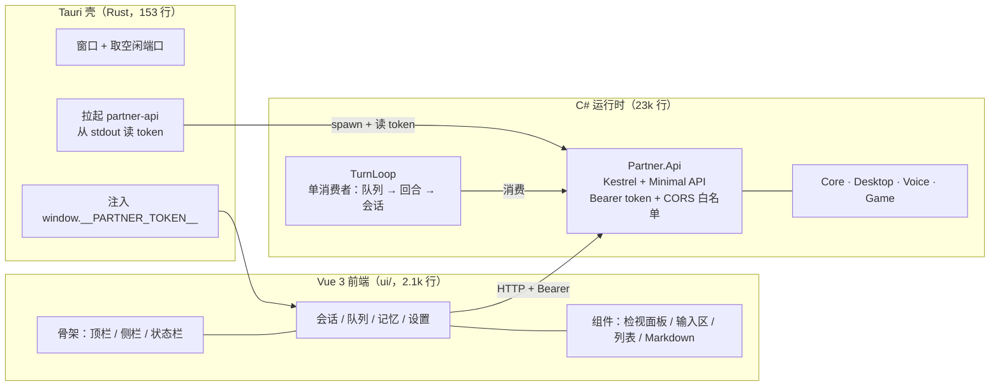

# Partner

本机 Agent 运行时。核心是一条**唯一逻辑会话**上的执行链：输入 → 队列 → Agent turn → 工具/记忆/治理 → 可编辑的会话日志，外加桌面控制、语音双向、游戏反射。

技术栈：**C# / .NET 8 运行时** + **Tauri 2 壳（Rust）** + **Vue 3 前端**。运行时用 C#（Win32 interop、音频、SQLite、MCP 都在这层），界面用 Web 技术（可 headless 测试），壳只负责起窗口和拉起 API。

设计文档在仓库外（随实现同步更新）：

| 文档 | 路径 |
|---|---|
| 目标架构方案（选型/缺口/分期/验收） | `D:/code/Clone/agent-harness-architecture-proposal.md` |
| 现状分析（被引用的源码核验） | `D:/code/Clone/agent-harness-desktop-game-implementation-analysis.md` |

---

## 快速开始

```bash
cd /d/code/Projects/partner
bash scripts/ci.sh
```

依次执行：.NET 编译 → 单元测试 → smoke → 能力门禁 → 前端类型检查/测试/构建 → 壳编译。任一步失败即中断，退出码非 0。

当前基线：**547 个 .NET 单测 + 85 个前端测试全绿 / 142 项 smoke 检查 / 54 项能力 `product-supported`**。

跳过最慢的壳编译：`SKIP_SHELL=1 bash scripts/ci.sh`。

### 环境要求

| 项 | 要求 |
|---|---|
| OS | **Windows**。`Desktop`/`Voice`/`Api`/`Smoke` 都是 `net8.0-windows10.0.19041.0`——API 之所以也在其中，是因为输入队列只有一个**进程内**消费者且没有跨进程锁，语音必须和它同进程（见「消费者」与「语音」） |

**体积代价**：`net8.0-windows10.0.19041.0` 会拉进 CsWinRT 投影（`Microsoft.Windows.SDK.NET.dll` 24 MB），自包含发布因此从 101 MB 涨到 214 MB、安装包 34.7 MB → 63 MB。这两个项目都没直接用 WinRT API，但去掉版本后缀就丢了 `SupportedOSPlatformVersion` 声明的系统下限（`NETSDK1135`），所以留着——**这是声明「需要 Win10 2004+」的正确方式**，不值得为 24 MB 和 SDK 较劲。想缩小就改成框架依赖发布（2.5 MB API，代价是要求目标机装 .NET 8 运行时）。
| .NET | .NET 8 SDK（当前 8.0.423） |
| Node | Node 22 + npm（前端；**不用 pnpm**，见「坑」） |
| Rust | cargo 1.98+（仅壳需要；缺失时 CI 自动跳过该步） |
| WebView2 | Win10+ 自带（当前 153.x） |
| 硬件 | 真机语音需要麦克风/扬声器；桌面能力需要真实桌面会话 |

---

## 架构



**唯一接缝是 HTTP + Bearer token**：壳不知道任何业务逻辑，前端不引用任何 .NET 程序集，运行时不知道 UI 用什么技术。

### 目录结构

| 路径 | 平台 | 职责 |
|---|---|---|
| `src/Partner.Core` | net8.0 | 会话日志、输入队列、调度、Agent turn、MCP、记忆、治理、契约。**全部逻辑所在** |
| `src/Partner.Desktop` | net8.0-windows | 窗口枚举、GDI 抓帧、输入编组、动作后校验、租约门控 |
| `src/Partner.Voice` | net8.0-windows | 麦克风输入（VAD/分句/流式）、TTS 输出、播放期停听 |
| `src/Partner.Game` | net8.0 | 游戏通用层：反射引擎（槽位锁）、六域上下文、感知去抖分级、进程适配器 |
| `src/Partner.Api` | net8.0-windows | **UI 的唯一数据源** + 两个宿主的家：Kestrel + Minimal API、队列消费者、语音宿主 |
| `src/Partner.Smoke` | net8.0-windows | 端到端 smoke + 能力清单生成 + 门禁 |
| `ui/` | — | Vue 3 + Vite + TS 前端（四视图 + 契约类型 + 测试） |
| `src-tauri/` | Rust | 桌面壳：窗口、sidecar 生命周期、token 注入 |
| `tests/Partner.GameTestServer` | net8.0 | 合成网格游戏，作为**真实子进程**供游戏层闭环验证 |
| `tests/Partner.McpTestServer` | net8.0 | MCP stdio 夹具 |

### 运行期产物

工作区（默认 `%LocalAppData%/Partner/workspace`，壳与手工启动的 API 共用同一个）：

```
<workspace>/
  session/events.jsonl    追加式会话日志（唯一真相，编辑是追加 Edit 事件）
  queue/items.jsonl       队列日志（重启即重放）
  memory/memory.db        SQLite + FTS5 记忆库
  settings/voice.json     语音设置（首次保存时创建）
```

删除工作区即回到初始状态——会话与队列从日志重建，**记忆库是权威存储，删除即丢失**。

---

## 运行

### 完整应用（壳 + API）

```bash
# 开发模式（热更新：改 Vue 立刻生效）
npm --prefix ui install                 # 首次
npx --prefix ui tauri dev               # 起 vite + 壳，壳自动拉起 API

# 生产打包（发布 API → 构建前端 → 编译壳 → 打 NSIS 安装包）
bash scripts/build-shell.sh             # SKIP_INSTALLER=1 则只编译壳
```

**顺序不能颠倒**：壳打包的是 API 的 `publish` 快照，跳过发布就会把上一次的 API 装进去（新端点会在应用里 404）。这条已经封进 `scripts/build-shell.sh`，不要手敲那四步。

壳自己挑空闲端口、自己起 `partner-api`、自己把 token 注入 webview —— **没有需要手填的配置**。

### 只起 API

```bash
dotnet run --project src/Partner.Api -- "D:/tmp/ws" 5280
```

未提供 token 时会生成一个并打印到 stdout（仅此一次）：

```
partner-api listening on http://127.0.0.1:5280
token: <base64url>
```

所有端点都要求 `Authorization: Bearer <token>`，**包括 `/api/health`**：

```bash
TOKEN=<上一步打印的>
curl -H "Authorization: Bearer $TOKEN" http://127.0.0.1:5280/api/session
curl -H "Authorization: Bearer $TOKEN" http://127.0.0.1:5280/api/queue
curl -X POST -H "Authorization: Bearer $TOKEN" http://127.0.0.1:5280/api/projections/rebuild
```

### 只起前端（浏览器里调）

```bash
npm --prefix ui run dev     # http://localhost:5173
```

浏览器控制台里先放 token（前端不接受 URL 参数，避免 token 进历史记录）：

```js
localStorage.setItem('partner.token', '<token>')
localStorage.setItem('partner.port', '5280')
```

CORS 白名单已包含 `http://localhost:5173`。

---

## 消费者（队列 → 回合）

`Core/Hosting/TurnLoop.cs` 是输入队列的**唯一消费者**（设计文档 §2.2）：一次取一项、按到达顺序、跑一个回合、把项落定为 `Done`/`Failed`/`Canceled`。没有它，投递只会停在队列里。

| 不变量 | 实现 |
|---|---|
| 同一时刻只有一项在飞 | 循环体串行 await，从不重叠 |
| 每个被认领的项都会落定 | 异常也走 `CompleteAsync`，不会留下卡在 `Running` 的项 |
| UI 取消能打断执行中的项 | 回合观察队列的 `RunningToken` |
| 停机不切断执行中的回合 | 停止只停「认领」；被打断的项由队列在下次启动时重投 |
| 重投递不重复执行 | 回合已结束（日志里有该 `itemId` 的 `TurnEnd`）的项直接落定，不重跑 |

**配置模型**（不配就没有消费者——不会起一个假回退）：

```bash
export PARTNER_LLM_BASE_URL=http://127.0.0.1:11434/v1   # OpenAI 兼容端点
export PARTNER_LLM_MODEL=qwen3
export PARTNER_LLM_API_KEY=...                          # 可选
```

未配置时 `GET /api/consumer` 返回 `running: false` 与**缺哪个变量**；界面在输入区与状态栏显示「未执行 · 未配置模型：缺少 …」，因为一个不动的队列和一个忙碌的队列在界面上没有区别。

```bash
curl -H "Authorization: Bearer $TOKEN" http://127.0.0.1:5280/api/consumer
# {"running":true,"reason":"运行中","model":"qwen3","stats":{"completed":3,...}}
```

---

## 设置（运行时配置）

`GET /api/settings` 返回五段，字段名与真正消费它们的 option 记录一一对应（`AsrOptions`、`TtsOptions`、`HttpLlmOptions`、`VoiceInputSetting`、`VoiceOutputSetting`），所以对应关系可以并排读出来，不用记映射。

| 段 | 关键项 | 谁在读 |
|---|---|---|
| `input` | 开关、设备、静音阈值、整句/句间间隔、窗口、流式、无标点强切长度 | 语音输入半（**尚无宿主**） |
| `output` | 开关、设备、音色、语速、段间静音、drain、采样率、播放期停听 | 语音输出半（**尚无宿主**） |
| `asr` | 服务地址、模型、语言、连接/读取超时、采样率 | ASR 客户端（**尚无宿主**） |
| `tts` | 服务地址、语言、采样率、克隆参考音频、超时、播放块 | TTS 客户端（**尚无宿主**） |
| `model` | 服务地址、模型名、**API Key**、超时 | **消费者（已接线）** |

### 名称是拉取的，不是手打的

| 项 | 怎么来 | 为什么走代理 |
|---|---|---|
| 音频设备 | `GET /api/voice/devices`（`WasapiAudioSource/Sink.ListDevices()`） | 浏览器问不到本机设备 |
| 模型名 | `POST /api/models` → `GET {base}/models`（OpenAI 兼容列表） | 模型端点不允许 webview 的 origin，且 **API Key 不能进浏览器** |

两条纪律：

- **探测失败必须给出原因**。端点不通、端点没实现 `/models`（404）、列表为空——三者要能区分。所以代理返回 `{ models, error }` 而不是空数组，界面也把原因显示出来。
- **已选但当前枚举不到的值仍然可选**。设备拔了、模型下线了，下拉里仍保留那一项；否则下一次保存会把它悄悄改成"默认"。
- 密钥只发给**已存的那个端点**：探测别的地址时不带密钥（有测试守着）。

### API Key 是只写的

`GET` 只返回 `apiKeySet`，**永不回传密钥值**——这个端点只要持有 token 就能访问，回传即泄露。

写入语义（否则客户端改一个无关字段就会把密钥清掉）：

| 请求里的 `model.apiKey` | 效果 |
|---|---|
| 缺省 / `null` | **保持不变** |
| `""` | 清除 |
| 有值 | 替换 |

### 改设置会立刻生效

`PUT /api/settings` 在**模型段发生变化时重启消费者**（其余段不打断执行中的回合——重启会重置计数，所以是可观测的）。响应带上 `consumer` 状态，界面据此显示「消费中 · 模型名」或「未配置模型：队列不会被执行」。

**优先级**：设置里的 `model` 段 > 环境变量 `PARTNER_LLM_BASE_URL`/`PARTNER_LLM_MODEL` > 不启动。来源会出现在 `/api/consumer` 的 `reason` 里（`运行中（设置）` / `运行中（环境变量）`），免得用户猜为什么改了没反应。

```bash
curl -H "Authorization: Bearer $TOKEN" http://127.0.0.1:5280/api/settings
curl -X PUT -H "Authorization: Bearer $TOKEN" -H "Content-Type: application/json" \
  -d '{"model":{"baseUrl":"http://127.0.0.1:11434/v1","model":"qwen3"}}' \
  http://127.0.0.1:5280/api/settings
```

---

## 历史：删除、撤回、压缩

删除与撤回是**物理清除**：目标行从 `events.jsonl` 里真的消失（先写临时文件再原子替换，崩溃只会留下旧文件或新文件，不会留下半截混排）。同时清掉那些事件的**修订行**——修订保存的是同一段内容的副本，留着就等于没删。清除只发生在**用户显式删除/撤回**这一条路径上。

留一条**不含内容的撤回记录**（`purge #a..#b`）代表被清掉的区间：它记录「删过什么范围」而不记录「删了什么内容」，同时保住 seq 高水位——**seq 永不复用**（`MemoryRecord.SourceEventSeq` 指回会话 seq，复用会让记忆错认事件）。

**压缩不在此列**：压缩写的也是 `Retract`，但它是有意无损的——折叠的历史留在日志里，靠摘要代表它。

| 操作 | 语义 | 界面上 |
|---|---|---|
| **删除此条** | 只移除选中事件（连它的修订一起） | 一次点击 |
| **撤回此条及之后** | 移除选中事件及之后**当时存在**的全部事件 | **二次确认**（内联两段式，不用原生弹窗——原生弹窗会阻塞 webview，也没法在测试里驱动） |

**撤回是闭区间**：范围在调用时就被钉住（`toSeq` = 调用时的最后一条）。写成开区间会把之后新发的事件也一并清掉——用户撤回后发的第一条消息就再也看不见了。

### 上下文占用与 token 计数

会话工具条常显 **`上下文 1.2k / 28.7k（4%）`**，悬停给出窗口、预留输出、保留条数与已折叠条数；占用 ≥ 85% 转 warn 色。这个数字**用回合同一套装配规则、同一个计数器测出来**（`/api/session` 的 `context` 段），所以屏幕上显示的就是决定「要不要折叠」的那个数。

计数分两级落地（外加一层双臂策略）：

| 级别 | 做法 |
|---|---|
| 本地估计 | `ApproximateTokenCounter`：~4 字符 ≈ 1 token。**对中文会低估约 2 倍**，所以它只是回退 |
| 模型原生 | `HttpLlmClient` 实现 `ITokenCounter`：`POST {base}/tokenize`（llama.cpp 兼容），结果 **memo 化** |
| 双臂 | `DualArmTokenCounter` 取 `max(provider, local)`——预算**永不取乐观的一侧** |

四条纪律：

- **接口扩展不破坏实现**：`CountAsync` 是默认接口方法，只实现 `Count` 的计数器自动可用。
- **没有 tokenizer 的服务器不再被反复询问**：404/405 视为永久（记住），5xx 视为瞬时（继续问）。
- **缓存键是 128 位内容哈希，不是原文**：会话视图每轮都给出新的字符串实例，按原文做键会把见过的每个正文都留在内存里。哈希碰撞只会让一条算错价，预算吸收得了；留住历史则不能。
- **表计自己不发 I/O**：占用是从**已经数过的结果**里答的（回合刚数过同一批正文），没数过的退回本地估计。这条是踩出来的——最初把「问模型数 token」放进 `/api/session`，模型端点一死，会话视图就跟着卡住加载不出来（壳的 e2e 用 `http://127.0.0.1:9/v1` 当场抓到）。视图的加载不该依赖模型是否活着。

### 上下文压缩

「上下文大小」是**模型的上下文窗口 token 数**（`model.contextTokens`），「输出长度」是单次补全上限（`model.maxTokens`）。两者都在模型卡片里，保存后**立即重启消费者**生效。

**提示预算 = 上下文大小 − 输出长度**：留给补全的空间必须先扣掉，否则提示会占满窗口、回答被截断。校验也要求 `maxTokens < contextTokens`。

装配器与压缩器**共用同一条「装得下」规则**（`Core/Agent/ContextBudget.cs`）：最新连续后缀装满预算就停，其余折叠。两处若各写一套，就会一边发得比窗口多、一边把装得下的也折了。

把上下文改小后，若历史超出新预算，**保存时立刻压缩一次**（不等下一轮，否则下一轮会先把超长对话发给模型）：

```
窗口外的对话 + 旧摘要 → 模型生成一段摘要 → 追加 Summary 事件 + 按连续区间追加 Retract
```

三条规则：

- **窗口按 token 裁剪，不是按条数**：撑爆模型的是 token，两者只是松散相关（一条工具结果能顶二十条短回合）。裁剪保留**最新的连续后缀**——从中间挑会留下一个在回答已经不在上下文里的问题。
- **摘要是上下文，不占窗口额度**：否则摘要会把最新的真实回合挤出窗口。
- **新摘要覆盖旧摘要**：每次压缩只留一条，否则每压一次上下文反而更长。
- **失败不丢历史**：模型没返回摘要就什么都不写，并如实报告原因（「未配置模型，无法压缩」）。

---

## 语音（麦克风 ↔ 会话）

`Api/Voice/VoiceHost.cs` 把两个半区接进运行时（设计文档 §2.8）：

```
麦克风 → 环形缓冲 → 停顿切句 → ASR → 队列 → 消费者跑回合 → 会话
                                                              ↓
扬声器 ← 顺序播放 ← TTS ← 切句 ← 新出现的 assistant 事件
```

| 设计点 | 为什么 |
|---|---|
| **与队列消费者同进程** | 队列只有一个**进程内**消费者、没有跨进程锁。另起一个语音进程会和消费者抢同一个日志 |
| 半个启动失败只影响自己 | 打不开麦克风不该让扬声器也停：两个半区各自报告 `running` / `reason` / `device` / `count` |
| 捕获按 20ms 帧节奏 tick | 停顿判定依赖到达节奏；输出半只等新文本，200ms 轮询足够 |
| 只朗读启动后新出现的事件 | 否则一开机就把整个历史读出来 |
| 幂等键带 boot id | `voice:{device}:{boot}:{startMs}`——流时钟重启后会归零，键必须含 boot |

**测试注入点**：`IVoiceComponents` 一处封住设备与两个客户端（`OpenSource`/`OpenSink`/`CreateAsr`/`CreateTts`），所以整条链可以在**没有麦克风、扬声器和服务**的情况下驱动——停顿边界与播放顺序本来也只能这样测。

```bash
curl -H "Authorization: Bearer $TOKEN" http://127.0.0.1:5280/api/voice
# {"input":{"running":true,"reason":"运行中","device":"synthetic-mic","count":3},
#  "output":{"running":false,"reason":"未配置 TTS 服务地址","device":null,"count":0}}
```

设置里改 `input`/`output`/`asr`/`tts` 任一段会**重启语音宿主**（重开设备）；只改 `model` 段不会——避免打断一次正在进行的识别。

---

## 桌面操控的交互设计（四次实测之后的修订）

一次真实的「打开网易云音乐」暴露了四层问题，**没有一层是库坏了**：注入返回 Ok=True、枚举到 9 个窗口、动作确实点了下去。坏的是把「模型能做」和「人能看到并批准」接在一起的那部分。

| 现象 | 原因 | 现在的做法 |
|---|---|---|
| 两次动作 120s 无人应答被拒 | 审批横幅只在**会话页**挂载（`v-if="active === 'session'"`），人不在那页就没人看 | 横幅提到 **App 层**，任何页签都看得到；有请求在等时按 500ms 轮询（徽标仍是 5s） |
| 批准后仍被拒（Expired） | 租约 TTL（15s）远短于审批窗口（120s），而租约只在观察时写一次 | **不再信任那张租约**：动作前重新观察，内容一致就继续（`Revalidate`），不一致就要求重新观察。人慢不再是失败 |
| `校验=NoChange` 读起来像没生效 | 结果串把「注入成功」和「画面没变」挤在一行 | 拆开说：`KeyPress · 注入成功 · 校验：画面无变化（效果未被确认） · 目标 X` |
| 对着错误的窗口盲打 | `KeyPress` 是**全局**输入（打到前台窗口），坐标也是屏幕坐标；窗口白名单空 = 不限 | 加护栏：按键要求目标**已在前台**（否则先 focus）、坐标必须落在目标矩形内；结果里写出**目标窗口标题**，approval 横幅也显示它 |

护栏是**在注入之前**拒绝的（refusals 不碰输入），所以 smoke 能验证它们而不动用户的鼠标。

---

## 工具调用的显示

**一次调用一张卡**（参考 deepseek-harness 的 tool-call 形态）：调用与结果是日志里的两个事件，对读者却是同一件事——此前渲染成两行互不相干的碎片，一轮里调过工具看起来像两段噪音。

| 位置 | 内容 |
|---|---|
| 折叠行 | 工具名（accent 色）· 参数摘要（JSON 压成一行、截断）· 状态（进行中 / 完成 / 失败，失败转 error 色） |
| 展开 | 「参数」区块（JSON 美化，解析失败则原样）与「结果」区块（Markdown 渲染） |
| 配对键 | 运行器写进两个事件 meta 里的调用 id；**结果找不到调用**（局部删除、旧日志）也会单独成卡，不静默丢弃 |

`/api/session` 因此多带一个 `meta` 字段（工具 id/name/args/ok、回合结束原因等，原样透出）——没有它界面无法把两行配成一张卡。

**「为什么它不干桌面的活」现在会明说。** 桌面能力默认关闭（fail-closed），关闭时工具**根本不注册给模型**——模型看不到，于是它只能回一段文字，看起来像能力坏了。输入区状态条**常显**模型手上的工具表（来自 `/api/consumer` 的 `tools`）：`工具：无 · 桌面未启用（设置 → 桌面）`，或 `工具：desktop_observe、desktop_act（需批准）`。

**改桌面段会重启消费者**（其它段不会）。工具表是在消费者启动时构建的，不重启就会出现「开关打开了、模型手上还是空的」——那正是看起来像坏掉的状态。判定用的是**值相等**：`DesktopSettings` 带一个列表字段，而 record 默认按引用比列表，两个默认值会永远「不相等」，于是每次保存都重启（把飞行中的回合计数也重置）。

---

## 桌面操控（M9）

按 `desktop-touch-mcp` 的方案做：**先发现再动作**（返回可交互元素，而不是让模型猜坐标）+ **每动作的感知护栏**。

| 工具 | 做什么 | 审批 |
|---|---|---|
| `desktop_observe` | 列出窗口**以及窗口内的控件**（elementId、名称、类型、点击点） | 永不审批（只读） |
| `desktop_act` | focus / movePointer / leftClick / rightClick / keyPress / typeText / scroll / drag | 按挡位 |
| `desktop_clipboard_get` | 读剪贴板 | 永不审批（只读） |
| `desktop_clipboard_set` | 写剪贴板 | 危险 |
| `desktop_launch` | 启动程序 / 打开 URI；**裸名字先查开始菜单** | 危险 |
| `desktop_exec` | 执行命令并回传输出（30s 超时、输出截断） | 危险 |

**为什么是元素而不是坐标。** 一次实测里模型想操作一个没在运行的程序，于是对着别的窗口盲打了按键。窗口级的坐标方案无法阻止这件事；元素级可以：`desktop_observe` 返回「播放」这个按钮及其点击点，`desktop_act` 用 `elementId` 寻址，点击点由服务端算（落在该窗口内是构造保证）。

**UIA 盲区：给模型看图，不做 OCR。** 模型卡片里的「支持图片（视觉）」决定这条路是否存在：打开后注册 `desktop_screenshot`，Electron / 游戏 / 画布这类 UIA 看不见的应用就靠**截图 + 模型视觉**，而不是本地 OCR——视觉模型自己读图比任何本地识别都准。关闭时截图工具根本不注册：把图发给纯文本模型只会让请求失败，所以这是一个关于「配的是什么模型」的声明，不是偏好。

图片怎么走到模型：工具结果在日志里是文本（记 media id），像素通过 `ToolResult.Images` 随下一次请求作为**用户消息的图像**发出——wire 上 `tool` 角色只能带文本，所以图片必须自己成一条消息。实测：真实窗口的截图到达模型（`data:image/png;base64,…`），日志里只有 media id。

**启动一个程序：名字要先解析。** `Process.Start` 走 ShellExecute，它搜 `PATH` 与 App Paths，但**不搜开始菜单**——所以 `notepad` 能开、`网易云音乐` 不能（它的快捷方式在开始菜单里，可执行文件在 `C:\game\WangYi\CloudMusic\cloudmusic.exe`）。裸名字现在先在开始菜单里解析（精确名优先，其次是包含它的最短名——否则「网易云音乐」会命中「卸载网易云音乐」），找不到时把最接近的几个名字回给模型，让它自己纠正，而不是去猜可执行文件路径。

**两处 Windows 现实**（都是实测撞出来的，不是设计选择）：

- **前台锁**：后台进程直接 `SetForegroundWindow` 会被拒绝，而打字必须前台——所以 focus 走 `AttachThreadInput`：接到**当前前台线程**的输入队列上（接到目标线程没用），借它的权限设前台，再断开。
- **文本框读回**：RichEdit 这类编辑器不暴露 `ValuePattern`，要用 `TextPattern`（截断到 200 字符）。这是 agent 唯一能验证「我打的字真的到了」的通道——截图看不出来。

**三道护栏**（都在注入之前，所以能被安全地测试）：

- **重新校验目标**：审批可能比租约活得久，所以动作前重新观察——窗口（以及被点名的控件）与决策时一致才继续，不一致就要求重新观察。租约过期不再是失败。
- **全局输入**：按键与打字要求目标**已在前台**（否则先 focus），坐标动作必须落在目标矩形内（拖拽两端都查）。
- **目标写进结果**：`KeyPress · 注入成功 · 校验：画面无变化（效果未被确认） · 目标 '播放' [Button] @ 网易云音乐` —— 「注入成功」和「画面没变」是两件事，挤在一行会读成失败。

### 审批提示在哪

**会话视图里、输入框正上方**。它一度被放在 App 壳里（内容区上方，任何页签都看得见），结果看起来像属于别的页面——而被挂起的回合讲的正是你正在输入的那条消息，人在看的就是输入框。会话视图按 400ms/2s 节奏读审批队列，所以提示出现得比一屏刷新快。

### 审批挡位（输入区下拉）

| 挡位 | 谁要批准 |
|---|---|
| **不审批** | 什么都不问，模型直接动手 |
| **危险指令审批** | 只有离开 GUI 的：执行命令、启动程序、写剪贴板 |
| **全部审批**（默认） | 每个桌面**动作**都要批准；**看屏幕不算** |

读取（观察、读剪贴板）永不需要批准——否则每看一眼都要点一次，纯摩擦且不保护任何东西。

挡位是**决策**而不是**能力**，所以它**实时生效**（治理每次调用时读当前挡位），不会重启消费者、不会打断飞行中的回合。切换开关（启用/停用）或改窗口白名单才重建工具表——那两件改变的是「存在什么」。

---

## 工具调用的显示

**一次调用一张卡**（参考 deepseek-harness 的 tool-call 形态）：调用与结果是日志里的两个事件，对读者却是同一件事——此前渲染成两行互不相干的碎片，一轮里调过工具看起来像两段噪音。

| 位置 | 内容 |
|---|---|
| 折叠行 | 工具名（accent 色）· 参数摘要（JSON 压成一行、截断）· 状态（进行中 / 完成 / 失败，失败转 error 色） |
| 展开 | 「参数」区块（JSON 美化，解析失败则原样）与「结果」区块（Markdown 渲染） |
| 配对键 | 运行器写进两个事件 meta 里的调用 id；**结果找不到调用**（局部删除、旧日志）也会单独成卡，不静默丢弃 |

`/api/session` 因此多带一个 `meta` 字段（工具 id/name/args/ok、回合结束原因等，原样透出）——没有它界面无法把两行配成一张卡。

**「为什么它不干桌面的活」现在会明说。** 桌面能力默认关闭（fail-closed），关闭时工具**根本不注册给模型**——模型看不到，于是它只能回一段文字，看起来像能力坏了。输入区状态条**常显**模型手上的工具表（来自 `/api/consumer` 的 `tools`）：`工具：无 · 桌面未启用（设置 → 桌面）`，或 `工具：desktop_observe、desktop_act（需批准）`。

**改桌面段会重启消费者**（其它段不会）。工具表是在消费者启动时构建的，不重启就会出现「开关打开了、模型手上还是空的」——那正是看起来像坏掉的状态。判定用的是**值相等**：`DesktopSettings` 带一个列表字段，而 record 默认按引用比列表，两个默认值会永远「不相等」，于是每次保存都重启（把飞行中的回合计数也重置）。

---

## 桌面操控（M9）

**已接入**：模型可以通过两个工具观察与操作真实桌面，界面可以批准或拒绝。

| 环节 | 做法 |
|---|---|
| 观察 | `desktop_observe`：枚举可见窗口（实体 id、标题、进程、矩形）并**发出租约**。只读，无需批准 |
| 动作 | `desktop_act`：focus / movePointer / leftClick / rightClick / keyPress。**不可逆**，所以治理把它放进 ask 列表——每次调用都要人点头 |
| 租约 | 动作必须携带最近一次观察发出的租约；TTL 来自设置（`desktop.leaseTtlMs`，受策略上下限约束），过期即拒绝，且**不做任何注入** |
| 批准 | 会话里弹出「允许 / 拒绝」；**无人应答按拒绝处理**（默认 120s）。窗口关着、页签没在看，都不会让不可逆动作溜过去 |
| 窗口白名单 | 设置里的标题子串列表（不区分大小写，空=不限）。真正拦住动作的是批准；这个列表只是把安装范围收窄 |
| 开关 | **默认关闭**。关闭时工具根本不注册给模型——不是「注册了但拒绝」，是模型看不到 |

**没做**：L2 感知（UIA 语义树 / OCR）——感知只到窗口级，所以「点那个按钮」目前只能给坐标。**没在真机验证**：注入的**成功**路径（真的点了一下、校验到变化）只有单测覆盖；smoke 验的是拒绝路径，它不会去动你的鼠标。

---

## 会话的实时性（流式、折叠、刷新）

三件事合起来回答「为什么我发了消息像没反应」：

| 现象 | 做法 |
|---|---|
| 回复要等整段写完才出现 | 客户端走 SSE（`stream: true`）把文本边到边报；界面显示 `正在回复… ▌`，写完换成正式事件 |
| 工具调用看不见 | `ToolCall` / `ToolResult` 进投影，界面**默认折叠**成一行（`▸ 调用 clock`），点开才看载荷 |
| 界面要手动刷新 | 视图自己按节奏读自己：`busy` 为真时 400ms，空闲 2s（别处发起的活也要早到足以看见它边写边出）；发送后立即刷新 |
| 回复长了看不到尾 | 打开时落在最新一条；之后**本来在底部**就持续贴底跟随，**已经翻上去**就保持当前位置不动（发送是例外：那等于说「我要看结果」） |

**半截回复不进日志。** 流式文本只存在于运行时的缓冲区（`ConsumerHost.LiveAssistant`），`/api/session` 把它作为一条 `streaming: true`、`seq=0` 的额外行下发；日志里只会出现写完的那一条 `Assistant` 事件。理由是崩溃安全：把半句记进会话，后续回合会把它当成完整回答读进上下文。

`ILlmClient.StreamAsync` 是**默认接口方法**（= 非流式 + 一次性回调），所以只实现 `CompleteAsync` 的客户端（脚本、测试替身）不受影响。`HttpLlmClient` 实现真流式：SSE 逐帧解析（文本增量 + 按 index 拼装的工具调用分片），服务端对 `stream: true` 返回 4xx 时**退回非流式**——本地服务端常常只实现其中一种。

**正文可多行。** 模型回复是 markdown，它的结构**就是**那些换行，所以事件正文原样落库。日志的「一行一条」由**序列化后的记录**保证——JSON 把 `\n` 转义成 `\\n`，落盘时不会出现真实换行；守卫在写入处（sink）检查记录，而不是在正文上。此前正文被压成单行（理由是「日志按行分帧」），代价是界面上所有靠行结构的 markdown——列表、标题、表格、代码块——全部塌成一段。

**图片输入。** 附图走 `POST /api/media` 存到 `<workspace>/media`，投递时只带 id，回合把**当前输入**的附图以 data URI 放进请求（OpenAI 兼容的 `content` 分片数组）。历史保持纯文本：后续提问不会为一张图重发兆级字节。日志（会话与队列）里只有 id，正文永远是可读文本。

**来源不是用户选的。** 输入区那个 `text / voice / schedule` 下拉已移除：在这里打字就是文本，麦克风的声音由语音宿主自己入队，定时任务来自调度器。语音输入是**设置里打开就监听**（`语音输入` 卡片显示 `运行中 · 设备 · 已识别 N 段`），不是每条消息的选项。

**工具行不进提示词**：装配器与压缩器只取 `IsContent()` 的条目（`IsToolControl()` 的两种被排除）。工具结果由回合运行器喂回它自己那一轮；历史保持对话本身。界面看得到、模型看不到，是刻意的。

---

## 调试

### 分层命令

```bash
dotnet build                                                     # .NET 编译
dotnet test                                                      # 全部 .NET 单测
dotnet test --filter "FullyQualifiedName~ReflexEngine"            # 单个测试类
dotnet run --project src/Partner.Smoke                            # 只跑 smoke（须在仓库根）

npm --prefix ui run typecheck                                     # 前端类型检查
npm --prefix ui run test                                          # 前端测试（含对真实 exe 的契约测试）
npm --prefix ui run test -- tests/views.test.ts                   # 单个前端测试文件
npm --prefix ui run build                                         # 前端构建

cargo build --manifest-path src-tauri/Cargo.toml                  # 只编译壳
```

### 测试分层

| 层 | 位置 | 覆盖什么 |
|---|---|---|
| .NET 单测（547） | `tests/` | 各层逻辑：会话/队列/调度/记忆/治理/MCP/桌面/语音/游戏/API（含消费者循环、投递口、模型客户端与 SSE 流式、设置读写、语音宿主、发现端点、历史删除与物理清除、按 token 的窗口与压缩、token 计数、工具行投影、进程生命周期） |
| smoke（142 检查） | `src/Partner.Smoke` | 端到端：真实进程、真实窗口、真实 HTTP、10 万条检索 P99 |
| 前端契约测试（15） | `ui/tests/api.contract.test.ts` | **拉起真实 `partner-api.exe`**，验证 TS 类型与服务端 JSON 不漂移、鉴权生效、消费者状态、设置全段落、密钥不回传、发现端点、上下文占用 |
| 前端视图测试（36） | `ui/tests/views.test.ts` | 四个视图的渲染与交互（含设置五张卡片、密钥只写语义、未生效提示、语音半状态、设备/模型下拉、删除与二次确认撤回、上下文占用表、队列只列待输入、流式行与刷新节奏、滚动跟随） |
| 前端组件测试（34） | `ui/tests/components.test.ts` | 顶栏徽标 / 侧栏 / 状态栏 / 输入区 / 检视面板 / Markdown 渲染与转义 / 事件列表（工具卡配对与状态、流式行与它的 Markdown 渲染） |
| **壳的端到端（34）** | `scripts/e2e-shell.mjs` | 启动**发布版壳**，经 CDP 驱动真实 webview：选中→编辑→保存、**删除一条 / 二次确认撤回**（并断言文本真的从日志里消失）、**队列页签只列待输入、并显示待输入正文**、**桌面卡片默认关闭且写明需批准**、切页签、投递一条输入、**在设置页改模型并看消费者起来**、**设备下拉列出真实端点**、**模型探测失败会说明原因**、**「支持图片」开关落盘并让运行中的消费者注册截图工具**、折叠侧栏、切主题、验鉴权、验 sidecar 回收。**不在 CI**（需要桌面会话），按需手动跑 |
| 能力门禁（54） | `capabilities/manifest.baseline.json` | 能力消失或降级即失败 |

### 落盘点

| 现象 | 去哪看 |
|---|---|
| smoke 某检查失败 | 工作区**保留**在开头打印的 `workspace: <path>` |
| API 起不来 | 壳会把它 stderr 的第一行带进 panic 信息；手工跑则直接看终端 |
| 前端请求失败 | 浏览器 DevTools（开发模式）；401 表示 token 不对/过期 |
| 壳里的界面行为 | `node scripts/e2e-shell.mjs` —— WebView2 不把 DOM 暴露给 UIA，CDP 是唯一入口 |
| 壳 panic | 终端输出；`RUST_BACKTRACE=1` 拿完整栈 |

### 各子系统怎么调

| 目标 | 手段 | 前置 |
|---|---|---|
| Core（会话/队列/调度/记忆/治理/MCP） | `dotnet test --filter` 或往 smoke 加检查 | 无 |
| Desktop | smoke 的 desktop 段 | 真实桌面会话 |
| Voice | smoke 走合成路径；真机验证跑壳 | 麦克风/扬声器 |
| Game | smoke 自动拉起 `Partner.GameTestServer`；也可单独跑它喂 JSON 协议 | 无 |
| Api | curl（记得带 token） | 无 |
| 前端 | `npm --prefix ui run dev` + 浏览器 | token 放进 localStorage |

---

## 界面（M13）

规格见 `ui.md`（布局语言、令牌、尺寸策略、验收对照）。实现落在 `ui/src`：

| 区域 | 组件 | 关键约束 |
|---|---|---|
| ① 顶栏 | `components/TopBar.vue` | 品牌 / 视图名 / 面包屑 / **队列徽标** / 主题 / 侧栏折叠。内容撑高，无固定高度 |
| ② 侧栏 | `components/SideBar.vue` | 新建查询 / 视图导航 / 重建投影。轨道 `minmax(0,var(--sidebar))`，折叠后只剩图标 |
| ③ 内容区 | `views/*.vue` + `components/{EventList,QueueList,MemoryList,Inspector}.vue` | 主区用 `--measure`（68ch）限行宽；会话与记忆是 master–detail。**队列页签只列 `Queued`/`Running`**（当前待输入的内容），已完成项只进摘要与顶栏徽标 |
| ④ 输入区 | `components/Composer.vue` | 仅会话视图；状态条 + 输入 + 来源选择。状态条与顶栏徽标**同源** |
| ⑤ 状态栏 | `components/StatusBar.vue` | 连接态（401 单独措辞）+ 阻塞态 + 版本 |

**三条规范怎么在画面上成立**：

| 规范 | 视觉证据 |
|---|---|
| UI 不持状态 | 每个视图都有显式「刷新」；写操作后重新拉取，界面上没有乐观更新 |
| 编辑可撤销 | 列表行**常显** `已编辑 N 次 · 原文：…`；检视面板常驻修订历史，每条带「恢复此版本」 |
| 阻塞可见 | 顶栏徽标 `队列 N · 失败 M · 执行中 X`（失败转 error 色），不切页也看得到；5s 轮询 |

**尺寸纪律**：令牌里只有视觉标量（圆角/间距/字号/阴影，全 `rem`）。布局尺寸一律就地算——内容撑高、`minmax(0,1fr)` 弹性轨道、`clamp()` 比例。自适应用 `@container`（`.body` 为容器），**不写 px 断点**：窄容器检视面板转浮层、再窄侧栏只剩图标、最窄顶栏丢次要元素。暗色只重写令牌，组件不改。

### 与 `ui.md` 的偏差（实现按真实后端能力落地）

| 规格处 | 偏差 | 原因 |
|---|---|---|
| §6 输入区「角色：用户 ▾」 | **未实现** | `InputItem` 只有 `Source`（voice/text/schedule）与 `Payload`，没有「角色」字段。造一个纯前端下拉就是假控件 |
| §6「发送后事件流顶部出现新行」 | 改为「已入队 · 等待执行」 | **队列没有消费者宿主**（`TakeAsync` 只被 smoke 调用）。投递的真实效果是入队，会话要等消费者跑完才有新行 |
| §5.6 设置第四组「记忆」 | 未实现 | `VoiceSettings` 里没有记忆相关字段（`injectionTokenLimit` 只在设计文档里，未进 API） |
| §4 侧栏「用量 / 配额」 | 未实现 | 没有用量接口。宁可少一项，也不放一个永远显示「—」的标签 |

---

## 能力门禁

规则：**能力等级由实跑的 smoke 检查推导，配置永远不能决定**。门禁与基线比对：

- 能力**消失或降级** → `GATE FAIL`，退出码 1
- 能力**新增** → 提示 `update the baseline to lock it in`（不失败）

加一条 smoke 检查：

1. 在 `src/Partner.Smoke/Program.cs` 的 `RunAsync` 对应段加 `Check("模块: 行为", 条件, 细节)`
2. 把检查名加进同文件 `Capabilities` 表对应模块
3. `dotnet run --project src/Partner.Smoke -- --update-baseline capabilities/manifest.baseline.json`
4. 此后 CI 自动守住它

---

## 模块 → 源码

| 模块 | 主要位置 |
|---|---|
| M1 会话 | `Core/Sessions/`（`JsonlSessionStore`、`SessionEvent`、`SessionView`）、`Core/Storage/` |
| M2 队列 | `Core/Queue/`（`JsonlInputQueue`、`InputItem`） |
| M3 Agent | `Core/Agent/`（`AgentTurnRunner`、`Hooks/`、`Llm/`（含 `HttpLlmClient`）、`Tools/`、`Governance/`、`Mcp/`、`Skills/`）、`Core/Hosting/TurnLoop.cs` |
| M4 调度 | `Core/Scheduler/`（`JsonlScheduler`、`CronExpression`） |
| M5 记忆 | `Core/Memory/`（`MemoryStore`、`MemorySchema`、`MemoryScorer`、`Embeddings`、`TokenCounter`） |
| M6 治理 | `Core/Agent/Governance/`、`Core/Agent/Tools/`（`ToolGovernance`、`InMemoryToolRegistry`） |
| M7 MCP | `Core/Agent/Mcp/` |
| M8 Skills | `Core/Agent/Skills/` |
| M9 桌面 | `Desktop/`（`Windows/`、`Capture/`、`Input/`、`Interop/`、`Perception/`、`DesktopAutomation`） |
| M10/M11 语音 | `Voice/`（`Audio/`、`Asr/`、`Perception/`、`Tts/`、`Playback/`、`Settings/`）、`Api/Voice/VoiceHost.cs` |
| M12 游戏 | `Game/`（`Reflex/`、`Perception/`、`Adapter/`） |
| M13 UI | `Api/ApiHost.cs`、`Api/Auth/TokenAuth.cs`、`Api/Endpoints/ViewEndpoints.cs`、`ui/src/`（骨架 + `components/` + `views/`）、`src-tauri/src/lib.rs` |

---

## 已实现能力（53）

括号内是支撑该能力的 smoke 检查数。

| 模块 | 能力 |
|---|---|
| M1 会话 | `session.append_only_log`(6)、`session.editable_projection`(5)、`session.removal`(3) |
| M2 队列 | `queue.single_fifo`(5)、`queue.idempotent_restart`(3)、`queue.crash_recovery`(2) |
| M3 Agent | `agent.turn_state_machine`(5)、`agent.tool_loop`(1)、`agent.hook_phases`(1)、`agent.queue_consumer`(4) |
| M4 调度 | `scheduler.durable_delivery`(3)、`scheduler.receipt_dedup`(1)、`scheduler.failure_retention`(2)、`scheduler.schedule_to_turn`(3) |
| M5 记忆 | `memory.recall_pipeline`(2)、`memory.offline_degradation`(1)、`memory.privacy_delete`(1)、`memory.promotion`(1)、`memory.injection_budget`(1)、`memory.scale_p99`(1) |
| M6 治理 | `governance.policy_decisions`(2)、`governance.fail_closed`(1)、`governance.target_param_rules`(1)、`governance.enforced_in_turn`(1) |
| M7 MCP | `mcp.stdio_lifecycle`(2)、`mcp.tool_bridge`(1)、`mcp.governed_turn`(1) |
| M8 Skills | `skills.workspace_scan`(1)、`skills.injection`(2) |
| M9 桌面 | `desktop.window_enumeration`(1)、`desktop.gdi_capture`(1)、`desktop.post_action_verification`(1)、`desktop.lease_gating`(3)、`desktop.input_marshalling`(1)、`desktop.model_vision`(2：截图作为图像到达模型、日志只留 media id)、`desktop.tool_path`(7：模型经工具观察、动作被审批拦住并拒绝、拒绝写进日志) |
| M10/M11 语音 | `voice.utterance_to_queue`(2)、`voice.asr_contract`(1)、`voice.threshold_guard`(1)、`voice.playback_gate`(4)、`voice.failure_visibility`(2)、`voice.output_ordering`(1)、`voice.output_switch`(1)、`voice.hosted_loop`(4) |
| M12 游戏 | `game.process_adapter`(3)、`game.reflex_loop`(2)、`game.sensor_debounce`(1)、`game.latency_monitor`(1) |
| M13 UI | `ui.auth`(2)、`ui.composer`(1)、`ui.session_view`(1)、`ui.memory_view`(2)、`ui.queue_view`(1)、`ui.settings`(1)、`ui.projection_rebuild`(1)、`settings.*`(2) |

---

## 必须知道的坑

1. **API 的 token 是 fail-closed 的**：中间件保护**每一个**端点（含 `/api/health`），新增端点自动受保护。token 走环境变量 `PARTNER_API_TOKEN`，**不走命令行**（argv 全机可读）。
2. **CORS 顺序**：`UseCors()` 必须在 `UseTokenAuth()` **之前**——预检请求不带凭据，否则会被 401 挡掉。白名单是枚举的 Tauri 来源，不是 `*`。
3. **前端用 npm，不要用 pnpm**：pnpm 11 默认拦截依赖的构建脚本，esbuild 装不上（`ERR_PNPM_IGNORED_BUILDS`），vite 直接不可用。
4. **壳的资源必须是整目录**：`partner-api` 是 .NET apphost，需要同目录的 `.dll`；Tauri 的 `resources` 若配成单文件，dev 下会得到"找不到 partner-api.dll"。
5. **CI 只能在 Windows 跑**（见「环境要求」）。
6. **改能力要更新基线**，否则下次门禁提示 `update the baseline to lock it in`。
7. **改完 API 必须重新 `dotnet publish` 再打包**：壳打包的是 publish 快照，不是 Debug 输出。dev 下壳优先用 Debug 输出（改完 `dotnet build` 即生效），release 下只用打包目录。
8. **`cargo build --release` 需要 `custom-protocol` feature**（已在 `Cargo.toml` 里设为 default）。少了它，release 二进制仍指向 `devUrl`，窗口里是 `ERR_CONNECTION_REFUSED`。`tauri dev` 用 `--no-default-features` 走 dev server，这是设计如此。
9. **本仓库尚未纳入版本控制**（没有 `.git`）。改动没有回滚点，建议先 `git init` 并提交当前状态。

---

## 未做 / 未验证

诚实边界，避免误判完成度：

| 项 | 状态 |
|---|---|
| UIA 语义树 | **已做**：窗口内的可交互控件（名称/类型/矩形/点击点）随观察返回。Chromium、游戏、画布这类 UIA 盲区返回空，仍走坐标路径 |
| 桌面控制的真机验证 | **已跑通**：开记事本 → 观察到 28 个控件（含 `Document:文本编辑器`）→ 聚焦 → unicode 打字 → 用 UIA 读回：正文里有那段字、标签变「已修改」、状态栏「21 个字符」正好等于长度。按名字启动也验过：`网易云音乐` 经开始菜单解析后正常打开 |
| UIA 盲区的应用 | **已给出路**：Electron 这类只暴露 1 个控件，现在走 `desktop_screenshot` 把画面交给模型（需勾选「支持图片」）。**坐标仍靠模型从图里估**——参考项目的 set-of-marks（画编号徽章）没做，那是精度上的下一步 |
| OCR | **不做**：盲区交给模型视觉（见上）。本地 OCR 只在没有视觉模型时才有意义，而那时也没有别的兜底 |
| 桌面注入的**成功**路径 | 未在真机验证。单测覆盖了参数与拒绝路径；smoke 只验拒绝（它不会去动用户的鼠标）。要确认「点一下真的生效」需要在真实窗口上手动跑一次 |
| 游戏商业目标 | 未接入。当前目标是自研合成网格游戏，用于证明闭环而非证明某个具体游戏 |
| 游戏浏览器/CDP 通道 | 未验证（环境受阻）。进程边界适配器已跑通并实测延迟 |
| 反射层真实节奏 | 未实测。单测与 smoke 都是受控节拍，真实游戏里的信号节奏仍需一次实测 |
| 壳的交互验证 | ✅ 已覆盖：`node scripts/e2e-shell.mjs`（27 项，CDP 驱动真实 webview）。**不在 CI**——需要桌面会话，且 CI 无法断言窗口 |
| WebView2 的 UI Automation | UIA 看不到 DOM（实测只暴露 16 个元素）；CDP 可以，e2e 就是走 CDP |
| 生产打包 | ✅ 已跑：`Partner_0.1.0_x64-setup.exe` **63 MB**（含 214 MB 自包含 API，NSIS 压缩）。**未在干净机器上安装验证** |
| 记忆页签空态 | API 按设计没有「新建记忆」端点（写入来自 Agent），因此该页签在空工作区是空列表 |
| MCP 工具 | **未接入**：MCP 客户端（`Core/Agent/Mcp/`）已在 smoke 里验证，但没接进宿主。桌面能力走的是自己的两个工具，不经过 MCP |
| 真实模型供应商往返 | **未验证**：`HttpLlmClient` 用桩 handler 验了线格式，用真 TCP 假端点验了完整往返；没有对真实供应商（OpenAI/Ollama 等）跑过 |
| 真实音频设备 | 部分验证：e2e 里语音宿主**真的打开了系统麦克风**（报出 `麦克风 (NVIDIA Broadcast)`）；但完整回路（说话→入队→回合→朗读）用的是合成声源/扬声器，**没有对着真麦克风说完一整句** |
| 真实 ASR / TTS 服务 | **未验证**：本机没有部署 ASR/TTS 服务，识别与合成走脚本实现；`HttpAsrClient`/`HttpTtsClient` 各有契约测试，但没对真实服务跑过 |
| 回合流式输出 | 未做：一次补全一次返回，界面不做逐字刷新 |
| Phase 5c 帧级闭环 | 未做 |
