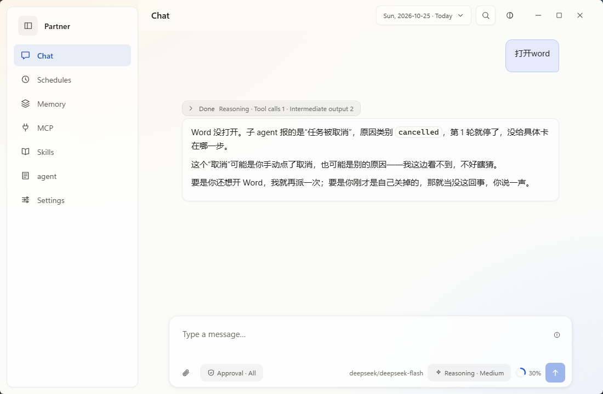
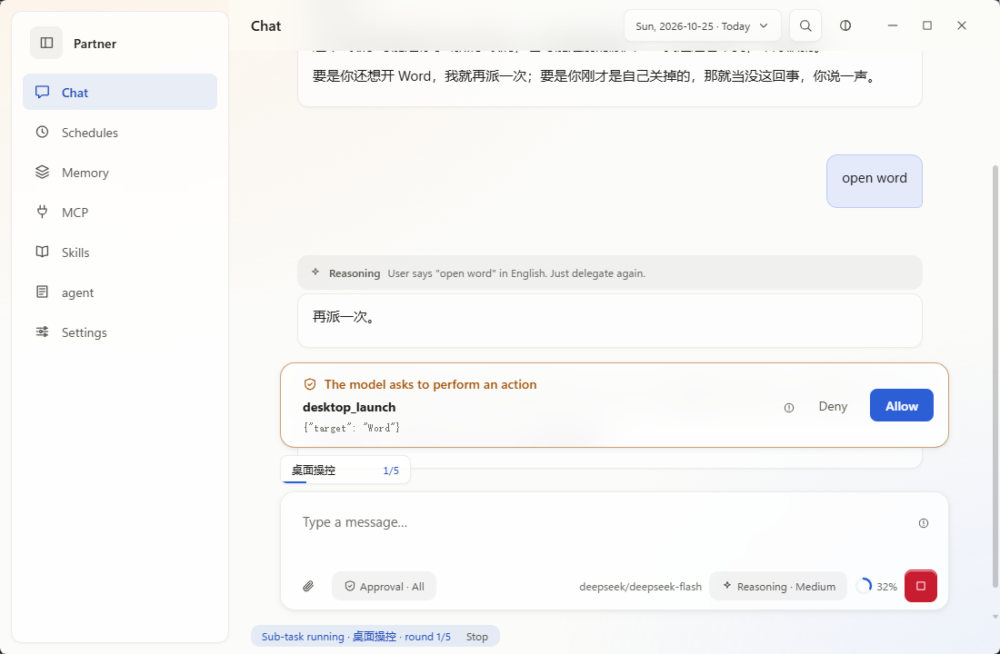
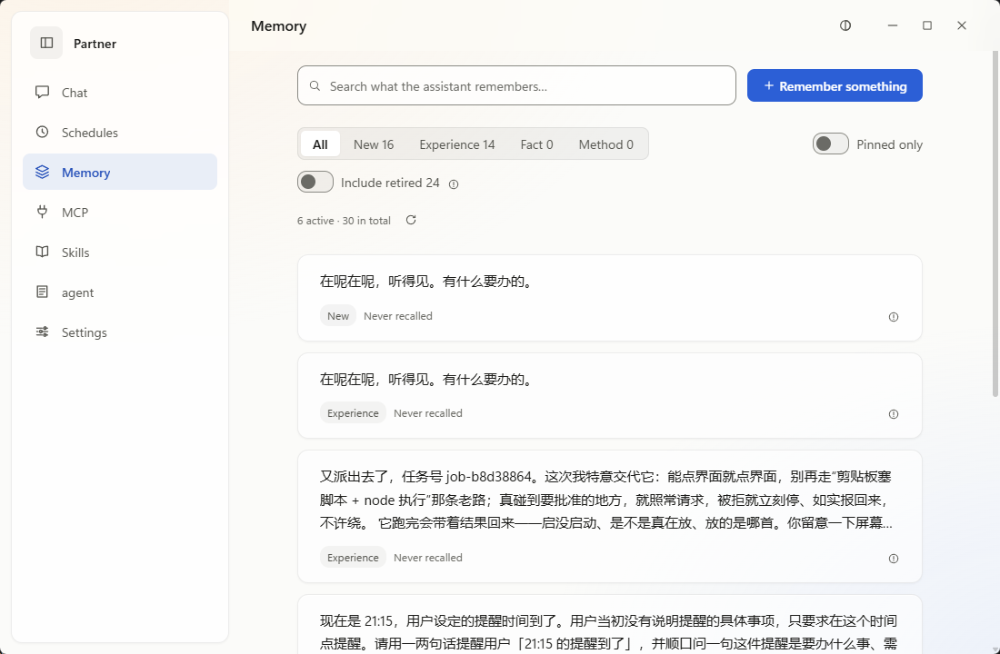
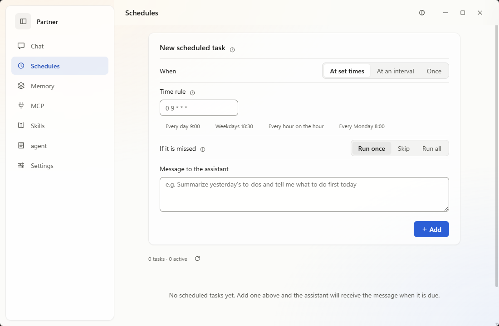
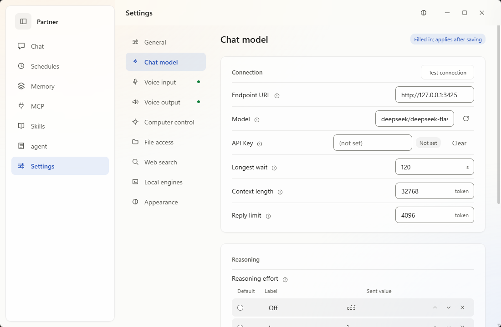
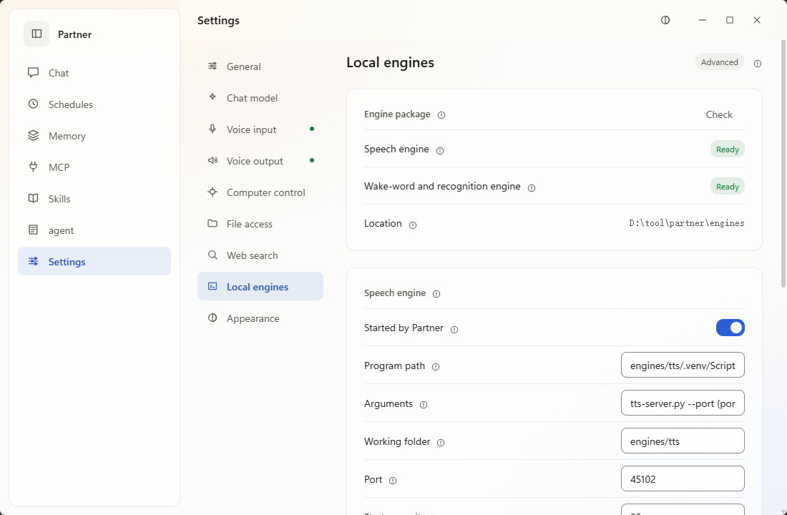

<div align="center">

# Partner

A ready-to-use, single-session Windows desktop AI assistant

[](https://github.com/Jaspersol/partner/releases)
[](https://github.com/Jaspersol/partner/releases)
[](https://tauri.app/)
[](LICENSE)

[简体中文](README.zh-CN.md) | [繁體中文](README.zh-TW.md) | **English**

**[Install](#install) · [Getting started](#getting-started) · [Features](#features) · [FAQ](#faq) · [Docs](doc/README.en.md)**

</div>

## Overview

Partner is a single-session assistant with voice input and output. It connects to the OpenAI-compatible or Anthropic endpoint you configure and covers most of what a typical agent harness does:

- **Single session**: one session only, nothing to create or switch. See [Single session](#single-session).
- **Voice**: wake word, phrase splitting, recognition, sentence-by-sentence read-aloud, and spoken approval, with local engines or your own ASR/TTS services.
- **Desktop control and sub-agents**: requests that need a window or a file go to a background sub-agent, which asks before it acts by default.
- **Memory, schedules, MCP, Skills**: see [Features](#features).

## Single session

Partner has exactly one session. Typed messages, voice, scheduled tasks and sub-agent reports all go into the same log and run in the order they arrive.

- **Nothing to maintain**: no sessions to create, name, switch or clean up.
- **Less to keep track of**: no need to remember which session something was discussed in. Just say it.
- **Suits voice**: you don't pick a session before you speak.

The view is split by day, and the date picker only changes which day you see. A message sent while an old day is on screen still goes to the end of the log; days without messages are not listed. Days follow your local time zone, and a turn still running at midnight finishes before the view moves to the new day.

## Screenshots

<table>
<tr>
<td align="center" width="50%"><br>Main window</td>
<td align="center" width="50%"><br>Approval before acting</td>
</tr>
<tr>
<td align="center"><br>Memory</td>
<td align="center"><br>Schedules</td>
</tr>
<tr>
<td align="center"><br>Model settings</td>
<td align="center"><br>Local engines</td>
</tr>
</table>

## Install

### Requirements

| Item | Requirement |
|---|---|
| OS | Windows 10 2004 or later, x64 |
| WebView2 | Included with Windows 10/11 |
| Model | An OpenAI-compatible or Anthropic endpoint |
| Voice (optional) | Microphone and speakers; local read-aloud needs about 1.9 GB of VRAM, wake word and recognition run on CPU |

The installer bundles the .NET runtime.

### Steps

1. Download `Partner_<version>_x64-setup.exe` from [Releases](https://github.com/Jaspersol/partner/releases/latest).
2. Run it. It installs for the current user without admin rights.
3. The installer is not code-signed. If SmartScreen blocks it, click "More info → Run anyway". `SHA256SUMS.txt` in the same release lets you verify the file.

### Updating

Settings → General → "Check for updates". The app downloads the new installer, verifies its SHA-256, starts it and exits.

## Getting started

1. Open Settings → Chat model. Pick the API format (OpenAI-compatible or Anthropic), enter the endpoint URL, choose a model from the list, and add an API key if needed. Saving applies immediately.
2. Send a message from the main window. If no model is configured, the message waits in the queue and the input area says what is missing.
3. Voice: download engines under Settings → Local engines, or enter your service URLs under Settings → Voice input / Voice output. See [Voice](doc/voice.en.md).
4. Desktop control: turn on Settings → Computer control → "Let the assistant operate the computer" and enable the Computer control sub-agent when prompted. Each action needs you to click Allow in the prompt above the input box; no answer counts as a refusal.

The model can also be set with environment variables; values from the settings page win:

```bash
export PARTNER_LLM_BASE_URL=http://127.0.0.1:11434/v1
export PARTNER_LLM_MODEL=qwen3
export PARTNER_LLM_API_KEY=...       # optional
export PARTNER_LLM_PROTOCOL=openai   # optional: openai / anthropic
```

## Features

| Feature | What it does | Docs |
|---|---|---|
| Memory | Keeps preferences you mention so later turns can use them. The memory page lets you browse, move items between four tiers, pin and delete. | [memory](doc/memory.en.md) |
| Sub-agents | Requests that need the desktop or a file run in a background sub-agent, which reports back when done. Failed runs are retried. | [sub-agents](doc/sub-agents.en.md) |
| Desktop control | Lists windows, clicks controls, types text and launches programs. Approval is required by default, and you can limit it to certain windows. | [desktop-control](doc/desktop-control.en.md) |
| Voice | A wake word starts listening, pauses split phrases, recognized text joins the queue, and replies are read one sentence at a time. The mic can stay off during read-aloud. | [voice](doc/voice.en.md) |
| Schedules | Cron, a fixed interval, or a specific date and time. When a schedule fires, its text enters the queue as a normal message. | [schedules](doc/schedules.en.md) |
| MCP | Connects stdio MCP servers. Tool calls need approval by default; you can turn that off per server. | [mcp](doc/mcp.en.md) |
| Skills | Describe a routine in `SKILL.md`, upload it or create it in the app. Enabled skills are added to the model prompt. | [skills](doc/skills.en.md) |

## FAQ

**Do I need the voice engines?**
No, typing doesn't use them. The wake word and recognition engine is about 380 MB and runs on CPU; the read-aloud engine is about 3 GB and needs a GPU. You can also skip both and use existing ASR/TTS services.

**Why is the read-aloud engine split into several files?**
GitHub limits release assets to 2 GiB and the engine is about 3 GB. The app downloads the parts in order into one folder, checks their SHA-256, and resumes after a dropped connection.

**Where is my data?**
In `%LocalAppData%/Partner/workspace` by default: the session log, queue, memory database and settings. The session and queue can be rebuilt from their `.jsonl` files. `memory.db` is copied into `memory/backups/` at least once a day — on startup when the newest copy is stale, and before the daily maintenance pass — keeping the newest 7; deleting the original loses only what was written since the last copy.

**Does anything leave my machine?**
Conversations go to the model endpoint you configured. Web search is on by default and sends search queries to third-party search engines; turn it off under Settings → Web search. The app also contacts GitHub to check for updates and download voice engines. The local API listens only on `127.0.0.1`, and every request needs the token generated at startup.

**macOS / Linux?**
Not supported. Desktop control and audio call the Win32 API directly; another OS would need both rewritten.

More in the [documentation index](doc/README.en.md).

## Building from source

You need the .NET 10 SDK, Node 22 with npm (not pnpm, which fails to install esbuild), and Rust (cargo 1.98+).

```bash
npm --prefix ui install          # first time
npx --prefix ui tauri dev        # dev mode: frontend + desktop shell, the shell starts the API
bash scripts/build-shell.sh      # build the NSIS installer
bash scripts/ci.sh               # full checks; SKIP_SHELL=1 skips the shell build
```

Debugging and running the API or frontend on their own: [Development](doc/development.en.md). Releases: [Release](doc/release.en.md).

### Project layout

| Path | Contents |
|---|---|
| `src/Partner.Core` | Session, queue, agent turns, memory, scheduler, MCP, Skills, governance |
| `src/Partner.Desktop` | Window enumeration, capture, input injection, action verification |
| `src/Partner.Voice` | Microphone input, segmentation, ASR/TTS clients, playback |
| `src/Partner.Api` | Local HTTP API, queue consumer, voice host, local engine management |
| `ui/` | Vue 3 frontend, UI in Simplified Chinese, Traditional Chinese and English |
| `src-tauri/` | Tauri 2 desktop shell |
| `engines/` | Server scripts for the local voice engines; runtimes and models stay out of git |
| `scripts/` | CI, packaging and engine install scripts |

**Tech stack**: C# / .NET 10 · Vue 3 · TypeScript · Tauri 2 · SQLite

## Contributing

Issues are welcome; for larger changes, open an issue to discuss first. Run `bash scripts/ci.sh` on Windows before sending a PR. `master` only accepts changes through PRs.

## License

The code is [MIT](LICENSE). The voice engine runtimes, model weights and voice anchors are not in this repository; each follows its own licence (Apache-2.0, FunASR MODEL_LICENSE and others, listed in [THIRD-PARTY-NOTICES.md](THIRD-PARTY-NOTICES.md)), and MIT does not cover them.
