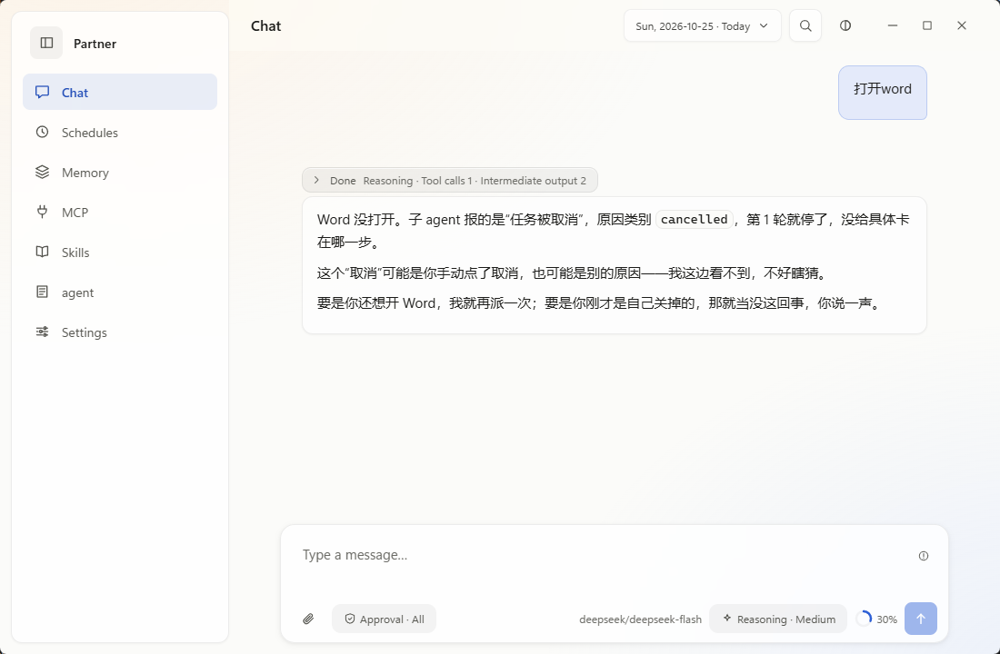
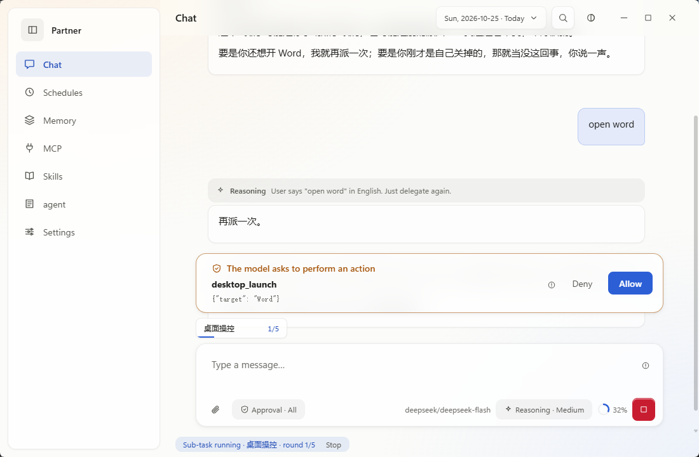
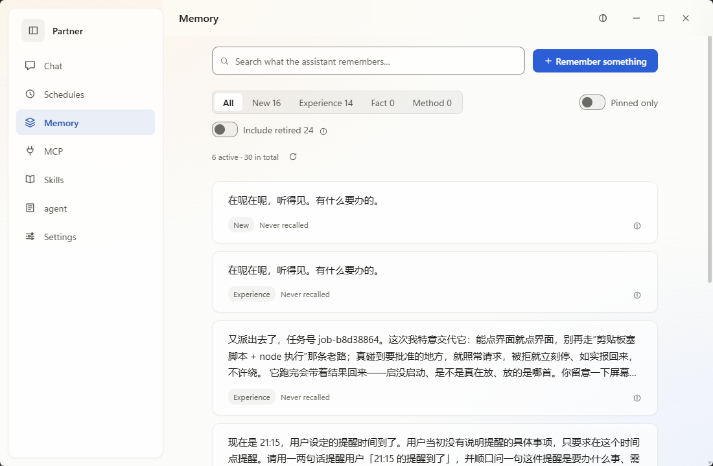
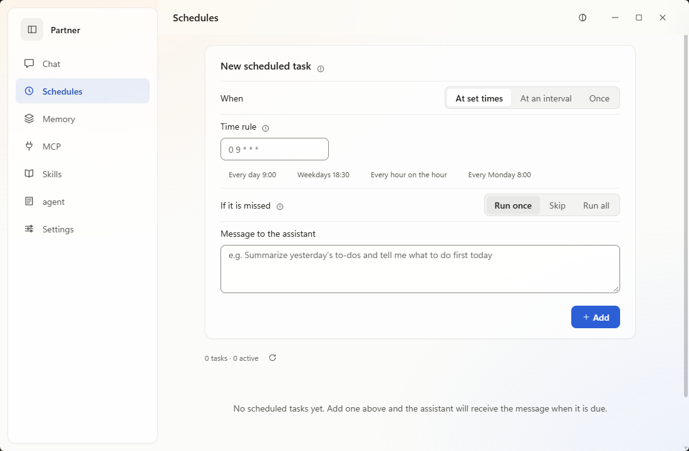
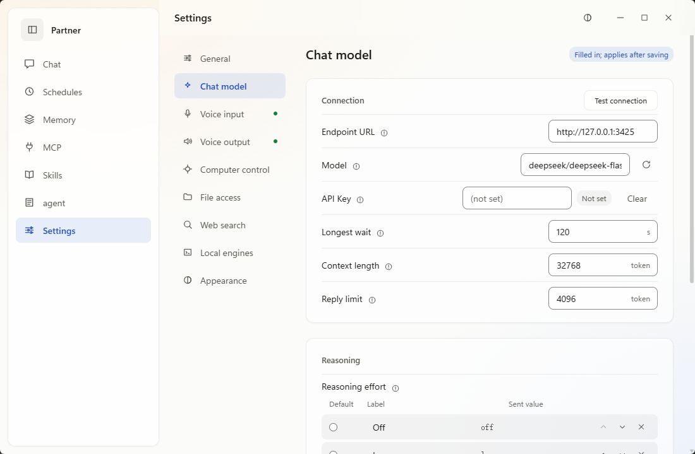
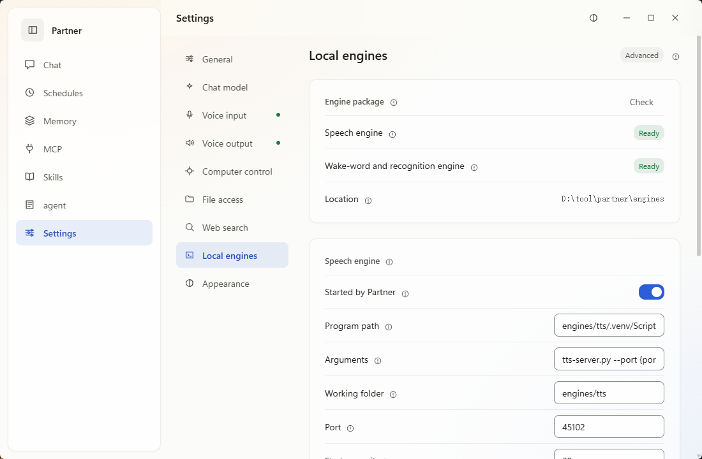

<div align="center">

# Partner

### A ready-to-use, single-session desktop AI assistant for Windows

**Partner keeps your conversations in one continuous session, whether you type or speak. It brings together memory, scheduled tasks, MCP, and Skills, and can delegate desktop work to sub-agents under the approval level you choose. Its local OpenAI- and Anthropic-compatible services let game AI mods, plugins, and other agents connect to your Partner, use relevant memories, and write interaction summaries back to its main memory.**

[](https://github.com/Jaspersol/partner/releases)
[](https://github.com/Jaspersol/partner/releases)
[](https://tauri.app/)
[](LICENSE)
[](https://github.com/Jaspersol/partner/releases/latest)

**English** | [简体中文](README.zh-CN.md) | [繁體中文](README.zh-TW.md)

**[Download](#download--installation) · [Quick Start](#quick-start) · [Features](#features) · [FAQ](#faq) · [Documentation](doc/README.en.md)**

</div>

## Why Partner?

Many agent tools ask you to manage conversations, choose a model for each chat, and type every message. Partner simplifies that routine: there is one ongoing session, and you can talk to it by keyboard or voice. It connects to the OpenAI-compatible or Anthropic endpoint you configure.

- **One conversation, no session housekeeping** — Typed messages, voice input, scheduled tasks, and sub-agent reports all enter the same log and run in arrival order. There is nothing to create, name, switch between, or clean up.
- **Voice with local engines or your own services** — Use wake words, pause-based phrase splitting, speech recognition, sentence-by-sentence read-aloud, and spoken approvals. Download the local engines or connect existing ASR/TTS services.
- **Desktop actions under your control** — Requests that involve windows or file reading are handled by a background sub-agent. Whether an action needs approval depends on the action and selected level; unanswered approval prompts are treated as refusals.
- **Inspectable memory** — Preferences you mention are stored in a local database. Every record can be reviewed, moved between tiers, pinned, or deleted.
- **Connect external agents and plugins** — Game AI mods, editor or browser plugins, and other agent frameworks can use a local OpenAI/Anthropic-compatible endpoint. Requests receive relevant memories, and interaction summaries can be written back to the main memory.
- **Schedules, MCP, and Skills** — Trigger a message on a cron schedule, fixed interval, or one-off time; connect stdio MCP servers; and give the model procedures through `SKILL.md` files.
- **Local by default** — The local API listens only on `127.0.0.1`, and requests must include a token generated at startup. Conversation content is sent to the model endpoint you configure.
- **A native Windows app** — Built with Tauri 2 and a .NET 10 backend. The installer includes the .NET runtime.

## Screenshots

<table>
<tr>
<td align="center" width="50%"><br>Main Window</td>
<td align="center" width="50%"><br>Approval Before Acting</td>
</tr>
<tr>
<td align="center"><br>Memory</td>
<td align="center"><br>Schedules</td>
</tr>
<tr>
<td align="center"><br>Model Settings</td>
<td align="center"><br>Local Engines</td>
</tr>
</table>

## Download & Installation

### System Requirements

| Item | Requirement |
|---|---|
| Operating system | Windows 10 2004 or later, x64 |
| WebView2 | Included with Windows 10/11 |
| Model service | An OpenAI-compatible or Anthropic endpoint |
| Voice (optional) | Microphone and speakers. Local text-to-speech needs about 1.9 GB of VRAM; wake-word detection and recognition use the CPU |

Partner does not support macOS or Linux. Desktop control and audio call Win32 APIs directly.

### Install on Windows

1. Download `Partner_<version>_x64-setup.exe` from the [latest release](https://github.com/Jaspersol/partner/releases/latest).
2. Run the installer. It installs for the current user and does not require administrator privileges.
3. The installer is not code-signed. If SmartScreen blocks it, select **More info → Run anyway**. Verify the file with `SHA256SUMS.txt` or `<installer>.exe.sha256` from the same release.

### Update

Go to **Settings → General → Check for updates**. Partner checks through the GitHub REST API first. If the API is rate-limited or unreachable, or the release lacks an API checksum file, it falls back to a direct download link. The app downloads the installer through an available route, verifies its SHA-256, starts the installer, and exits.

## Quick Start

### Get Started

1. **Configure a model** — Open **Settings → Chat model**, choose OpenAI-compatible or Anthropic format, enter the service URL, and select a model from the list. Add an API key if required. Changes take effect as soon as you save.
2. **Send a message** — Type in the main window. If no model is configured, the message remains queued and the input area indicates what is missing.
3. **Set up voice (optional)** — Download engines under **Settings → Local engines**, or enter existing service URLs under **Settings → Voice input / Voice output**. See [Voice](doc/voice.en.md).
4. **Enable desktop control (optional)** — Open **Settings → Computer control → Let the assistant operate the computer**, then enable the Computer control sub-agent when prompted. When an action needs approval, select **Allow** in the prompt above the input box.

You can also configure the model with environment variables. Values entered in Settings take precedence:

```bash
export PARTNER_LLM_BASE_URL=http://127.0.0.1:11434/v1
export PARTNER_LLM_MODEL=qwen3
export PARTNER_LLM_API_KEY=...       # optional
export PARTNER_LLM_PROTOCOL=openai   # optional: openai / anthropic
```

### Memory, Schedules, MCP, and Skills

- **Memory** — Open **Memory** in the sidebar to browse records, filter by tier, pin or delete them, or add one manually.
- **Schedules** — Open **Schedules** in the sidebar, choose cron, an interval, or a one-off time, then enter the message to send.
- **MCP** — Go to **Settings → MCP**, enable the master switch, and add a server name, command, and arguments.
- **Skills** — Go to **Settings → Skills** to upload a `SKILL.md` or a zipped skill folder, or create a skill in the app.
- **Memory Services** — Open **Memory Services** in the sidebar and add a service with a name, port, protocol, and exposed model name. Copy the token, which is displayed only once, then configure `http://127.0.0.1:<port>/v1`, the token, and the model name in your mod or plugin.
- **Agents** — Go to **Settings → Agent** to edit the main agent and sub-agent prompts, and optionally assign a separate model to each sub-agent.

> **Note:** Messages from every source stay queued while no model is configured. They are processed once a model becomes available.

For detailed instructions, see the **[documentation index](doc/README.en.md)**.

## Features

### Feature Overview

| Feature | Description | Docs |
|---|---|---|
| Single session | One log for text, voice, schedules, and sub-agent reports, browsable by day | [Single session](#single-session) |
| Memory | Stores preferences you mention for later turns to retrieve | [Memory](doc/memory.en.md) |
| Sub-agents | Run desktop and file-reading tasks in the background and report back | [Sub-agents](doc/sub-agents.en.md) |
| Desktop control | List windows, operate controls, enter text, and launch programs | [Desktop control](doc/desktop-control.en.md) |
| Voice | Wake word, recognition, read-aloud, and spoken approvals | [Voice](doc/voice.en.md) |
| Schedules | Cron, fixed intervals, or a specific date and time | [Schedules](doc/schedules.en.md) |
| MCP | Connect stdio MCP servers | [MCP](doc/mcp.en.md) |
| Skills | Describe procedures in `SKILL.md` | [Skills](doc/skills.en.md) |
| Memory Services | Let game mods, plugins, and external agents use memory through a local OpenAI/Anthropic endpoint, with summaries written back to the main memory | [Memory Services](doc/services.en.md) |

### Single Session

- **One shared log** — Text, voice, scheduled tasks, and sub-agent reports enter the same queue and run in the order they arrive.
- **No session maintenance** — There is no need to create, name, switch, or clean up sessions, or to remember which conversation covered a topic.
- **Ready for voice** — You do not need to choose a session before speaking.
- **Browse by date** — The date picker changes only which day is displayed. Messages sent while viewing an older day still append to the end of the log, and dates without messages are omitted. Dates use the local time zone. If a turn is still running at midnight, the view switches to the new day after that turn finishes.
- **Committed history** — In the default mode, the session view publishes a new event only after it has been flushed to disk successfully. An event whose commit fails is not shown as history.

### Memory

- **Automatic extraction** — Memories are distilled at the end of each turn. Relevant records are retrieved before the next turn and added to the system prompt, up to about 5,000 tokens.
- **Four tiers** — New, Experience, Fact, and Method. When a newer record conflicts with an older one in the same tier, the older record is marked invalid and notes what replaced it rather than being deleted. Records not recalled for three months move down one tier.
- **You control the records** — The Memory page lists all records, including invalidated ones. You can change tiers, pin records to prevent demotion or cleanup, add records yourself, or delete any record.
- **Chinese full-text search** — A separate bigram-based index avoids falling back to a full table scan for Chinese searches.
- **Local storage and backups** — Memories live in SQLite and are copied to `memory/backups/` at least daily. The seven most recent backups are kept.

### Sub-agents and Desktop Control

- **Delegate work** — The main agent handles conversation and delegation. A sub-agent works in the background and returns its result as a new input for the main agent to relay to you.
- **Two task modes** — `desktop` is built in. `file-read` is read-only, disabled by default, and restricted to an allowed directory list.
- **Retries and evidence** — A task gets up to 5 rounds by default (configurable from 1 to 10) and has a 15-minute total time limit. A success report must include evidence from the sub-agent; if every round fails, the main agent reports the failure rather than claiming success.
- **Locate controls before acting** — Actions target control IDs rather than guessed coordinates. UI Automation invokes buttons, list items, and checkboxes without bringing the window to the foreground. Chromium/Electron page controls work without a debugging port as well.
- **Approval levels** — Choose **No approval**, **Approve risky actions**, or the default **Approve everything** from the input area. Commands need approval only under **Approve everything**. File writes and edits require approval at every level except **No approval**. Launching programs, writing to the clipboard, and system shortcuts (Win combinations, Alt+F4, Alt+Tab, Ctrl+Alt+*, Ctrl+Shift+Esc) require approval under both approval levels.
- **Guardrails** — Key presses and text entry require the target window to be in the foreground and the target control to have focus. Out-of-range coordinates are rejected rather than clamped. Password fields do not return their values. Results report separately whether an action was sent and whether the screen changed.
- **Window allowlist** — Restrict actions to selected windows. Screenshots require a model with image input enabled.

### Voice

- **Pipeline** — Microphone audio is split at pauses, sent through ASR and the queue, and handled as a turn in the session. New assistant replies are split into sentences, passed to TTS, and played in order.
- **Local engines or existing services** — KWS and ASR use sherpa-onnx and SenseVoice (about 380 MB, CPU-only). TTS uses Qwen3-TTS 1.7B GGUF (about 3.0 GB and about 1.9 GB of VRAM). The engines are downloaded separately and support resuming after a connection drops. You can also enter existing ASR/TTS service URLs.
- **Wake words** — Configure multiple comma-separated words, the time to wait after waking, and an optional wake-up sound.
- **Speaking controls** — Mute the microphone while the assistant speaks, or interrupt it by speaking for about half a second. There is no echo cancellation, so headphones are recommended.
- **Spoken approvals** — Approval requests are read aloud. Respond with “批准执行” (approve) or “拒绝执行” (deny). Raw arguments are not spoken; a request with no response after 120 seconds is denied.

### Schedules, MCP, and Skills

- **Schedules** — Supports five-field cron in the local time zone, intervals from 1 minute to 1 year, and one-off future times. Up to 100 tasks are allowed. When a task fires, its content enters the queue as a normal message. The assistant can create schedules too; creation and deletion follow your approval level.
- **MCP** — Disabled by default. Tool names use the `mcp_{server}_` prefix, and each call requires approval unless you enable **Skip approval** for that server. A server failing to start does not affect the others.
- **Skills** — A skill is a folder containing a `SKILL.md` with `name`, `description`, and steps. Enabled skills appear in the model prompt, up to 50 skills, and take effect on the next turn without a restart.

### Memory Services

- **Use cases** — Connect external agents and plugins, including game AI mods, NPC dialogue plugins, writing or coding plugins, and other agent frameworks that accept an OpenAI- or Anthropic-compatible URL, key, and model name.
- **Request handling** — Each service listens on its own `127.0.0.1` port and forwards requests to the main model or a separately configured upstream. It changes only the exposed model name, the recalled memories inserted before the last user message, and an optional custom prompt. Tools, streaming, `tool_calls`, and errors pass through unchanged.
- **Write-back** — At the configured interval, the caller's request and response are summarized in one sentence and added to main memory with the prefix `[对外服务:<name>]`. The Memory page can filter records by source. When deleting a service, you can also delete memories it wrote.
- **Boundaries** — Callers must run on the same computer as Partner. The service protocol must match the upstream protocol; no format conversion is performed. Each service has its own token. External text can enter main memory, so only share tokens with trusted programs.

### Desktop Pet

- **Live2D character** — A transparent, always-on-top window matches finalized assistant replies against a keyword dictionary and plays fixed scenes. You choose whether to download Cubism Core and the model.

### System and Platform

- **Model protocols** — Supports OpenAI-compatible and Anthropic Messages endpoints. API keys are write-only and cannot be read back.
- **Web search** — Enabled by default. Search queries are sent to a third-party search engine; turn this off under **Settings → Web search**.
- **Automatic updates** — Downloads the new installer, verifies its SHA-256, and restarts into the new version.
- **Crash recovery** — The session and queue are append-only `.jsonl` files and can be rebuilt. If a crash interrupts sub-agent tasks, they are reported as interrupted the next time the app starts.
- **Languages** — The interface is available in Simplified Chinese, Traditional Chinese, and English.

## FAQ

<details>
<summary><strong>Do I need to download the voice engines?</strong></summary>

No. They are not needed for text-only use. The wake-word and recognition engines are about 380 MB and run on the CPU; the read-aloud engine is about 3 GB and needs a GPU. You can skip the local engines and connect existing ASR/TTS services instead.

</details>

<details>
<summary><strong>Why is the read-aloud engine split across several files?</strong></summary>

GitHub limits each release asset to 2 GiB, while the read-aloud engine is about 3 GB. The app downloads the files in order to the same directory, verifies their SHA-256, and resumes after a connection drops.

</details>

<details>
<summary><strong>Where is my data stored?</strong></summary>

By default, data is under `%LocalAppData%/Partner/workspace`:

- **Session log**: `session/events.jsonl`
- **Queue**: `queue/items.jsonl`
- **Memory database**: `memory/memory.db` (SQLite), backed up under `memory/backups/`
- **Scheduled tasks**: `scheduler/`
- **Skills**: `skills/`
- **Attachments**: `media/`

The session and queue can be rebuilt from their `.jsonl` files. `memory.db` is copied to `memory/backups/` at least daily. A backup is created at startup if the newest one is stale, and the daily maintenance pass checks as well. The latest 7 copies are kept. If the original database is lost, only memories added after the most recent backup are missing.

</details>

<details>
<summary><strong>Where can I find the logs?</strong></summary>

The desktop shell writes the API's stdout/stderr and its own diagnostic messages to `%LocalAppData%/Partner/partner-api.log`. The log rotates at 10 MB and keeps one previous file.

</details>

<details>
<summary><strong>Does my data get sent elsewhere?</strong></summary>

Conversation content goes to the model endpoint you configure. Web search is enabled by default and sends search queries to a third-party search engine; you can disable it under **Settings → Web search**. The app also contacts GitHub to check for updates and download voice engines. The local API and Memory Services listen only on `127.0.0.1`, and requests require a token.

</details>

<details>
<summary><strong>Why does the assistant keep asking for approval?</strong></summary>

Desktop control defaults to **Approve everything**, and unanswered prompts are denied. Change the level using the drop-down in the chat input area. **Approve risky actions** asks before launching programs, writing to the clipboard, or using system shortcuts (Win combinations, Alt+F4, Alt+Tab, Ctrl+Alt+*, Ctrl+Shift+Esc), but not before running commands. Commands require approval only under **Approve everything**. File writes and edits require approval at every level other than **No approval**. Under the default level, one approval lets the same window perform up to 10 more steps within 10 minutes. MCP tools use each server's **Skip approval** setting instead of this approval level.

</details>

<details>
<summary><strong>Why didn't a scheduled task run while the app was closed?</strong></summary>

Scheduled times missed while the app is closed or a task is paused are skipped, not replayed. Tasks cannot currently be edited; delete and recreate a task to change its schedule or content.

</details>

<details>
<summary><strong>Is macOS or Linux supported?</strong></summary>

No. Desktop control and audio call Win32 APIs directly, so both parts would need to be rewritten for another operating system.

</details>

For more answers, see the [documentation index](doc/README.en.md).

## Building from Source

You need the .NET 10 SDK, Node 22 with npm (do not use pnpm; esbuild will fail to install), and Rust (cargo 1.98 or later).

```bash
npm --prefix ui install          # first-time setup
npx --prefix ui tauri dev        # development: starts the frontend and desktop shell; the shell starts the API
bash scripts/build-shell.sh      # build the NSIS installer
bash scripts/ci.sh               # run all checks; set SKIP_SHELL=1 to skip the shell build
```

For debugging and running the API or frontend separately, see [Development](doc/development.en.md).

### Project Layout

| Path | Contents |
|---|---|
| `src/Partner.Core` | Sessions, queue, agent turns, memory, scheduling, MCP, Skills, and governance |
| `src/Partner.Desktop` | Window enumeration, screenshots, input injection, and action validation |
| `src/Partner.Voice` | Microphone input, segmentation, ASR/TTS clients, and playback |
| `src/Partner.Api` | Local HTTP API, queue consumer, voice host, and local engine management |
| `ui/` | Vue 3 frontend with Simplified Chinese, Traditional Chinese, and English UI |
| `src-tauri/` | Tauri 2 desktop shell |
| `engines/` | Local voice engine service scripts; runtimes and models are not committed to git |
| `scripts/` | CI, packaging, and engine installation scripts |

## Contributing

Issues and suggestions are welcome. For larger changes, open an issue to discuss the approach first. Before submitting a PR, run `bash scripts/ci.sh` on Windows. The `master` branch accepts changes through PRs only.

**Tech stack**: C# / .NET 10 · Vue 3 · TypeScript · Tauri 2 · SQLite

## Star History

[](https://www.star-history.com/#Jaspersol/partner&Date)

## License

The code is licensed under [MIT](LICENSE). Voice engine runtimes, model weights, and voice anchors are not included in this repository. They are governed by the licenses listed in [THIRD-PARTY-NOTICES.md](THIRD-PARTY-NOTICES.md), including Apache-2.0 and FunASR MODEL_LICENSE, and are not covered by MIT.
