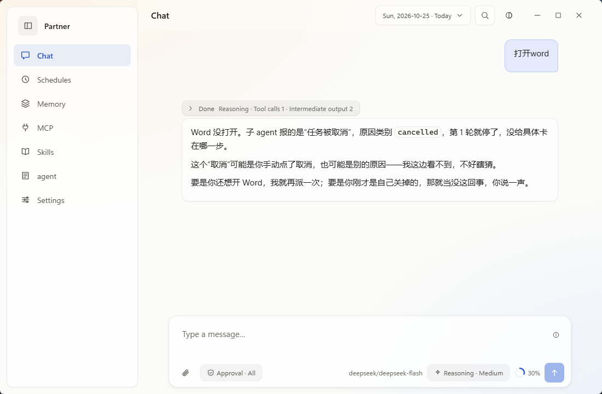
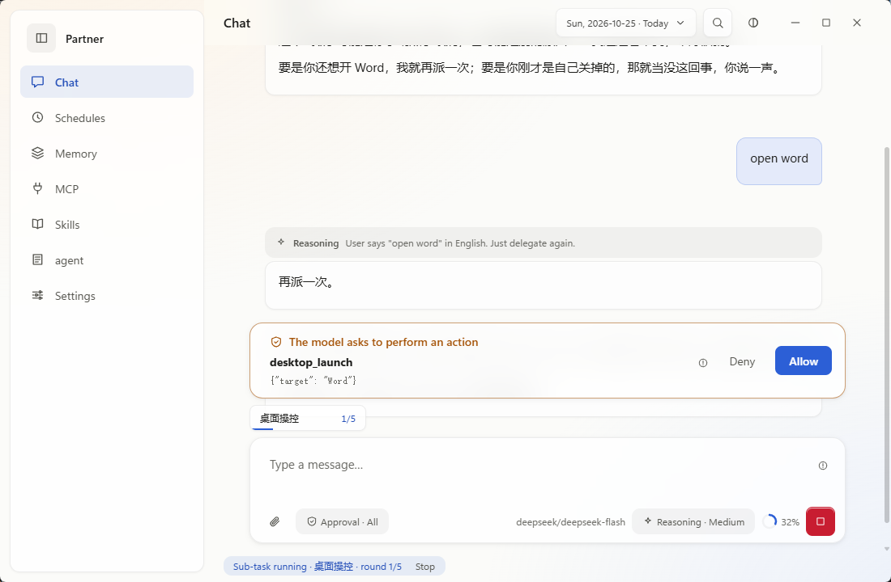
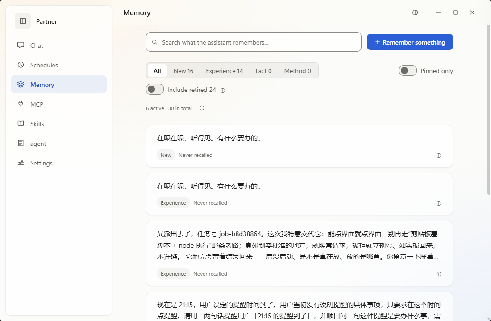
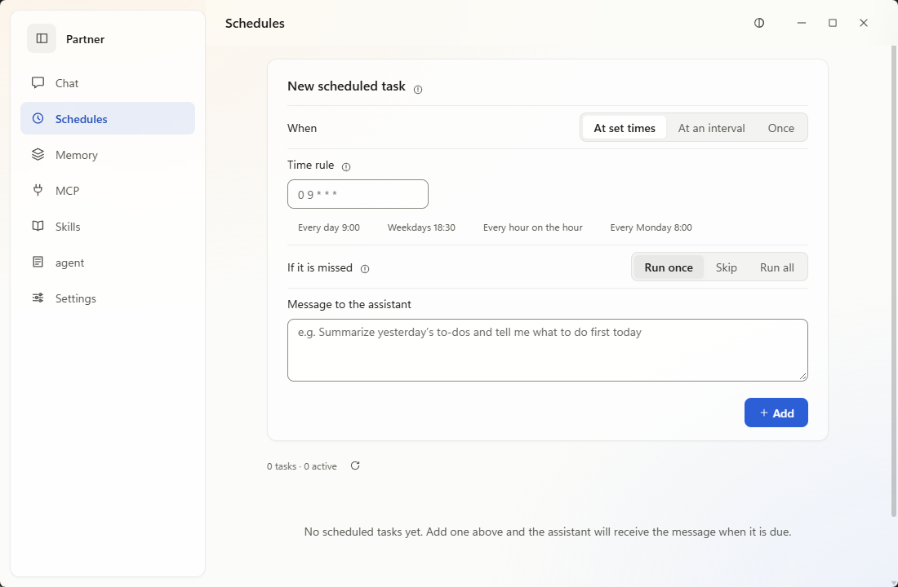
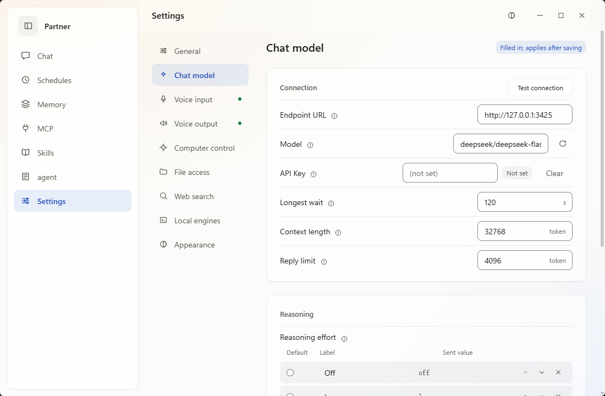
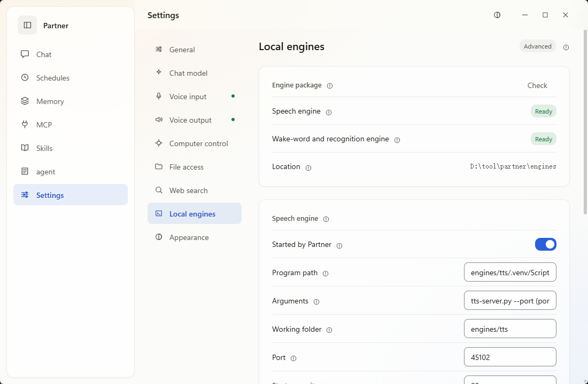

<div align="center">

# Partner

### A Ready-to-Use, Single-Session Desktop AI Assistant for Windows

**One continuous conversation you can type or speak to; with memory, schedules, MCP, Skills, and sub-agents that operate your desktop, asking you before they act. Through Memory Services — a general-purpose API that keeps historical memory — your Partner plugs seamlessly into game AI mods, plugins and other agents.**

[](https://github.com/Jaspersol/partner/releases)
[](https://github.com/Jaspersol/partner/releases)
[](https://tauri.app/)
[](LICENSE)
[](https://github.com/Jaspersol/partner/releases/latest)

English | [简体中文](README.zh-CN.md) | [繁體中文](README.zh-TW.md)

**[Download](#download--installation) · [Quick Start](#quick-start) · [Features](#features) · [FAQ](#faq) · [Documentation](doc/README.en.md)**

</div>

## Why Partner?

Most agent tools make you manage sessions, pick a model per chat, and type everything. Partner removes that bookkeeping: there is one session, and you talk to it the way you would talk to a person, by keyboard or by voice. It connects to the OpenAI-compatible or Anthropic endpoint you configure.

- **One Session, Nothing to Manage** — Typed messages, voice, scheduled tasks, and sub-agent reports all go into the same log and run in the order they arrive. No sessions to create, name, switch, or clean up
- **Voice, Local or Your Own** — Wake word, phrase splitting, recognition, sentence-by-sentence read-aloud, and spoken approval, using downloadable local engines or your own ASR/TTS services
- **Desktop Control With Approval** — Requests that need a window or a file go to a background sub-agent. By default it asks before every action, and no answer counts as a refusal
- **Memory That Stays Visible** — Preferences you mention are kept in a local database. You can browse, re-tier, pin, and delete every record
- **Connect External Agents & Plugins** — Give a game AI mod, an editor or browser plugin, or another agent framework a local OpenAI/Anthropic-compatible endpoint, and your own Partner joins any platform that accepts a model address: each request gets the relevant memories, and summaries of the exchange go back into the main memory
- **Schedules, MCP & Skills** — Run a sentence on a cron, interval, or one-off time; connect stdio MCP servers; teach the model routines with `SKILL.md`
- **Local by Default** — The local API listens only on `127.0.0.1` and requires a token generated at startup. Conversations go only to the model endpoint you configured
- **Native Windows App** — Built with Tauri 2 and a .NET 10 backend; the installer bundles the .NET runtime

## Screenshots

<table>
<tr>
<td align="center" width="50%"><br>Main Window</td>
<td align="center" width="50%"><br>Approval Before Acting</td>
</tr>
<tr>
<td align="center"><br>Memory</td>
<td align="center"><br>Schedules</td>
</tr>
<tr>
<td align="center"><br>Model Settings</td>
<td align="center"><br>Local Engines</td>
</tr>
</table>

## Download & Installation

### System Requirements

| Item | Requirement |
|---|---|
| OS | Windows 10 2004 or later, x64 |
| WebView2 | Included with Windows 10/11 |
| Model | An OpenAI-compatible or Anthropic endpoint |
| Voice (optional) | Microphone and speakers. Local read-aloud needs about 1.9 GB of VRAM; wake word and recognition run on CPU |

macOS and Linux are not supported. Desktop control and audio call the Win32 API directly.

### Windows Users

1. Download `Partner_<version>_x64-setup.exe` from the [Releases](https://github.com/Jaspersol/partner/releases/latest) page.
2. Run it. It installs for the current user and needs no admin rights.
3. The installer is not code-signed. If SmartScreen blocks it, click "More info → Run anyway". `SHA256SUMS.txt` and `<installer>.exe.sha256` in the same release let you verify the file.

### Updating

Settings → General → "Check for updates". The check uses the GitHub REST API first and falls back to direct release-download links when the API is rate-limited, unreachable, or the release has no API checksum. The app downloads the installer from whichever path answers, verifies its SHA-256, starts it, and exits.

## Quick Start

### Basic Usage

1. **Configure a Model**: Open Settings → Chat model. Pick the API format (OpenAI-compatible or Anthropic), enter the endpoint URL, choose a model from the list, and add an API key if needed. Saving applies immediately
2. **Send a Message**: Type in the main window. If no model is configured, the message waits in the queue and the input area says what is missing
3. **Turn On Voice (optional)**: Download engines under Settings → Local engines, or enter your service URLs under Settings → Voice input / Voice output. See [Voice](doc/voice.en.md)
4. **Turn On Desktop Control (optional)**: Enable Settings → Computer control → "Let the assistant operate the computer", then enable the Computer control sub-agent when prompted. Each action needs you to click Allow in the prompt above the input box

The model can also be set with environment variables. Values from the settings page win:

```bash
export PARTNER_LLM_BASE_URL=http://127.0.0.1:11434/v1
export PARTNER_LLM_MODEL=qwen3
export PARTNER_LLM_API_KEY=...       # optional
export PARTNER_LLM_PROTOCOL=openai   # optional: openai / anthropic
```

### Memory, Schedules, MCP & Skills

- **Memory**: Click "Memory" in the sidebar → browse records, filter by tier, pin, delete, or write one by hand
- **Schedules**: Click "Schedules" in the sidebar → choose cron, interval, or a one-off time → enter the sentence to send
- **MCP**: Click "MCP" in the sidebar → turn on the master switch → add a server (name, command, arguments)
- **Skills**: Click "Skills" in the sidebar → upload a `SKILL.md` (or a zipped skill folder), or create one in the app
- **Memory Services**: Click "Memory Services" in the sidebar → add a service (name, port, protocol, exposed model name) → copy the token, which is shown once → enter `http://127.0.0.1:<port>/v1`, the token and the model name in the mod or plugin
- **Agents**: Click "agent" in the sidebar to edit the prompts of the main agent and each sub-agent, and to give a sub-agent its own model

> **Note**: With no model configured, nothing is lost. Messages from every source wait in the queue until a model is available.

For detailed guides on every feature, see the **[documentation index](doc/README.en.md)**.

## Features

### Supported Features

| Feature | What it does | Docs |
|---|---|---|
| Single session | One log for typing, voice, schedules, and sub-agent reports, split into days in the view | [Single session](#single-session) |
| Memory | Keeps preferences you mention so later turns can use them | [memory](doc/memory.en.md) |
| Sub-agents | Run desktop and file tasks in the background and report back | [sub-agents](doc/sub-agents.en.md) |
| Desktop control | Lists windows, clicks controls, types text, and launches programs | [desktop-control](doc/desktop-control.en.md) |
| Voice | Wake word, recognition, read-aloud, and spoken approval | [voice](doc/voice.en.md) |
| Schedules | Cron, fixed interval, or a specific date and time | [schedules](doc/schedules.en.md) |
| MCP | Connects stdio MCP servers | [mcp](doc/mcp.en.md) |
| Skills | Describes routines in `SKILL.md` | [skills](doc/skills.en.md) |
| Memory Services | Let game mods, plugins and external agents use your memory through a local OpenAI/Anthropic endpoint, with summaries written back to main memory | [services](doc/services.en.md) |

### Single Session

- **One log** — Typed messages, voice, scheduled tasks, and sub-agent reports are lined up in one queue and run in the order they arrive
- **Nothing to maintain** — No sessions to create, name, switch, or clean up, and no need to remember which session something was discussed in
- **Suits voice** — You don't pick a session before you speak
- **Split by day** — The date picker only changes which day you see. A message sent while an old day is on screen still goes to the end of the log, and days without messages are not listed. Days follow your local time zone, and a turn still running at midnight finishes before the view moves to the new day

### Memory

- **Automatic** — Distilled at the end of each turn. Before each turn, relevant memories are retrieved and added to the system prompt, up to about 5000 tokens
- **Four tiers** — New, Experience, Fact, and Method. A newer record that conflicts with an older one in the same tier supersedes it without deleting it, and records not recalled for three months drop one tier
- **Yours to edit** — The memory page lists every record, including superseded ones. Move items between tiers, pin them so they are never demoted or cleaned up, create your own, or delete any
- **Chinese search** — A separate bigram full-text index keeps Chinese search off a table scan
- **Local and backed up** — Stored in SQLite and copied into `memory/backups/` at least once a day, keeping the newest 7

### Sub-agents & Desktop Control

- **Delegation** — The main agent only talks and delegates. A sub-agent works in the background, and its result returns as a new input that the main agent relays to you
- **Two scenes** — `desktop` (built in) and `file-read` (read-only, off by default, limited to a directory allowlist)
- **Retries** — A job runs up to 5 rounds by default (1–10) within 15 minutes. Success needs evidence from the sub-agent; if every round fails, the main agent reports the failure instead of claiming success
- **Find the control, then act** — Actions target a control ID rather than guessed coordinates. Buttons, list items, and checkboxes are invoked through UI Automation without bringing the window to the front
- **Approval levels** — Switch between "No approval", "Approve risky actions", and "Approve everything" (default) from the input area. Commands, launches, and clipboard writes ask every time under the default level
- **Guardrails** — Keys and typing need the target window in the foreground, out-of-range coordinates are refused rather than clamped, and results report "input injected" and "did the screen change" separately
- **Window allowlist** — Limit control to named windows. Screenshots need a model with "Can see images" turned on

### Voice

- **Pipeline** — Microphone → pause segmentation → ASR → queue → turn → session, and new assistant replies → sentence split → TTS → ordered playback
- **Local engines or your own** — KWS + ASR (sherpa-onnx + SenseVoice, about 380 MB, CPU) and TTS (Qwen3-TTS 1.7B GGUF, about 3.0 GB, about 1.9 GB VRAM) download separately and resume after a dropped connection. Or enter your existing ASR/TTS service URLs
- **Wake word** — Comma-separated words, a configurable wait after waking, and an optional chime
- **Speaking controls** — Mute the microphone while the assistant speaks, or interrupt it by speaking for about half a second (use headphones, there is no echo cancellation)
- **Voice approval** — An approval request is read aloud and can be answered by saying "批准执行" (approve) or "拒绝执行" (deny). Raw arguments are never read out, and no answer within 120 seconds counts as a denial

### Schedules, MCP & Skills

- **Schedules** — Five-field cron in your local time zone, an interval of 1 minute to 1 year, or a one-off future time; up to 100 tasks. When one fires, its text enters the queue as a normal message. The assistant can create them too, and creating and deleting follow your approval level
- **MCP** — Off by default. Tools get the prefix `mcp_{server}_`, every call asks by default, and you can turn on "Skip approval" per server. A server that fails to start does not affect the others
- **Skills** — A folder with a `SKILL.md` (`name`, `description`, and steps). Enabled skills are listed in the model prompt, up to 50, and take effect on the next turn without a restart

### Memory Services

- **What for** — Connecting external agents and plugins. A game AI mod, an NPC dialogue plugin, a writing or coding plugin, or another agent framework can connect as long as it lets you enter an OpenAI- or Anthropic-compatible address, key and model name
- **How** — Each service listens on its own `127.0.0.1` port and forwards to the main model or an upstream of its own. It changes three things: the model name, recalled memories in front of the last user message, and an optional custom prompt. Tools, streaming, `tool_calls` and errors pass through unchanged
- **Write-back** — On a set interval, what callers asked and what came back is summarized into one sentence starting with `[对外服务:<name>]` and written to the main memory. The Memory page filters by origin, and deleting a service can delete the memories it wrote
- **Boundaries** — The caller must run on the same computer as Partner; a service's protocol must match its upstream's, with no format conversion; each service has its own token. External text reaches the main memory, so give tokens only to programs you trust

### System & Platform

- **Model protocols** — OpenAI-compatible and Anthropic Messages endpoints, with the API key stored write-only
- **Web search** — On by default and sends search queries to third-party search engines; turn it off under Settings → Web search
- **Auto-updater** — Downloads the new installer, verifies its SHA-256, and restarts into it
- **Crash recovery** — The session and queue are append-only `.jsonl` files and can be rebuilt; unfinished sub-agent jobs get an "interrupted" report on the next start
- **i18n** — Simplified Chinese, Traditional Chinese, and English UI

## FAQ

<details>
<summary><strong>Do I need the voice engines?</strong></summary>

No, typing doesn't use them. The wake word and recognition engine is about 380 MB and runs on CPU; the read-aloud engine is about 3 GB and needs a GPU. You can also skip both and use existing ASR/TTS services.

</details>

<details>
<summary><strong>Why is the read-aloud engine split into several files?</strong></summary>

GitHub limits release assets to 2 GiB and the engine is about 3 GB. The app downloads the parts in order into one folder, checks their SHA-256, and resumes after a dropped connection.

</details>

<details>
<summary><strong>Where is my data stored?</strong></summary>

In `%LocalAppData%/Partner/workspace` by default:

- **Session log**: `session/events.jsonl`
- **Queue**: `queue/items.jsonl`
- **Memory database**: `memory/memory.db` (SQLite), with copies in `memory/backups/`
- **Schedules**: `scheduler/`
- **Skills**: `skills/`
- **Attachments**: `media/`

The session and queue can be rebuilt from their `.jsonl` files. `memory.db` is copied into `memory/backups/` at least once a day, on startup when the newest copy is stale and before the daily maintenance pass, keeping the newest 7. Deleting the original loses only what was written since the last copy.

</details>

<details>
<summary><strong>Where are the logs?</strong></summary>

The shell writes the API's stdout/stderr and its own diagnostics to `%LocalAppData%/Partner/partner-api.log`. It rotates at 10 MB and keeps one previous file.

</details>

<details>
<summary><strong>Does anything leave my machine?</strong></summary>

Conversations go to the model endpoint you configured. Web search is on by default and sends search queries to third-party search engines; turn it off under Settings → Web search. The app also contacts GitHub to check for updates and download voice engines. The local API and Memory Services listen only on `127.0.0.1`, and every request needs a token.

</details>

<details>
<summary><strong>Why does the assistant keep asking for approval?</strong></summary>

"Approve everything" is the default level for desktop control, so every UI action asks and no answer counts as a refusal. Change the level from the drop-down in the chat input area. "Approve risky actions" asks only for running commands, launching programs, and writing the clipboard. Under the default level, one approval lets the same window continue for 10 more steps within 10 minutes. MCP tools use their own per-server "Skip approval" list instead of this level.

</details>

<details>
<summary><strong>Why did my scheduled task not run while the app was closed?</strong></summary>

Times missed while the app was closed are skipped, and so are times missed while a task was paused. Nothing is replayed. There is no edit button: to change a rule or its content, delete the task and create it again.

</details>

<details>
<summary><strong>Does it work on macOS or Linux?</strong></summary>

No. Desktop control and audio call the Win32 API directly, and another OS would need both rewritten.

</details>

For more questions, see the [documentation index](doc/README.en.md).

## Building from Source

You need the .NET 10 SDK, Node 22 with npm (not pnpm, which fails to install esbuild), and Rust (cargo 1.98+).

```bash
npm --prefix ui install          # first time
npx --prefix ui tauri dev        # dev mode: frontend + desktop shell, the shell starts the API
bash scripts/build-shell.sh      # build the NSIS installer
bash scripts/ci.sh               # full checks; SKIP_SHELL=1 skips the shell build
```

Debugging and running the API or frontend on their own: [Development](doc/development.en.md). Releases: [Release](doc/release.en.md).

### Project Layout

| Path | Contents |
|---|---|
| `src/Partner.Core` | Session, queue, agent turns, memory, scheduler, MCP, Skills, governance |
| `src/Partner.Desktop` | Window enumeration, capture, input injection, action verification |
| `src/Partner.Voice` | Microphone input, segmentation, ASR/TTS clients, playback |
| `src/Partner.Api` | Local HTTP API, queue consumer, voice host, local engine management |
| `ui/` | Vue 3 frontend, UI in Simplified Chinese, Traditional Chinese and English |
| `src-tauri/` | Tauri 2 desktop shell |
| `engines/` | Server scripts for the local voice engines; runtimes and models stay out of git |
| `scripts/` | CI, packaging and engine install scripts |

## Contributing

Issues and suggestions are welcome. For larger changes, open an issue to discuss the approach first. Run `bash scripts/ci.sh` on Windows before sending a PR. `master` only accepts changes through PRs.

**Tech stack**: C# / .NET 10 · Vue 3 · TypeScript · Tauri 2 · SQLite

## Star History

[](https://www.star-history.com/#Jaspersol/partner&Date)

## License

The code is [MIT](LICENSE). The voice engine runtimes, model weights and voice anchors are not in this repository. Each follows its own licence (Apache-2.0, FunASR MODEL_LICENSE and others, listed in [THIRD-PARTY-NOTICES.md](THIRD-PARTY-NOTICES.md)), and MIT does not cover them.
