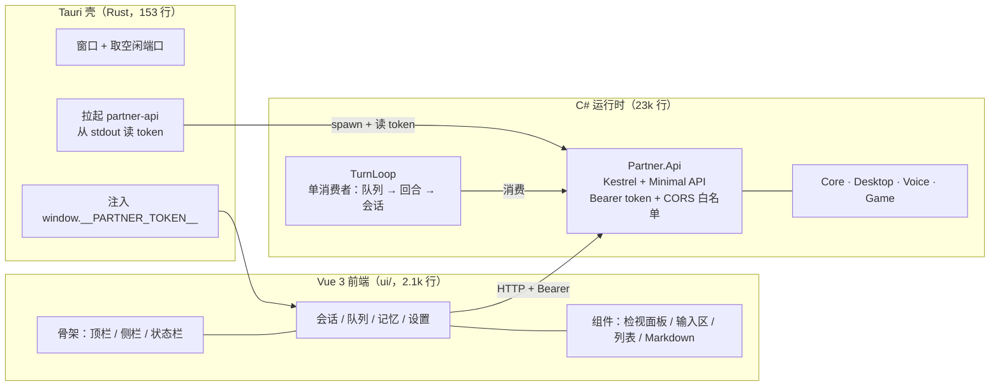

# Partner

本机 Agent 运行时。核心是一条**唯一逻辑会话**上的执行链：输入 → 队列 → Agent turn → 工具/记忆/治理 → 可编辑的会话日志，外加桌面控制、语音双向、游戏反射。

技术栈：**C# / .NET 8 运行时** + **Tauri 2 壳（Rust）** + **Vue 3 前端**。运行时用 C#（Win32 interop、音频、SQLite、MCP 都在这层），界面用 Web 技术（可 headless 测试），壳只负责起窗口和拉起 API。

设计文档在仓库外（随实现同步更新）：

| 文档 | 路径 |
|---|---|
| 目标架构方案（选型/缺口/分期/验收） | `D:/code/Clone/agent-harness-architecture-proposal.md` |
| 现状分析（被引用的源码核验） | `D:/code/Clone/agent-harness-desktop-game-implementation-analysis.md` |
| 桌面操控优化的待办（P0–P3 分期） | `todo.md` |

---

## 快速开始

```bash
cd /d/code/Projects/partner
bash scripts/ci.sh
```

依次执行：.NET 编译 → 单元测试 → smoke → 能力门禁 → 前端类型检查/测试/构建 → 壳编译。任一步失败即中断，退出码非 0。

当前基线：**1000+ 个 .NET 单测 + 200 个前端测试全绿 / smoke 检查（其中 2 项需 `PARTNER_DESKTOP_LIVE=1`，本机默认 skip）/ 能力 `product-supported` 数以 baseline 为准**。桌面那两个依赖真实前台窗口的测试要在**应用停掉时**才稳定，见坑 12。

跳过最慢的壳编译：`SKIP_SHELL=1 bash scripts/ci.sh`。

### 环境要求

| 项 | 要求 |
|---|---|
| OS | **Windows**。`Desktop`/`Voice`/`Api`/`Smoke` 都是 `net8.0-windows10.0.19041.0`——API 之所以也在其中，是因为输入队列只有一个**进程内**消费者且没有跨进程锁，语音必须和它同进程（见「消费者」与「语音」） |

**体积代价**：`net8.0-windows10.0.19041.0` 会拉进 CsWinRT 投影（`Microsoft.Windows.SDK.NET.dll` 24 MB），自包含发布因此从 101 MB 涨到 214 MB、安装包 34.7 MB → 63 MB。这两个项目都没直接用 WinRT API，但去掉版本后缀就丢了 `SupportedOSPlatformVersion` 声明的系统下限（`NETSDK1135`），所以留着——**这是声明「需要 Win10 2004+」的正确方式**，不值得为 24 MB 和 SDK 较劲。想缩小就改成框架依赖发布（2.5 MB API，代价是要求目标机装 .NET 8 运行时）。
| .NET | .NET 8 SDK（当前 8.0.423） |
| Node | Node 22 + npm（前端；**不用 pnpm**，见「坑」） |
| Rust | cargo 1.98+（仅壳需要；缺失时 CI 自动跳过该步） |
| WebView2 | Win10+ 自带（当前 153.x） |
| 硬件 | 真机语音需要麦克风/扬声器；桌面能力需要真实桌面会话 |

---

## 架构



**唯一接缝是 HTTP + Bearer token**：壳不知道任何业务逻辑，前端不引用任何 .NET 程序集，运行时不知道 UI 用什么技术。

### 目录结构

| 路径 | 平台 | 职责 |
|---|---|---|
| `src/Partner.Core` | net8.0 | 会话日志、输入队列、调度、Agent turn、MCP、记忆、治理、契约。**全部逻辑所在** |
| `src/Partner.Desktop` | net8.0-windows | 窗口枚举、GDI 抓帧、输入编组、动作后校验、租约门控 |
| `src/Partner.Voice` | net8.0-windows | 麦克风输入（VAD/分句/流式）、TTS 输出、播放期停听 |
| `src/Partner.Game` | net8.0 | 游戏通用层：反射引擎（槽位锁）、六域上下文、感知去抖分级、进程适配器 |
| `src/Partner.Api` | net8.0-windows | **UI 的唯一数据源** + 两个宿主的家：Kestrel + Minimal API、队列消费者、语音宿主 |
| `src/Partner.Smoke` | net8.0-windows | 端到端 smoke + 能力清单生成 + 门禁 |
| `ui/` | — | Vue 3 + Vite + TS 前端（四视图 + 契约类型 + 测试） |
| `src-tauri/` | Rust | 桌面壳：窗口、sidecar 生命周期、token 注入 |
| `tests/Partner.GameTestServer` | net8.0 | 合成网格游戏，作为**真实子进程**供游戏层闭环验证 |
| `tests/Partner.McpTestServer` | net8.0 | MCP stdio 夹具 |

### 运行期产物

工作区（默认 `%LocalAppData%/Partner/workspace`，壳与手工启动的 API 共用同一个）：

```
<workspace>/
  session/events.jsonl    追加式会话日志（唯一真相，编辑是追加 Edit 事件）
  queue/items.jsonl       队列日志（重启即重放）
  memory/memory.db        SQLite + FTS5 记忆库
  settings/voice.json     语音设置（首次保存时创建）
```

删除工作区即回到初始状态——会话与队列从日志重建，**记忆库是权威存储，删除即丢失**。

---

## 运行

### 完整应用（壳 + API）

```bash
# 开发模式（热更新：改 Vue 立刻生效）
npm --prefix ui install                 # 首次
npx --prefix ui tauri dev               # 起 vite + 壳，壳自动拉起 API

# 生产打包（发布 API → 构建前端 → 编译壳 → 打 NSIS 安装包）
bash scripts/build-shell.sh             # SKIP_INSTALLER=1 则只编译壳
```

**顺序不能颠倒**：壳打包的是 API 的 `publish` 快照，跳过发布就会把上一次的 API 装进去（新端点会在应用里 404）。这条已经封进 `scripts/build-shell.sh`，不要手敲那四步。

壳自己挑空闲端口、自己起 `partner-api`、自己把 token 注入 webview —— **没有需要手填的配置**。

### 只起 API

```bash
dotnet run --project src/Partner.Api -- "D:/tmp/ws" 5280
```

未提供 token 时会生成一个并打印到 stdout（仅此一次）：

```
partner-api listening on http://127.0.0.1:5280
token: <base64url>
```

所有端点都要求 `Authorization: Bearer <token>`，**包括 `/api/health`**：

```bash
TOKEN=<上一步打印的>
curl -H "Authorization: Bearer $TOKEN" http://127.0.0.1:5280/api/session
curl -H "Authorization: Bearer $TOKEN" http://127.0.0.1:5280/api/queue
curl -X POST -H "Authorization: Bearer $TOKEN" http://127.0.0.1:5280/api/projections/rebuild
```

### 只起前端（浏览器里调）

```bash
npm --prefix ui run dev     # http://localhost:5173
```

浏览器控制台里先放 token（前端不接受 URL 参数，避免 token 进历史记录）：

```js
localStorage.setItem('partner.token', '<token>')
localStorage.setItem('partner.port', '5280')
```

CORS 白名单已包含 `http://localhost:5173`。

---

## 消费者（队列 → 回合）

`Core/Hosting/TurnLoop.cs` 是输入队列的**唯一消费者**（设计文档 §2.2）：一次取一项、按到达顺序、跑一个回合、把项落定为 `Done`/`Failed`/`Canceled`。没有它，投递只会停在队列里。

| 不变量 | 实现 |
|---|---|
| 同一时刻只有一项在飞 | 循环体串行 await，从不重叠 |
| 每个被认领的项都会落定 | 异常也走 `CompleteAsync`，不会留下卡在 `Running` 的项 |
| UI 取消能打断执行中的项 | 回合观察队列的 `RunningToken` |
| 停机不切断执行中的回合 | 停止只停「认领」；被打断的项由队列在下次启动时重投 |
| 重投递不重复执行 | 回合已结束（日志里有该 `itemId` 的 `TurnEnd`）的项直接落定，不重跑 |

**配置模型**（不配就没有消费者——不会起一个假回退）：

```bash
export PARTNER_LLM_BASE_URL=http://127.0.0.1:11434/v1   # OpenAI 兼容端点
export PARTNER_LLM_MODEL=qwen3
export PARTNER_LLM_API_KEY=...                          # 可选
```

未配置时 `GET /api/consumer` 返回 `running: false` 与**缺哪个变量**；界面在输入区与状态栏显示「未执行 · 未配置模型：缺少 …」，因为一个不动的队列和一个忙碌的队列在界面上没有区别。

```bash
curl -H "Authorization: Bearer $TOKEN" http://127.0.0.1:5280/api/consumer
# {"running":true,"reason":"运行中","model":"qwen3","stats":{"completed":3,...}}
```

---

## 设置（运行时配置）

`GET /api/settings` 返回五段，字段名与真正消费它们的 option 记录一一对应（`AsrOptions`、`TtsOptions`、`HttpLlmOptions`、`VoiceInputSetting`、`VoiceOutputSetting`），所以对应关系可以并排读出来，不用记映射。

| 段 | 关键项 | 谁在读 |
|---|---|---|
| `input` | 开关、设备、静音阈值、整句/句间间隔、窗口、流式、无标点强切长度 | 语音输入半（**尚无宿主**） |
| `output` | 开关、设备、音色、语速、段间静音、drain、采样率、播放期停听 | 语音输出半（**尚无宿主**） |
| `asr` | 服务地址、模型、语言、连接/读取超时、采样率 | ASR 客户端（**尚无宿主**） |
| `tts` | 服务地址、语言、采样率、克隆参考音频、超时、播放块 | TTS 客户端（**尚无宿主**） |
| `model` | 服务地址、模型名、**API Key**、超时、上下文大小、输出长度、支持图片、**思考挡位** | **消费者（已接线）** |

### 名称是拉取的，不是手打的

| 项 | 怎么来 | 为什么走代理 |
|---|---|---|
| 音频设备 | `GET /api/voice/devices`（`WasapiAudioSource/Sink.ListDevices()`） | 浏览器问不到本机设备 |
| 模型名 | `POST /api/models` → `GET {base}/models`（OpenAI 兼容列表） | 模型端点不允许 webview 的 origin，且 **API Key 不能进浏览器** |

两条纪律：

- **探测失败必须给出原因**。端点不通、端点没实现 `/models`（404）、列表为空——三者要能区分。所以代理返回 `{ models, error }` 而不是空数组，界面也把原因显示出来。
- **已选但当前枚举不到的值仍然可选**。设备拔了、模型下线了，下拉里仍保留那一项；否则下一次保存会把它悄悄改成"默认"。
- 密钥只发给**已存的那个端点**：探测别的地址时不带密钥（有测试守着）。

### API Key 是只写的

`GET` 只返回 `apiKeySet`，**永不回传密钥值**——这个端点只要持有 token 就能访问，回传即泄露。

写入语义（否则客户端改一个无关字段就会把密钥清掉）：

| 请求里的 `model.apiKey` | 效果 |
|---|---|
| 缺省 / `null` | **保持不变** |
| `""` | 清除 |
| 有值 | 替换 |

### 改设置会立刻生效

`PUT /api/settings` 在**模型段发生变化时重启消费者**（其余段不打断执行中的回合——重启会重置计数，所以是可观测的）。响应带上 `consumer` 状态，界面据此显示「消费中 · 模型名」或「未配置模型：队列不会被执行」。

**优先级**：设置里的 `model` 段 > 环境变量 `PARTNER_LLM_BASE_URL`/`PARTNER_LLM_MODEL` > 不启动。来源会出现在 `/api/consumer` 的 `reason` 里（`运行中（设置）` / `运行中（环境变量）`），免得用户猜为什么改了没反应。

### 思考挡位（`model.reasoningEffort` + `model.reasoningGears`）

每次补全都发 `reasoning_effort`，**默认 `medium`**。`off`（或留空）表示**不发这个字段**，而不是发一个值：不吃这个参数的模型不该收到一个猜的值。形状归一化（`" HIGH "` → `high`），所以大小写和空格不算两个设置。

**清单是菜单，不是约束。** `model.reasoningGears` 是用户自己维护的、**有顺序**的词表：会话里的下拉就按这个顺序显示，删掉一个词只是让它不再出现在菜单里，已经用这个词发出去的消息不受影响。输入框本身是自由文本：端点自己发明的词（`minimal`、`none`…）加进清单即可——把服务端认识的词拒掉，比原样发出去更糟。保存时清单按**规范化 → 去重（保留用户排的顺序）→ 丢空白**处理；存空会回退到内置的 `off / low / medium / high / xhigh / max`（空菜单不是可用的设置）。默认挡位不在清单里时会被**补回**而不是拒绝——否则改个名字就让设置页存不下去。

**逐条消息覆盖**：会话输入区有一个「思考」下拉，选中的那一档随这条消息进队列（`InputItem.ReasoningEffort`），跑这一回合的**每一次**请求都用它，不中途退回默认。缺省 = 用设置里的默认。`/api/input` 会校验它在清单里，不在就 400 并列出可用值——菜单只给清单内的词，所以别的都是过期或手搓的客户端。

链路是 设置 → 消费者构建的客户端 → 请求体（`LlmRequest.ReasoningEffort` 覆盖客户端默认值，`AgentTurnRunner` 把队列项上的挡位灌进每个请求）；smoke 守着最后一跳（`settings: the thinking gear reaches the model request`），Core 测试守着默认值、`off` 的省略、逐条覆盖与工具循环内的一致性，API 测试守着清单的规范化与拒绝逻辑。

```bash
curl -H "Authorization: Bearer $TOKEN" http://127.0.0.1:5280/api/settings
curl -X PUT -H "Authorization: Bearer $TOKEN" -H "Content-Type: application/json" \
  -d '{"model":{"baseUrl":"http://127.0.0.1:11434/v1","model":"qwen3"}}' \
  http://127.0.0.1:5280/api/settings
```

---

## 定时任务（侧边栏「定时」）

一条任务 = **一句话 + 一个触发规则**。到点时调度器把这句话作为 `InputSource.Schedule` 入队，所以它和打字、语音走同一条队列、排在已有消息后面，会话里按「调度」来源显示；调度器自己从不跑 agent（`Core/Scheduler/`，持久化在 `<workspace>/scheduler/tasks.jsonl` + `receipts.jsonl`）。

三种规则：`cron`（五段，**按本机时区**）、`interval`（分钟，≥ 1，从创建那一刻起）、`once`（必须晚于现在，执行后自动变为已执行）。没有「编辑」：改规则或内容 = 删了重建，因为发放记录按 `(任务 id, 时间点)` 去重，原地改写会让旧记录吞掉新的触发。

| 路径 | 作用 |
|---|---|
| `GET /api/schedules` | 全部任务，最近的在前 |
| `POST /api/schedules` | `{ kind, cron? \| intervalMinutes? \| at?, payload }`，不合规返回 400 和原因 |
| `POST /api/schedules/{id}/pause` · `/resume` | 暂停 / 恢复；恢复时**跳过**暂停期间错过的时间点，不补发 |
| `DELETE /api/schedules/{id}` | 删除（写一条墓碑记录，日志仍是只追加） |

校验只有一份（`Api/Endpoints/ScheduleRules.cs`），页面和助手的工具共用：内容 ≤ 2000 字，间隔 1 分钟到 1 年，最多 100 个任务。进程停着时错过的时间点同样跳过。

**助手自己建任务**：主 agent 始终有三个工具 `schedule_create` / `schedule_list` / `schedule_delete`（不受任何开关控制，也不给子 agent）。模型没有时钟，所以 `schedule_list` 和每次创建的结果都会带上「现在是 …（本机时间）」，一次性任务可以直接写 `delayMinutes`（几分钟后）而不必自己算日期。**创建和删除要人工批准，列出不用**：任务的内容到点会被当作你发的消息，是一条会长期留着的指令，所以不能让助手读到的网页替它悄悄留下一条。审批条会把规则和那句话读出来，而不是原始 JSON。

页面里的日期时间用自带的 `DateTimePicker`（月历 + 时/分两列 + 「1 小时后 / 明天 9:00 / 下周一 9:00」），过去的日期和时间不可选，选今天时会把时间夹到下一个还没过去的分钟。

## 历史：删除、撤回、压缩

删除是**物理清除**（撤回在发出新消息后也会变成物理清除，见下）：目标行从 `events.jsonl` 里真的消失（先写临时文件再原子替换，崩溃只会留下旧文件或新文件，不会留下半截混排）。同时清掉那些事件的**修订行**——修订保存的是同一段内容的副本，留着就等于没删。清除只发生在**用户显式删除/撤回**这一条路径上。

留一条**不含内容的撤回记录**（`purge #a..#b`）代表被清掉的区间：它记录「删过什么范围」而不记录「删了什么内容」，同时保住 seq 高水位——**seq 永不复用**（`MemoryRecord.SourceEventSeq` 指回会话 seq，复用会让记忆错认事件）。

**压缩不在此列**：压缩写的也是 `Retract`，但它是有意无损的——折叠的历史留在日志里，靠摘要代表它。

**「对话」**是一次交流：从某条有人发出的消息（打字、说话、定时任务）开始，到下一条这样的消息为止。子 agent 的汇报不开始新的对话——它到达时属于引起它的那一轮，并且**不出现在会话视图里**（`GET /api/session` 把 `Agent` 来源的用户消息过滤掉；日志和模型照样能读到，主 agent 对它的回复是一条普通的助手消息，照常显示）。也**不进记忆**：`MemoryDistilHook` 对 `Agent` 来源整轮跳过。

| 操作 | 语义 | 界面上 |
|---|---|---|
| **删除** | **只能删最新一次对话**，整段删（连同它的轮次标记、修订、记忆）；物理清除，不可恢复 | **二次确认**（内联两段式）；只出现在最新一次对话的各行上 |
| **撤回** | 隐藏所选对话**及之后**的全部对话；一个字节都不删，记忆也不动 | 一次点击；会话底部出现「已撤回 N 条对话」和「取消撤回」 |

**撤回可以取消，直到发出新消息。** 它写的是一条普通的 `Retract`（带 `withdrawn` 标记），视图和上下文都看不到被隐藏的区间；「取消撤回」就是把这条记录从日志里拿掉，隐藏的内容原样回来。**发送新消息**（`POST /api/input` 或一句语音）的瞬间、先于入队，服务端才把区间物理清除并级联删掉由它们蒸馏出的记忆——所以撤回之后的第一句话不会召回被撤回的内容，也不能再取消。同一时刻最多一次待定的撤回：从更早的位置再撤回会把它扩大（所有可见对话都在待定区间之前，新的范围总是包住旧的），取消则一并恢复。定时或子 agent 汇报到达不算「发出新消息」。

**范围都是闭区间**：撤回的 `toSeq` 在调用时就被钉住（= 调用时的最后一条），之后到达的事件不受影响——写成开区间会把撤回之后发的第一条消息也一并清掉。删除和撤回在有回合进行时返回 409（回合还在写的历史不能抽走），删除在有待定撤回时也返回 409（否则会悄悄让撤回变成最终的）。

### 上下文占用与 token 计数

会话工具条常显 **`上下文 1.2k / 28.7k（4%）`**，悬停给出窗口、预留输出、保留条数与已折叠条数；占用 ≥ 85% 转 warn 色。这个数字**用回合同一套装配规则、同一个计数器测出来**（`/api/session` 的 `context` 段），所以屏幕上显示的就是决定「要不要折叠」的那个数。

计数分两级落地（外加一层双臂策略）：

| 级别 | 做法 |
|---|---|
| 本地估计 | `ApproximateTokenCounter`：~4 字符 ≈ 1 token。**对中文会低估约 2 倍**，所以它只是回退 |
| 模型原生 | `HttpLlmClient` 实现 `ITokenCounter`：`POST {base}/tokenize`（llama.cpp 兼容），结果 **memo 化** |
| 双臂 | `DualArmTokenCounter` 取 `max(provider, local)`——预算**永不取乐观的一侧** |

四条纪律：

- **接口扩展不破坏实现**：`CountAsync` 是默认接口方法，只实现 `Count` 的计数器自动可用。
- **没有 tokenizer 的服务器不再被反复询问**：404/405 视为永久（记住），5xx 视为瞬时（继续问）。
- **缓存键是 128 位内容哈希，不是原文**：会话视图每轮都给出新的字符串实例，按原文做键会把见过的每个正文都留在内存里。哈希碰撞只会让一条算错价，预算吸收得了；留住历史则不能。
- **表计自己不发 I/O**：占用是从**已经数过的结果**里答的（回合刚数过同一批正文），没数过的退回本地估计。这条是踩出来的——最初把「问模型数 token」放进 `/api/session`，模型端点一死，会话视图就跟着卡住加载不出来（壳的 e2e 用 `http://127.0.0.1:9/v1` 当场抓到）。视图的加载不该依赖模型是否活着。

### 上下文压缩

「上下文大小」是**模型的上下文窗口 token 数**（`model.contextTokens`），「输出长度」是单次补全上限（`model.maxTokens`）。两者都在模型卡片里，保存后**立即重启消费者**生效。

**提示预算 = 上下文大小 − 输出长度**：留给补全的空间必须先扣掉，否则提示会占满窗口、回答被截断。校验也要求 `maxTokens < contextTokens`。

装配器与压缩器**共用同一条「装得下」规则**（`Core/Agent/ContextBudget.cs`）：最新连续后缀装满预算就停，其余折叠。两处若各写一套，就会一边发得比窗口多、一边把装得下的也折了。

把上下文改小后，若历史超出新预算，**保存时立刻压缩一次**（不等下一轮，否则下一轮会先把超长对话发给模型）：

```
窗口外的对话 + 旧摘要 → 模型生成一段摘要 → 追加 Summary 事件 + 按连续区间追加 Retract
```

三条规则：

- **窗口按 token 裁剪，不是按条数**：撑爆模型的是 token，两者只是松散相关（一条工具结果能顶二十条短回合）。裁剪保留**最新的连续后缀**——从中间挑会留下一个在回答已经不在上下文里的问题。
- **摘要是上下文，不占窗口额度**：否则摘要会把最新的真实回合挤出窗口。
- **新摘要覆盖旧摘要**：每次压缩只留一条，否则每压一次上下文反而更长。
- **失败不丢历史**：模型没返回摘要就什么都不写，并如实报告原因（「未配置模型，无法压缩」）。

---

## 语音（麦克风 ↔ 会话）

`Api/Voice/VoiceHost.cs` 把两个半区接进运行时（设计文档 §2.8）：

```
麦克风 → 环形缓冲 → 停顿切句 → ASR → 队列 → 消费者跑回合 → 会话
                                                              ↓
扬声器 ← 顺序播放 ← TTS ← 切句 ← 新出现的 assistant 事件
```

| 设计点 | 为什么 |
|---|---|
| **与队列消费者同进程** | 队列只有一个**进程内**消费者、没有跨进程锁。另起一个语音进程会和消费者抢同一个日志 |
| 半个启动失败只影响自己 | 打不开麦克风不该让扬声器也停：两个半区各自报告 `running` / `reason` / `device` / `count` |
| 捕获按 20ms 帧节奏 tick | 停顿判定依赖到达节奏；输出半只等新文本，200ms 轮询足够 |
| 只朗读启动后新出现的事件 | 否则一开机就把整个历史读出来 |
| 幂等键带 boot id | `voice:{device}:{boot}:{startMs}`——流时钟重启后会归零，键必须含 boot |

**测试注入点**：`IVoiceComponents` 一处封住设备与两个客户端（`OpenSource`/`OpenSink`/`CreateAsr`/`CreateTts`），所以整条链可以在**没有麦克风、扬声器和服务**的情况下驱动——停顿边界与播放顺序本来也只能这样测。

```bash
curl -H "Authorization: Bearer $TOKEN" http://127.0.0.1:5280/api/voice
# {"input":{"running":true,"reason":"运行中","device":"synthetic-mic","count":3},
#  "output":{"running":false,"reason":"未配置 TTS 服务地址","device":null,"count":0}}
```

设置里改 `input`/`output`/`asr`/`tts` 任一段会**重启语音宿主**（重开设备）；只改 `model` 段不会——避免打断一次正在进行的识别。

### 本地引擎（可选，`engines/`）

调研与预算见 [本地音频.md](本地音频.md)。两个引擎是**独立进程**，由 `Api/Voice/LocalEngineHost.cs` 按设置拉起/杀掉：

```
local.tts  → engines/tts/tts-server.py      POST /v1/audio/speech   （设置：tts.protocol=openai）
local.kws  → engines/kws-asr/asr-server.py  POST /recognize + /wake/infer（asr.protocol=sensevoice + 唤醒门）
```

| 设计点 | 为什么 |
|---|---|
| **关闭 = 杀进程** | ONNX 内存池扩张后不归还宿主（见调研 §4 坑一），只有进程退出才可靠释放。所以「不占资源」的单位是进程，不是客户端对象 |
| 两个开关各自一个可执行文件 | TTS 占显存（~1.0–1.3GB），KWS/ASR 占内存（KWS 常驻 ~50MB，转写时 SenseVoice ~500MB）——关一个不影响另一个 |
| 同配置不打抖 | 保存设置时若引擎配置没变且进程活着，不重启：一次无关的设置保存不该把正在跑的引擎掐掉 |
| `{port}` 占位符 | 引擎要知道监听哪、宿主要知道连哪；一个模板同时喂两边，避免两处配置静默漂移 |
| 端口从 `local.*.port` 来，不是从 `asr.baseUrl` 推 | 引擎托管与客户端地址是两件事：可以托管在 A 端口而客户端连 B（比如引擎先跑着、宿主后配） |

**唤醒门**（`VoiceInputSetting.Wake`）：KWS 引擎开启时语音输入进入门控——麦克风持续采、音频照常进环形缓冲，但**不提交 ASR**；宿主每满 100ms 增量把新音频转发给 `/wake/infer`，命中后开闸一个会话窗；G2（整段静默闭合）即回闸等下一次唤醒——**只喊词不说话也算说完**，回闸与否只看 G2，不看这一块最后值不值得转写。前置音频只在引擎那条流刚建好时（首帧、命中换流、引擎重启）送一次：KWS 解码器要左边上下文才命中（裸增量和 0.3s 前置实测都打不出，1.0s 才行），但每帧都送会让同一条流把每句话听两遍——两遍「小克」正好凑出双声词「小克小克」，于是喊一声也唤醒（实测旧时序单声命中 5 次，改后 0 次）。唤醒词后紧跟着的话不会被掐头（缓冲里还在）。KWS 失联只记日志、下一 tick 重试，不死半区。

**唤醒后的宽限期**（`input.wakeTimeoutMs`，默认 5000）：提示音到用户开口之间那段沉默是「在想说什么」，不是「说完了」——命中后还没听到人说话时，静默按宽限期计而不是 `utteranceGapMs`（默认 1200）；一听到语音就立刻回到正常判句。这条是必须分开的：只喊唤醒词不说话时 `_dirty` 必须立起来（否则 G2 永不成立、会话卡死，见上），而 `_dirty` 一旦立起来，用判句间隔去关会话就变成「唤醒后约 1.1 s 内不开口，会话就关」——实测唤醒后停 1.2 s / 2.0 s 再说话，`utterance` 为 0、ASR 调用 0 次，用户看到的就是「唤醒之后说的话没变成输入」。宽限期之外的静默仍照常关会话（误唤醒不会一直敞着闸门收环境音），纯静音块也仍然不提交 ASR。流式模式（`asrStream`）下 G1 的句界判定同样跳过宽限期内的静默。**唤醒提示音是外放的，非耳机时会被麦克风原样收回来**（幅度轻松过 `silenceThreshold`），宿主在提示音窗口内（`ToneEchoSeconds`，0.6 s = 提示音 0.16 s + 出声延迟 + 余响）不判开口，否则提示音自己就把宽限期打掉、会话在它结束后 ~1.1 s 关上——真机上命令一个字都进不了 ASR（单测里提示音只是个计数回调、从不回灌，所以改前全绿）；同时「开口」要在**同一簇声音里累计** ≥ `WakeOnsetMs`（200 ms）过阈值才算数，一个 50 ms 能量窗不够（咳嗽、键盘、桌面磕碰同样能打掉宽限期）。累计而不是连续：汉语一个音节过阈值只有 60–190 ms，音节之间就掉到阈值以下，要求连续 200 ms 则整句命令都打不掉宽限期；簇内短于 `OnsetBridgeSeconds`（300 ms）的间隙不清零，簇起点还要回退 `OnsetPreRollSeconds`（300 ms），否则首字辅音起音被掐掉。

**引擎包是独立模块，不在安装包里。** 安装包只带两个很小的服务脚本（`asr-server.py`、`tts-server.py`，见 `tauri.conf.json` 的 resources）；运行时和模型（约 3GB）放在应用目录下的 `engines/`，由「设置 → 本地引擎」里的「下载」按钮取回（`Api/Voice/EnginePackage.cs`，`/api/local-engines/package*`）。

| 设计点 | 为什么 |
|---|---|
| 检测看磁盘，不看设置 | `GET /api/local-engines/package` 每次重读：按文件是否齐全判断「已就绪」，并列出缺什么。设置页的「检测」就是它 |
| 找到才展示引擎设置 | 程序路径、启动参数、运行目录等只在引擎就绪（或此前已配过路径）时出现；否则页面给下载、检测、手动指定 |
| 默认路径存相对路径 | `engines/tts/…` 相对应用目录，`LocalEngineHost` 启动时再解析，所以应用搬家或重装不用改设置；手动指定的目录在别处，存绝对路径 |
| 应用目录由壳告知 | 壳通过 `PARTNER_APP_DIR` 传给 API；开发时是仓库根（`engines/` 就在那里） |
| 下载可续传、先校验再解压 | 落成 `.part`，用 `Range` 续；有 SHA-256 就校验；解压拒绝越界路径；服务端给了长度就核对，截断不算成功 |
| 手动指定要通过检查 | `PUT /api/local-engines/package/root` 只在目录里确有完整引擎时才记下（存在 `<workspace>/local-engines-root.txt`，不进设置表单） |

压缩包里的路径相对 `engines/`（`tts/…` 或 `kws-asr/…`）。地址在 `EnginePackage` 的常量里，或用环境变量 `PARTNER_ENGINE_TTS_URL` / `PARTNER_ENGINE_KWS_URL`（及 `_SHA256`）覆盖。解释器按顺序找 `<引擎>/python/python.exe`（可搬走的运行时，推荐放进压缩包）再找 venv——venv 的 `pyvenv.cfg` 写死了建它那台机器的 Python 路径，换机器用不了。

开发机安装：`powershell -ExecutionPolicy Bypass -File scripts/install-engines.ps1 [-Engine tts|kws|both]`，装进仓库的 `engines/`（同一个位置，设置页直接能检测到）。实测事实与踩坑清单见 [engines/README.md](engines/README.md)：官方 KWS 包只有 **chunk-16**（~320ms 延迟）、`keywords.txt` 自带 8 个词、`get_result()` 返回字符串、**不用 Silero VAD 切段**（切出来的段喂回 SenseVoice 会得到空文本，30 s 保命条款改由定长切分承担）、下载必须校验长度（`Invoke-WebRequest` 曾把 999MiB 静默截成 670MB 并报成功）。

---

## 桌面操控的交互设计（四次实测之后的修订）

一次真实的「打开网易云音乐」暴露了四层问题，**没有一层是库坏了**：注入返回 Ok=True、枚举到 9 个窗口、动作确实点了下去。坏的是把「模型能做」和「人能看到并批准」接在一起的那部分。

| 现象 | 原因 | 现在的做法 |
|---|---|---|
| 两次动作 120s 无人应答被拒 | 审批横幅只在**会话页**挂载（`v-if="active === 'session'"`），人不在那页就没人看 | 横幅提到 **App 层**，任何页签都看得到；有请求在等时按 500ms 轮询（徽标仍是 5s） |
| 批准后仍被拒（Expired） | 租约 TTL（15s）远短于审批窗口（120s），而租约只在观察时写一次 | **不再信任那张租约**：动作前重新观察，内容一致就继续（`Revalidate`），不一致就要求重新观察。人慢不再是失败 |
| `校验=NoChange` 读起来像没生效 | 结果串把「注入成功」和「画面没变」挤在一行 | 拆开说：`KeyPress · 注入成功 · 校验：画面无变化（效果未被确认） · 目标 X` |
| 最小化窗口被当成可点的小窗口 | 最小化窗口的矩形是 -32000 处的 160×28 占位值；截图只能得到一条空白，点击落在虚空 | 观察标记 `minimized`、截图与点击都拒绝并提示先 focus，`focus` 负责还原 |
| 对着错误的窗口盲打 | `KeyPress` 是**全局**输入（打到前台窗口），坐标也是屏幕坐标；窗口白名单空 = 不限 | 加护栏：按键要求目标**已在前台**（否则先 focus）、坐标必须落在目标矩形内；结果里写出**目标窗口标题**，approval 横幅也显示它 |

护栏是**在注入之前**拒绝的（refusals 不碰输入），所以 smoke 能验证它们而不动用户的鼠标。

---

## 工具调用的显示

**一次调用一张卡**（参考 deepseek-harness 的 tool-call 形态）：调用与结果是日志里的两个事件，对读者却是同一件事——此前渲染成两行互不相干的碎片，一轮里调过工具看起来像两段噪音。

| 位置 | 内容 |
|---|---|
| 折叠行 | 工具名（accent 色）· 参数摘要（JSON 压成一行、截断）· 状态（进行中 / 完成 / 失败，失败转 error 色） |
| 展开 | 「参数」区块（JSON 美化，解析失败则原样）与「结果」区块（Markdown 渲染） |
| 配对键 | 运行器写进两个事件 meta 里的调用 id；**结果找不到调用**（局部删除、旧日志）也会单独成卡，不静默丢弃 |

`/api/session` 因此多带一个 `meta` 字段（工具 id/name/args/ok、回合结束原因等，原样透出）——没有它界面无法把两行配成一张卡。

**「为什么它不干桌面的活」现在会明说。** 桌面能力默认关闭（fail-closed），关闭时工具**根本不注册给模型**——模型看不到，于是它只能回一段文字，看起来像能力坏了。输入区状态条**常显**模型手上的工具表（来自 `/api/consumer` 的 `tools`）：`工具：无 · 桌面未启用（设置 → 桌面）`，或 `工具：desktop_observe、desktop_act（需批准）`。

**改桌面段会重启消费者**（其它段不会）。工具表是在消费者启动时构建的，不重启就会出现「开关打开了、模型手上还是空的」——那正是看起来像坏掉的状态。判定用的是**值相等**：`DesktopSettings` 带一个列表字段，而 record 默认按引用比列表，两个默认值会永远「不相等」，于是每次保存都重启（把飞行中的回合计数也重置）。

---

## 主 agent 与子 agent（委派）

主 agent 只对话和派活，重活交给**按场景路由的子 agent**。场景是个封闭目录，只有两项：

| 场景 | 子 agent 的工具 | 能力开关 | 谁可以占用 |
|---|---|---|---|
| `desktop`（桌面操控） | `desktop_*` | `desktop.enabled` | 内置的「桌面操控」子 agent（不可删，场景锁定） |
| `file-read`（读取文件） | `file_list`、`file_read`（只读） | `files.enabled`（默认关）+ 目录白名单 | 用户新增的子 agent（可选） |

**同一场景只能有一个子 agent**，所以子 agent 总数最多两个。**没人占用的场景由主 agent 自己执行**：开了 `files` 却没有读文件子 agent 时，`file_*` 在主 agent 手上。桌面是例外——桌面状态是进程内单例（任何一次 `Observe` 都让旧租约失效），两个 agent 共用会互相作废观察，所以桌面工具**从不给主 agent**，开启桌面就**必须**有启用的桌面子 agent。这一条保存时校验；手改文件绕过去的，加载时 fail-closed（谁都没有桌面工具），`GET /api/agents` 的 `problems` 说明原因。

### 派活与回灌

- 主 agent 有三个工具：`agent_delegate`（立即返回）、`agent_job_status`、`agent_job_cancel`。没有可用场景时这三个都不注册。
- **异步，不能同步等**：工具有 30 s 超时，而且主 turn 会占着单读者队列。job 在后台跑，**结束后把汇报作为一条 `InputSource.Agent` 的输入入队**（幂等键 `agent-job:{id}`），主 agent 起新 turn 转述。`POST /api/input` 不接受 `Agent` 来源，客户端冒充不了子 agent。
- 每个 job 有自己的会话 `agents/<agentId>/<jobId>/session/events.jsonl`：截图、读到的文件内容**不进主会话**，也不触发记忆提炼。`GET /api/agent-jobs/{id}/session` 只读查看。`agents/jobs.jsonl` 记 job 的开始和结束，进程崩溃后下次启动给每个没结束的 job 补一条 `interrupted` 汇报。
- 一个子 agent 同时只跑一个 job（再委派得到 `busy`）。刚失败的同一目标，10 分钟内不能原样再委派（忽略空白和标点）。
- 审批沿用同一个队列，`origin` 字段写明是哪个子 agent、在做什么。工具表在 `GET /api/consumer` 的 `agentTools` 下，主 agent 的在 `tools` 下。

### 逐轮重试与失败回报

一轮 = 对 job 会话跑一次完整的 turn；`maxRounds` 默认 5（含首轮，1–10 可调）。**成败由 `task_report` 工具判定，不解析自然语言**：成功必须带 `evidence`，失败必须带 `error`；一轮没调用它就是失败。

终止类失败**不重试**，直接结束：审批被拒或超时（`approval_denied`）、治理拒绝 / 路径在目录外 / 目标窗口以管理员运行（`governance_denied`）、取消、总时限（15 分钟）、模型调用失败，以及子 agent 自己声明 `retryable=false`。其余（元素找不到、租约过期、被遮挡、画面无变化、步数耗尽、没汇报）都算可重试。轮与轮之间由**代码**生成一条反馈：失败原因、最后一次错误、上一轮**已经执行过的动作清单**，并要求先观察现状——桌面动作不幂等，一轮可能已经把消息发出去了，只是校验没认出来。

全部失败后主 agent 收到的第一行是 `[子 agent「…」任务 … · 无法执行]`，随后是原因类别（`rounds_exhausted` 等）、最后一次错误原文、逐轮一行原因和已执行的动作清单。主 agent 的提示词里有一段自动生成的说明：用人话转告原因，不得说成功，也不要原样再委派。

### 提示词（侧边栏「提示词」）

主 agent 和每个子 agent 都有可编辑的提示词，存的是**覆盖值**（`null` = 用内置默认，升级默认能自动到没改过的人手上）。`GET /api/agents` 同时返回默认值和**模型实际看到的**提示词：主 agent 的末尾有自动生成的「可委派场景」块，子 agent 的末尾有「汇报方式」块，这两块不可编辑——前者是场景表的唯一出口，后者让运行时分得清成功和失败。

提示词每个 turn（子 agent 是每个 job 开始时）读取最新值，**改它不重启消费者**；重启会重置回合计数并停掉 MCP 子进程。只有改变主 agent 工具表的东西才重启（桌面开关、`files`、子 agent 的启用与场景）。提示词长度限制为提示预算的一半，中文按一字一 token 估。子 agent 的模型默认**跟随主模型**，也可以单独配（比如桌面子 agent 用视觉模型、主 agent 用文本模型；截图工具是否注册看子 agent 自己的 `supportsImages`）；它的 API key 和主模型的一样只写不回显。

`agents` 段由 `PUT /api/agents` 编辑；`PUT /api/settings` **缺省 `agents` = 保持原样**，设置页或脚本不会把它清回默认。

### 读文件的边界

`file_read` 只读文本，按 `offset`/`limit` 分段（默认 12000、上限 40000 字符），UTF-8 不合法时按 GB18030 解码并在结果里写明，二进制和超过 8 MB 的文件拒绝。路径必须落在 `files.roots` 内：规范化后比较，`..` 穿越、指向目录外的符号链接 / junction 都拒绝；解析不了的链接按拒绝处理。目录内也永远不读：`.env*`、`*.pem`/`*.key`/`*.pfx` 之类的密钥文件，以及**整个工作区**（里面的 `runtime.json` 有模型的 API key）。读到的内容会进模型的上下文并可能被转述，白名单配得过宽就等于没有。

---

## 桌面操控（M9）

按 `desktop-touch-mcp` 的方案做：**先发现再动作**（返回可交互元素，而不是让模型猜坐标）+ **每动作的感知护栏**。

> 下面这些工具由**桌面子 agent** 持有，主 agent 只能通过 `agent_delegate` 委派（见上一节）；审批、租约、遥测都不变，只是发起方从主 agent 换成了子 agent。

| 工具 | 做什么 | 审批 |
|---|---|---|
| `desktop_observe` | 列出窗口**以及窗口内的控件**（elementId、名称、类型、点击点） | 永不审批（只读） |
| `desktop_act` | focus / movePointer / leftClick / rightClick / keyPress / typeText / scroll / drag；批准后在**同一窗口**内连续操作不再逐次弹窗（任务租约，见下）；**动作校验完成后自动附一张该窗口的新截图**（含网格与标记，px/py 可直接对它用；`feedback=off` 关闭；拒绝、无视觉后果的 kind（focus/movePointer/scrollIntoView）、纯文本模型时不附） | 按挡位；批准动作自动授后续步 |
| `desktop_wait` | 等一个条件，最多 5 秒：控件出现 / 窗口出现 / 画面停在两帧哈希相同上 | 永不审批（只读，硬顶 5s） |
| `desktop_clipboard_get` | 读剪贴板 | 永不审批（只读） |
| `desktop_clipboard_set` | 写剪贴板 | 危险 |
| `desktop_launch` | 启动程序 / 打开 URI；**裸名字先查开始菜单** | 危险 |
| `desktop_exec` | 执行命令并回传输出（30s 超时、输出截断） | 危险 |

**坐标是屏幕坐标，窗口可以不给。** `desktop_observe` 的 `clickAt` 是屏幕坐标，`desktop_act` 的 `x/y` 也是——同一套约定。模型最自然的调用是「看图 → 算坐标 → 点」，**不带窗口 id**：这时按坐标落在哪个已观察窗口里定目标（绝对坐标点击本来就落到那个点上，不是猜）；跨多个窗口有歧义时**拒绝并列出候选**，而「最后给模型看过的那张图所属窗口」用于打破平局。这条是被日志逼出来的：模型连发四次 `{kind:LeftClick,x:…,y:…}`，每次都被「缺少 entityId」拒掉，最后一步耗尽步数，窗口一动没动。

坐标必须在**虚拟桌面**内（多屏的并集，原点可能是负数）。越界的点会被 `SendInput` 静默截到屏幕边缘，所以宁可**拒绝**：静默夹取会把「点保存」变成「点屏幕边」，而这类安静的错正是这层存在的理由。鼠标事件同时带 `MOUSEEVENTF_ABSOLUTE | MOUSEEVENTF_VIRTUALDESK`，坐标按虚拟桌面归一化到 0..65535——**少了 `ABSOLUTE` 就会把屏幕坐标当成相对位移**，点哪都落到屏幕角上（这是个已经修掉的 bug，见下节的实测）。

**最小化的窗口是一个陷阱。** Windows 把最小化的窗口报成 -32000 处的 160×28 占位矩形：它看起来像一个能点的窗口，点下去落在虚空里；截图也只是一条空白。所以：观察里标 `minimized:true`；截图**拒绝**（先 focus 还原）；指向它的点击**拒绝**；而 `focus` 会**还原**它（`SetForegroundWindow` 只会点亮任务栏按钮）。判断用的是 `IsIconic` 而不是矩形——同一个最小化窗口，位置可能是 -32000，也可能是它原来的位置，只有状态是可靠的。

**为什么是元素而不是坐标。** 一次实测里模型想操作一个没在运行的程序，于是对着别的窗口盲打了按键。窗口级的坐标方案无法阻止这件事；元素级可以：`desktop_observe` 返回「播放」这个按钮及其点击点，`desktop_act` 用 `elementId` 寻址，点击点由服务端算（落在该窗口内是构造保证）。**点名了控件就优先走 UIA pattern**：按钮走 `InvokePattern`、列表项/页签走 `SelectionItemPattern`、复选框走 `TogglePattern`——**不需要窗口在前台，也不受控件移动的影响**，结果里写明用了哪个（`已通过界面自动化执行 · uia.invoke：…`）；控件没有对应 pattern 时才回落到点它的中心点。`typeText` 刻意**不**走 `ValuePattern.SetValue`：那是整字段覆盖，不是「打这几个字」。

**UIA 盲区：给模型看图，不做 OCR。** 模型卡片里的「支持图片（视觉）」决定这条路是否存在：打开后注册 `desktop_screenshot`，Electron / 游戏 / 画布这类 UIA 看不见的应用就靠**截图 + 模型视觉**，而不是本地 OCR——视觉模型自己读图比任何本地识别都准。关闭时截图工具根本不注册：把图发给纯文本模型只会让请求失败，所以这是一个关于「配的是什么模型」的声明，不是偏好。

**桌面这一级（`scope:"desktop"`）。** 任务栏、托盘、通知横幅、桌面图标都属于**没有顶层窗口**的那层，任何一个窗口的截图都照不到它们——旧方案下模型永远看不见，只能靠 `desktop_launch` 的开始菜单解析当补丁。现在 `desktop_screenshot` 接受 `scope:"desktop"`：一张**虚拟桌面全景**（多屏拼接，原点可能为负，`CaptureScreenRegionAsync` 一次调用 ~60ms），叠同档的坐标网格，另外给每个可见/未最小化窗口画**编号标记块**——编号即结果文本里列出的对应 entityId，从图到动作不需要再观察一次；这是刻意不需要前提观察的一条（第一次看不能以先看过为前提）。图上的 px/py 由 act 服务端换算成屏幕坐标后走**裸坐标路径**（命中测试、遮挡检查、z 序全都要过），全帧图带来的精度代价由 `maxDimension` 控制（默认 1280，可传 4096 到近原生分辨率）。能力登记：`desktop.desktop_scope`(2)。

- **图上带参考标记。** `desktop_screenshot` 在图上叠**坐标网格**（刻度上的数字就是屏幕坐标）和**控件编号标记**：带标记的控件直接给 `elementId`（点击点由服务端算），没有标记的地方（图标、画布、游戏）就沿网格读出屏幕坐标。只有**能按**的控件才编号：`Document` 不编号——它是编辑器的文本面（也是 Chromium 窗口唯一暴露的元素），矩形是整个内容区，「点它的中心」等于「点文档中间」，编号只会给出一个看着能点、其实不能的标记；一个标记都没有时答案会明说「只有网格可用」。这是被实测逼出来的：模型把播放按钮**用文字描述对了**，报出来的坐标却偏了 334px，落在左侧歌单面板的空白背景上（测得该像素是 `#F7F9FC`）——图没问题，是图上没有任何可量尺的东西。参数 `marks:false` 可以要回不带标注的原图。

**租约认的是「窗口」，不是「窗口当时的样子」。** 租约的身份是 `句柄 + 进程 + 进程启动时间`，**标题和矩形不算身份**。这不是宽松，是必需：网易云音乐的标题就是当前歌名（换首歌就变），浏览器是页签名，编辑器是脏标记，终端是路径——把它们算进身份，这些应用就永远动不了；而 `focus` 会把最小化的窗口**还原**（矩形因此必变），于是模型上一步的成功动作会把它自己的下一步作废。实测就是这么绕死的：`focus` 注入成功、紧接的 `movePointer` 被拒「标题/进程/位置/大小变了」，只能再观察一次，8 步预算耗尽。现在身份变了（句柄被回收 / 进程重启）才拒绝；标题或矩形变了**照常执行**，只在结果里附一句「注意：窗口已变化（…）」，坐标一律按**新**矩形重算（越界仍按新矩形拒绝）。

图片怎么走到模型：工具结果在日志里是文本（记 media id），像素通过 `ToolResult.Images` 随下一次请求作为**用户消息的图像**发出——wire 上 `tool` 角色只能带文本，所以图片必须自己成一条消息。实测：真实窗口的截图到达模型（`data:image/png;base64,…`），日志里只有 media id。

**动作的返回值现在自带世界状态**（`desktop_act` 默认 `feedback=auto`）。一条真实的 GUI 任务要 20–40 步，而「动作 → 再调一次 desktop_screenshot 才知道结果」把每步变成两次模型往返，还把 8 步的回合预算耗光在验收上。现在校验完成就把**同一个窗口**按新观察重新出图（网格与标记叠在 fresh 的 elementId 上——附图标注的就是模型下一步能按名寻址的那批控件）附在结果里：看一眼−动一下在一回合内收敛，`px/py + mediaId` 天然指向最新那帧。不附图的三种情形是明确的：拒绝（什么都没注入，没有新画面可附）、`focus/movePointer/scrollIntoView`（为下一步瞄准的 kind，不改画面）、`feedback=off` 或纯文本模型（右侧开关的状态即声明）。渲染失败**静默降级**为无图——文字结果自己站得住，一次保存失败不应该把一个已经成功的动作变成失败。能力登记：`desktop.act_returns_state`；单击成功路径的实收官在 `PARTNER_DESKTOP_LIVE` 的 `An_injected_click_reaches_a_real_button`（真点击 → 结果带图）。

**启动一个程序：名字要先解析。** `Process.Start` 走 ShellExecute，它搜 `PATH` 与 App Paths，但**不搜开始菜单**——所以 `notepad` 能开、`网易云音乐` 不能（它的快捷方式在开始菜单里，可执行文件在 `C:\game\WangYi\CloudMusic\cloudmusic.exe`）。裸名字现在先在开始菜单里解析（精确名优先，其次是包含它的最短名——否则「网易云音乐」会命中「卸载网易云音乐」），找不到时把最接近的几个名字回给模型，让它自己纠正，而不是去猜可执行文件路径。

**两处 Windows 现实**（都是实测撞出来的，不是设计选择）：

- **前台锁**：后台进程直接 `SetForegroundWindow` 会被拒绝，而打字必须前台——所以 focus 走 `AttachThreadInput`：接到**当前前台线程**的输入队列上（接到目标线程没用），借它的权限设前台，再断开。
- **文本框读回**：RichEdit 这类编辑器不暴露 `ValuePattern`，要用 `TextPattern`（截断到 200 字符）。这是 agent 唯一能验证「我打的字真的到了」的通道——截图看不出来。

**校验判的是被点的那个控件，不是整个窗口。** 「0.5% 的目标区域变了」这条阈值，原本的「目标区域」是**整帧**：一个 1200×800 的窗口里点一个小按钮，改动 60×30=1800px 而阈值线是 4800px，于是**点击成功了却报「画面无变化（效果未被确认）」**——那句话恰恰是 agent 最没法处理的一句，因为它分不清该重试还是该往下走。现在点名了控件的动作就按**那个控件的矩形**判定（屏幕坐标经该帧自己的 `ScreenRect` 映射进帧内），比例变成「按钮变了多少/按钮有多大」。两种情况仍回落到整窗，都是有理由的：UI Automation的 pattern 调用**不局部**（按一个菜单按钮会在窗口任何地方弹出菜单，只判按钮就会把菜单报成「没变化」），而按键和打字根本没有自己的矩形——它们改的是文字落地的那个窗口。

**一次动作能说的，比以前多。** 「做不到」和「做得慢」是两种问题，后者修起来不动语义，前者要先把语义扩开：

- **组合键**：`keyPress` 接 `modifiers`（`["ctrl"]`、`["ctrl","shift"]`）。修饰键是**按住不放包住主键**，不是折进主键——Windows 交付「Ctrl+C」的方式是「Ctrl 按着时按下了 C」，而一个同时带两个虚拟键的事件是一条目标端不认识的和弦。写错的名字**报错而不是静默丢弃**：丢了就会「报告发了 Ctrl+C」而实际发的是「c」，一个看着对的错动作。
- **双击**：`doubleClick` 是两组完整的 down/up 加一次真实停顿。`down/up/down/up` 是一个「按了又移动的单击」；Windows 的双击是**两次单击**在时间里凑成的，而靠第二下才打开的东西（文件夹、链接）根本看不到第二次。
- **控件内部的子区域**：`offset` 是控件自身的相对位置（0..1）。不传就是控件中心——「这个控件」不指位置时指它的中间，不是屏幕某个角。越界**拒绝而不是夹取**：夹取出来的是调用方没要求的那个位置。
- **滚进视野**：`scrollIntoView` 由**控件自己报距离**（`ScrollItemPattern`，回退 `ScrollPattern` / `ExpandCollapsePattern`）。为此做了一件事：**把 offscreen 的控件从遍历里放回来**——原来它们在 `Describe` 里直接被扔掉，于是根本没有东西可以滚，「往下滚一点再点」只能靠模型猜一个滚轮格数、再观察一次、再猜。而对 offscreen 控件的动作会被拒绝并指名那条 `scrollIntoView`。代价：它们也占 40 个控件的配额。
- **`NoChange` 带上下一步**：「画面无变化」是三件不同的事（点偏了 / 要先 hover / 效果在这条测量看不到的地方），而那句话恰恰是 agent 最没法处理的一句。现在区分「有变化但不在目标控件上」与「完全没动」，后者直接给出可执行的三条路。

**静态标签不再挤占控件名额。** `Interesting` 去掉了 `Text`。代价不只是 token：40 个控件的配额是给控件的，而静态标签是真实界面里数量最多的元素——**一个 40 个标签排在按钮上面的窗口，原先只返回标签，按钮直接从答案里消失了**。

**遍历被截断时会说。** 上限省了时间，代价本来是模型不知道自己少看了东西。现在 `WalkStopReason` 一路带到 `desktop_observe` 的 `elementsIncomplete`。**只有「按节点数停」和「按时间停」算**——深度上限和控件上限是常态（每个深树都会撞深度，每个控件多的窗口都会撞上限），报上去等于天天报警，反而教会模型忽略它。

**观察可以只看一个窗口。** `desktop_observe` 接 `entityId` / `titleContains`。九窗口的桌面每轮都按九窗口的控件量发过来，而模型通常只操作其中一个。筛不出东西时**报出看到了什么**而不是回一个空列表——空列表读起来像「桌面是空的」，会把模型支去启动已经开着的程序。

**盲的 Electron 窗口会明说出口在哪。** 一轮真实任务里，`desktop_launch` 启动的网易云音乐（Electron 程序，名字里看不出引擎）只给 UIA 一个 `Document` 面——后面 13 步全靠模型在截图网格上读坐标，读了三遍放大图。现在：观察里一个**可见窗口的控件数 < 2** 时，结果尾部附一行——「此窗口只露出极少控件……重启时在 arguments 里带上 `--remote-debugging-port=9222`，页面里的按钮就能作为控件出现在观察里，直接按名字点」。出口本来就存在（`desktop_launch` 对 Chromium 族会自动开端口，对自己传过 flag 的程序也认），缺的是模型知道它适用于「看起来像坏掉」的这个窗口。**`scroll` 不再要坐标。** 无 `x/y`、无 `elementId` 的 scroll 默认滚目标窗口中心，不再拒绝——拒绝逼着模型花一整轮算一组它本不需要的坐标。

**aim-only 的动作不再演「校验」。** `focus` / `movePointer` / `scrollIntoView` 改变的是指针与焦点——下一步的去向，不是画面本身；它们重绘与否与动作无关。`Focus · 注入成功 · 校验：画面无变化（效果未被确认）` 这句话曾经把一轮实测里第 5 步引去「再移动一次指针无限循环」——它读起来就是动作失败。现在这三种 kind 跳过抓帧与校验（顺带省 ~250ms/次），结果里不再出现校验字样。**按像素点坐标点错窗口时，拒答会带着它离谁最近。** `不在矩形内` 的拒绝过去只报几何事实，模型为找到最近的目标又跑了一次观察；现在拒绝文本顺手列出观察里离该点最近的可交互控件（名称 + `elementId` + 点击点）。

**UIA遍历有两个上限，而产出上限曾经什么也限不住。** 遍历原本只按「产出了多少个控件」停——而 `Describe` 对不感兴趣的控件返回 `null`、计数不增长，所以**一个全是 `Custom`/`Image` 控件的窗口（正是 Chromium / Electron 的形状）永远触发不了上限，整棵树会被走完**，每个节点一次跨进程 RPC。实测：一个 2000 个无用控件的窗口，观察它**要 23.8 秒**——九窗口的桌面上就是整次观察报废。现在按**访问节点数**停（`WalkBudget`，默认 800 节点 / 5 秒），同一个窗口 **4.4 秒**，而且按钮照样找得到（它排在前面）。同一批改动里 `ReadValue` 改成只对 `Edit`/`Document`/`ComboBox` 取值——`Text` 是真实界面里最多的控件，而 `TextPattern.DocumentRange.GetText` 要拉整段文档范围，这个值从来没人用。

**每个窗口只查一次进程。** 枚举里每个窗口各开一次 `Process.GetProcessById` 取名字、再开一次取启动时间；九窗口就是十八次句柄，实际只有 handful 个进程。现在按 pid 归组，一次枚举内每个进程查一次，**「这个进程拒绝回答」也算一次答案并被缓存**。

**按 id 压控件不再走两遍树。** 动作前为了重新校验已经重走过目标窗口那棵 UIA 树（`Observe(elementsFor:)`），`TryAct` 却为了把 id 还原成控件**又走了一遍**——而 UI Automation 是每节点一次 RPC。现在那一次遍历的 `AutomationElement` 和编号元素一起留着，动作直接取；两个列表必须仍是同一次遍历的 lockstep 对（id 的含义就建立在这上面），整次观察时顺手清掉已关闭窗口的缓存。

**四道护栏**（都在注入之前，所以能被安全地测试）：

- **重新校验目标**：审批可能比租约活得久，所以动作前重新观察——**身份**一致（还是同一个窗口）才继续；标题或位置变了不算不一致，只在结果里提醒一句，坐标按新矩形重算。句柄被别的窗口占用（Windows 会回收句柄）才要求重新观察。租约过期不再是失败。
- **全局输入**：按键与打字要求目标**已在前台**（否则先 focus），坐标动作必须落在目标矩形内（拖拽两端都查）。目标有页面调试端口且 `inputMode` 为 `auto` / `background` 时，输入改走页面协议、直接寻址，前台这条不再适用（见「后台输入」）。
- **点必须真的能落到目标窗口上**：坐标是全局的，交给谁由系统按 z 序决定——点在目标矩形里仍可能被别的窗口盖住（最常见的就是本应用自己的窗口，因为那正是用户在看的），于是点击被那个窗口收下、目标画面不变、结果却写着「注入成功」。注入前现在先做命中测试（`WindowFromPoint` → `GetAncestor(GA_ROOT)`）：落点不是目标、也不属于目标自己的菜单/弹窗（owner 链），就**先把目标带到前台再点**（`focus` 会 `SetWindowPos(HWND_TOP)` 提到自己那条 z 序带的最上面——「已经在前台」不等于「没被盖住」；结果里写明「目标原来被挡住，已把它带到前台」）。带不动才拒绝并报出挡住的窗口。点名了控件且控件有 UIA pattern 的动作不受这条限制——pattern 直达控件，那正是「按一个被挡住的控件」的唯一办法。
- **目标写进结果**：`KeyPress · 注入成功 · 校验：画面无变化（效果未被确认） · 目标 '播放' [Button] @ 网易云音乐` —— 「注入成功」和「画面没变」是两件事，挤在一行会读成失败。

**租约从「观察结束」开始计时。** 读九个窗口的 UIA 树要 **10.2 秒**（Chromium 要先发布树、一个窗口顶到 40 元素上限、每窗口还有一个时间预算），而枚举窗口只要几毫秒。时间戳原本打在这段之前，于是 15 秒的租约发出去时已经「用了」10 秒，紧接的动作报 `Expired`——smoke 里稳定复现。现在时间戳打在遍历之后，租约的有效期就是它的 TTL；`observedRoundTripMs` 也改成覆盖整次观察，让「观察慢就放宽租约」这条策略真正起作用。**动作前的重新观察只重走目标窗口那一棵 UIA 树**（`Observe(elementsFor:)`）：被作用的只有一个窗口，其余窗口沿用模型手上那批元素（id 是按窗口编号的，引用不变），于是重新校验的代价从「整个桌面」降到「一个窗口」——同一台机器上应用在跑时整桌面一次 30.2s，而单窗口是几百毫秒量级。

**校验在窗口变形时不再放弃。** 「两次抓帧之间几何变了」原本直接报 `Indeterminate`——而 `focus` 还原一个最小化窗口**就是**几何变化，恰好是最想知道「还原成功了吗」的那一刻。现在按两次抓帧的**重叠部分**比较；只有完全不相交才判无法判断。顺带修了一个坐标系错误：传给校验器的是**屏幕矩形**，而脏区来自**帧内坐标**，两者相交没有意义（窗口在 (752,320) 时任何目标都算成空的）。

**截图必须和窗口矩形对齐。** `PrintWindow` 从**窗口矩形**的原点渲染，而 Win10+ 的窗口矩形比可见边框大一圈不可见 resize 边框（本机 100% DPI 实测左侧 7px）。此前按可见边框开位图直接渲染，于是**整张图的内容偏了 7px**：网格刻度、控件标记都是按可见边框坐标画的，模型照图读出的每个屏幕坐标都同幅偏，点下去正好落到旁边——而全链路没有一处报错（注入成功、画面也真的变了）。现在按窗口矩形渲染、再把不可见边框裁掉；真机测试 `The_picture_of_a_window_is_aligned_with_the_window_rect` 用一个已知颜色的面板量这条对齐（修前 offset `(7,0)`，修后 `0`）。

### 审批提示在哪

**会话视图里、输入框正上方**。它一度被放在 App 壳里（内容区上方，任何页签都看得见），结果看起来像属于别的页面——而被挂起的回合讲的正是你正在输入的那条消息，人在看的就是输入框。会话视图按 400ms/2s 节奏读审批队列，所以提示出现得比一屏刷新快。

### 审批挡位（输入区下拉）

| 挡位 | 谁要批准 |
|---|---|
| **不审批** | 什么都不问，模型直接动手 |
| **危险指令审批** | 只有离开 GUI 的：执行命令、启动程序、写剪贴板 |
| **全部审批**（默认） | 每个 GUI **动作**都要批准；**看屏幕不算** |

读取（观察、读剪贴板）永不需要批准——否则每看一眼都要点一次，纯摩擦且不保护任何东西。

### 任务租约：批准一次，同一窗口不再逐次弹窗

「全部审批」挡位下的旧语义（每个动作一问）在真实任务里成了一个按钮按 24 次的仪式。现在的分支是：

| 动作 | 第一次 | 之后（同一窗口） |
|---|---|---|
| GUI 交互（点击/打字/按键…） | 弹窗；**批准即授后续 10 步** | 租约消费一步，直接执行，不再问 |
| 离开 GUI 的（exec / launch / clipboard_set） | **每一条都单独问**，租约永不覆盖 | 同左——授权「在窗口里操作」不能顺带变成「能跑命令」 |

- 授予只发生在**人真正说了是**的那里：批准应答的路径上裹了一层 `LeaseGrantingApprovalHandler`，批准成功才记账。拒绝、超时（false）、挡位本就不问的三种情况都不生租约。
- 租约身份是**窗口句柄**（同观察租约的语义：不认标题/矩形——换歌名、拖动不使它失效；句柄被回收/进程重启才失效）。存在 `ApiContext.TaskLeases` 上，**重启不消租约**（授予是关于人做过的事，不是关于这个回合）。
- 每次执行消一步；步数用完或 10 分钟（超任何一次审批会话）后自然失效，`GET /api/desktop` 的 `taskLeases` 能看到剩余。危险类不受影响是硬的——由构造保证（只有 `desktop_act` 查租约）。
- 横幅文案直接写明：`无人应答即拒绝 · 允许将授权目标窗口继续 10 步（危险类仍逐次询问）`。下一步是拒绝、改挡位或步数用完，重新弹窗。
- 能力登记：`desktop.task_lease_approval`(3，grant 记账 / 不重问 / 危险永不覆盖)。

### 步预算按工具族

`MaxSteps = 8` 曾是所有族一个数——而一条真实 GUI 任务要 20–40 步 look-act-look，聊天的回合则随答案而终。现在 `AgentTurnOptions.ToolStepBudgets` 按工具名前缀给预算（`desktop: 32、mcp_: 32，其余 8`），决定依据是**注册表里有什么**（`StepsAllowedFor`）——在第一次 desktop 调用之前就定死，而不是等到预算不够。大上限对会自然结束的回合没有任何作用（循环在答案写完时退出）。能力登记：`desktop.step_budget_by_family`。

### 等待原语

慢弹窗、加载画面不再烧观察步数：`desktop_wait` 一次调用带死线（默认 3s，**硬顶 5s**）三选一——`element`（控件出现：只重新走那一个窗口的 UIA 树，成功即附新观察与新 elementId）、`window`（窗口出现：查窗口列表，毫秒级）、`stillFrame`（画面停止变化：**连续两帧哈希相同**才算稳——一帧相同正是重绘中间那一瞬的形状，`PostActionVerifier` 的同一条纪律）。只读，永不审批；超时报「未达成」并给出当前状态，不是挂着耗回合。能力登记：`desktop.wait_primitive`。

### 桌面遥测（调参的裁定依据）

工具自己已经算出的数字——px/py 吸附命中、动作校验结论、附图尺寸、观察/动作耗时、遍历截断——过去只在结果文本里出现一次就丢。现在 `ITelemetrySink`（会话级单例，`src/Partner.Desktop/Telemetry/`）在三个出口记账：`DesktopAutomation.Observe`（延迟 + 截断原因）、`DesktopActTool`（ok / snapped / 校验结论 / 附图宽高 / 耗时）、`DesktopScreenshotTool`（media 尺寸，zoom 有 kind 区分）。`GET /api/desktop/telemetry` 按滑动窗（1h）聚合：snap 命中率、校验分布（AnyChange/NoChange/Indeterminate）、附图频次与均宽高、observe/act p50·p99、截断计数。

**它为哪儿存在**：吸附半径、zoom 参数、`feedback` 默认挡、租约步数的每一次调整原来只能靠感觉，现在按数字裁——todo.md 的 T 区每一条都绑着触发阈值。**契约是双向静默**：遥测坏了不连累工具（每个记点 try/catch 包裹），工具坏了也不少记（记点在出口处，不在管线中途）。能力登记：`desktop.telemetry_aggregates`。

### `feedback` 三挡（auto / on-failure / off）

`auto` 是老形状：动作后自动附图，一次返回里就能看见效果。`off` 全关。新挡 **`on-failure`**：只在**校验未能确认效果**（NoChange / Indeterminate）时才附图——动作生效了就不需要下一帧，省的是校验通过那张的 token；动作存疑的那张保留，因为它正是模型下一步要用的信息。判据收敛在 `WantsPicture` 一处。默认仍是 `auto`——换默认的条件由遥测数字决定（附图 token 占比），不提前。

### smoke 会先警告

跑 smoke 时若有 partner 相关进程在跑，会先打一行 `WARN`（进程名 + pid）——桌面检查读的是真实桌面，多一个 WebView2 窗口会让定时敏感场景整片失真（坑 11/12）。警告把「该停应用」的决定放到开头，而不是等桌面段跑满一分钟再看小白文。

挡位是**决策**而不是**能力**，所以它**实时生效**（治理每次调用时读当前挡位），不会重启消费者、不会打断飞行中的回合。切换开关（启用/停用）或改窗口白名单才重建工具表——那两件改变的是「存在什么」。

---

## UIA 盲区（Chromium / Electron）走哪条路

UIA 对一个 Chromium 窗口只暴露**一个**控件——webview 自己的文档面。所以那里面的每个按钮只能靠坐标，也就是靠模型从截图上读。现在多一条路：**页面自己的 DOM**。

| 环节 | 做法 |
|---|---|
| 开端口 | `desktop_launch` 启动 chrome/msedge/electron 时附带 `--remote-debugging-port=<空端口>`；**在 arguments 里自己写了 `--remote-debugging-port=9222` 的程序同样能用**（两种拼法都认） |
| 什么时候算已经开了 | `desktop_launch` **等端口应答**再记下 pid→端口。**记下「打算开」而不是「已经开了」**，就会留下一个声称能读 DOM 而实际读不了的窗口——那看上去正好等于「这个应用没有控件」 |
| 读 | 页面内跑一段 JS：取出 `a[href]/button/input/select/textarea/summary/[role]/[contenteditable]/[tabindex]`，给每个打上 `data-partner-cdp="N"` **再**返回它的矩形（视口坐标）+ 名称 + 类型 |
| 坐标 | 视口矩形 + **客户区屏幕原点**（`ClientToScreen`，不是窗口原点：边框和标题栏宽度随主题与 DPI 变）× **`devicePixelRatio`**。三样少一个，点就落在旁边那个控件上，而每一步都报成功 |
| 元素 id | `{windowId}#cdp:{marker}`。**marker 是节点上的属性而不是索引**——页面重新渲染后索引指向别的节点，而属性跟着节点走 |
| 点 | `element.click()`（先 `scrollIntoView` + `focus`）。不需坐标、不需前台；页面没了那个 marker 就**报错**，而不是去点它现在所在的那个位置 |
| 与 UIA 元素同形 | 同一个 `UiElement`，所以编号、截图标记、点击点、重校验全部复用；来源不同对下游不可见 |

**四个只有真浏览器能发现的坑**（都是实现时被这个机制自己撞出来的，不是设想的）：

1. **一个调试目标只接受一个客户端。** 每次调用开一个新 socket，于是「先读后点」在前一个还没关完时直接失败——而那正是这条机制存在的理由。改为**每端口保持一条连接**。
2. **必须先发 `Runtime.enable`。** `Runtime.evaluate` 不带 contextId 时应答的是「当前默认上下文」——一个**什么都没有的文档**，于是每次查找都找不到元素。而且**第一次调用甚至可以成功**，看上去像偶发。
3. **回复不能拼在一个缓冲区里。** 两次回复拼起来的字符串不是一个合法 JSON 文档，于是**第二次及以后的每次读取都失败**。改为按 WebSocket **消息**分帧。
4. **`Extract` 不能假设结果里有 `value`。** 页面里抛异常时结果对象根本没有 `value`，`GetProperty` 抛的是 `KeyNotFoundException`——把一次「读不到东西」变成一次未处理异常。

还有一条是**代价不是 bug**：`EvaluateTimeout = 5s`。一个不答话的页面不应该把一整轮吊死，而调用方分不出「慢」和「不回来」。

**真机验证**（`PARTNER_DESKTOP_LIVE=1`，启动真 Edge）：页面报出了按钮与输入框；**每个元素的屏幕坐标都落在它所属窗口的矩形内**；`element.click()` 真的让页面自己的 `textContent` 变了。

## 后台输入：不抢前台、不动鼠标（`desktop.inputMode`）

`SendInput` 是一条**全局**输入队列：指针是用户的指针，键盘属于前台窗口。所以坐标点击、按键、打字这三样，在用户自己的桌面上**没有后台版本**——要么把窗口带到前台、动真实光标，要么不做。能做的是让更多动作**不走** `SendInput`。设置里「操作时占用屏幕吗」（`desktop.inputMode`，每次动作和启动时现读，改了不用重启）：

| 取值 | 行为 |
|---|---|
| `foreground`（默认） | 与此前完全一致：点名了控件且有 pattern / DOM 就走后台通道，其余抢前台 |
| `auto` | 能在后台完成就在后台，做不到再接管屏幕 |
| `background` | 绝不接管屏幕；做不到的动作**拒绝并列出替代办法**，不静默抢前台 |

**哪些是后台通道**（路由是 `BackgroundRoute.Decide` 一张纯函数表，单测钉住）：

| 通道 | 管什么 | 限制 |
|---|---|---|
| 页面调试协议（CDP） | 窗口有调试端口时，**坐标点击 / 双击 / 右键 / 拖拽 / 滚轮 / 按键 / 打字 / 聚焦**，都以 `Input.dispatch*` / `Input.insertText` 发给页面本身 | 只有 `desktop_launch` 启动的浏览器 / Electron 才有端口；只能操作**页面里**的东西，窗口边框和浏览器工具栏上的点会被拒绝 |
| UIA pattern | 点名控件的点击 / 选中 / 切换 / 聚焦 / 滚入视野（原有）；新增 `scroll`（`ScrollPattern`，必要时找上层可滚动容器）和 `typeText`（`ValuePattern`，**追加**到原内容之后，从不覆盖） | 控件要支持对应 pattern；追加是因为 pattern 不知道光标在哪，结果里会说 |
| 不激活地还原 | `focus` 一个最小化窗口：`SW_SHOWNOACTIVATE` 还原并放到最底层 | 原生窗口没有后台的键盘焦点，这只是「还原」，不是「拿到键盘」 |

**启动也不抢前台**：`ShellExecuteEx` 带 `SW_SHOWNOACTIVATE`，再盯 5 秒内出现的新窗口、`SetWindowPos(HWND_BOTTOM)` 放到最底层；程序仍然抢了前台就**还给原来的窗口**（结果里写明：放了几个窗口、有没有抢、有没有还成功）。Chromium 另外附带 `--disable-backgrounding-occluded-windows` 和 `--disable-features=CalculateNativeWinOcclusion`（合并进已有的 `--disable-features`，重复开关是「最后一个赢」而不是并集），否则浏览器认为自己被盖住就停止绘制，截图和页面定时器都会过期。「新窗口」只认**被启动的进程**或**启动之后才起来的进程**的窗口——这几秒里用户自己开的窗口既不会被压到底层，前台也不会被抢回去。

**屏幕坐标 → 页面坐标**（`CdpInput.ViewportOrigin`）：浏览器把标签栏和地址栏画在客户区里、页面的上方；Electron 窗口则没有。页面自己报的 `innerWidth/innerHeight` 说明客户区里有多少是页面，剩下的就是边框和工具栏。**实测一个 Edge 窗口**：客户区 1249×1364，页面 1241×1280 → 左右各 4px 边框（同样厚度也在底部），工具栏是 80 而不是 84——把 84 全算成工具栏会让每个点低 4px。对不上（页面比客户区窄得超出边框能解释的范围，像是侧边栏 / 停靠的开发者工具）就**拒绝**，不近似。

**真机验证**（`PARTNER_DESKTOP_LIVE=1`，`DesktopBackgroundLiveTests`，真 Edge + 一个 WinForms 窗口）：后台启动后前台窗口没变；点击的位置由**窗口截图里的红色按钮**量出来（独立于被测的换算规则），页面自己报告的落点离按钮中心 ≤2 CSS px；工具栏上的点被拒；打字 / 退格 / Ctrl+A 后覆盖输入 / 滚轮都生效；最小化的窗口被还原而没有成为前台；每个动作的 `Injection.Detail` 都是 `cdp.` 或 `bg.` 开头（没走过 `SendInput`）。`ValuePattern` 追加不覆盖、`ScrollPattern` 经行找到上层列表，也在真窗口上验过。

**没做 / 没验证**（诚实边界）：

- **PostMessage 后端**（经典 Win32 控件的 `WM_CHAR` / `WM_LBUTTONDOWN`）：没做。它对 UWP / WinUI / Chromium / 游戏无效，Win11 新记事本很可能也不行，值不值得投入要先拿具体应用做试验。
- **`Page.captureScreenshot`**：没做。后台窗口目前仍靠 `PrintWindow`；Chromium 在最小化时不绘制，截图仍会被拒绝（先 `focus` 还原）。
- **全新 Edge 配置会自己弹对话框**：实测在几秒后弹出一个 524×364 的自有窗口并抢走前台。这是浏览器在行动，不是代理；用户已有的配置通常没有。live 测试放行同进程窗口抢前台，但**不放行目标窗口自己**。
- **用户已经开着的程序**：没有调试端口，补不上。`background` 下对它们的坐标 / 按键 / 打字会被拒绝，要么点名控件走 UIA，要么关掉后用 `desktop_launch` 重新启动。
- **整个桌面的完整后台**（隐藏桌面、独立会话 / 虚拟机里跑 Desktop worker）：没做，是另一个量级的决定，见上面「用户自己的桌面」一句。

---

## 会话的实时性（流式、折叠、刷新）

三件事合起来回答「为什么我发了消息像没反应」：

| 现象 | 做法 |
|---|---|
| 回复要等整段写完才出现 | 客户端走 SSE（`stream: true`）把文本边到边报；界面显示 `正在回复… ▌`，写完换成正式事件 |
| 工具调用看不见 | `ToolCall` / `ToolResult` 进投影，界面**默认折叠**成一行（`▸ 调用 clock`），点开才看载荷 |
| 界面要手动刷新 | 视图自己按节奏读自己：`busy` 为真时 400ms，空闲 2s（别处发起的活也要早到足以看见它边写边出）；发送后立即刷新 |
| 回复长了看不到尾 | 打开时落在最新一条；之后**本来在底部**就持续贴底跟随，**已经翻上去**就保持当前位置不动（发送是例外：那等于说「我要看结果」） |

**半截回复不进日志。** 流式文本只存在于运行时的缓冲区（`ConsumerHost.LiveAssistant`），`/api/session` 把它作为一条 `streaming: true`、`seq=0` 的额外行下发；日志里只会出现写完的那一条 `Assistant` 事件。理由是崩溃安全：把半句记进会话，后续回合会把它当成完整回答读进上下文。

`ILlmClient.StreamAsync` 是**默认接口方法**（= 非流式 + 一次性回调），所以只实现 `CompleteAsync` 的客户端（脚本、测试替身）不受影响。`HttpLlmClient` 实现真流式：SSE 逐帧解析（文本增量 + 按 index 拼装的工具调用分片），服务端对 `stream: true` 返回 4xx 时**退回非流式**——本地服务端常常只实现其中一种。

**正文可多行。** 模型回复是 markdown，它的结构**就是**那些换行，所以事件正文原样落库。日志的「一行一条」由**序列化后的记录**保证——JSON 把 `\n` 转义成 `\\n`，落盘时不会出现真实换行；守卫在写入处（sink）检查记录，而不是在正文上。此前正文被压成单行（理由是「日志按行分帧」），代价是界面上所有靠行结构的 markdown——列表、标题、表格、代码块——全部塌成一段。

**工具行不进提示词**：装配器与压缩器只取 `IsContent()` 的条目（`IsToolControl()` 的三种被排除：调用、结果、思考）。工具结果由回合运行器喂回它自己那一轮；推理连自己那一轮都不进。历史保持对话本身。界面看得到、模型看不到，是刻意的。

---

## 思考：看得见，但不回灌

推理模型的答案前面往往有一段思考。此前这一段被**直接丢掉**：`ChatDelta` 只认 `Content` 与 `ToolCalls`，`reasoning_content` 分片解析出来就扔了。后果不是少显示一行，而是**「模型想了三分钟然后秒回」看起来和卡死一模一样**。

| 环节 | 做法 |
|---|---|
| 线格式 | `reasoning_content`（DeepSeek）与 `reasoning`（OpenAI 的 reasoning 模型）**两个键都读**——只认一个等于不支持另一家 |
| 分片 | 与文本同样逐帧拼接，且**先于**任何 `content` 到达；`onReasoning` 是独立通道，不混进 `onText` |
| 返回值 | `LlmResponse.Reasoning`。**没有就是 `null`，不是空串**——「模型没思考」与「端点没给」是同一个答案，界面不该画成两回事 |
| 落盘 | 运行器把它写成一条 `Thinking` 事件。**记录而不只是实时显示**：只在思考期间存在的思考行，在模型答完的瞬间就没了，而「它当时在算什么」正是读者事后要问的 |
| 实时 | `LiveAssistant` 带 `Reasoning` 与 `ReasoningSince`，`/api/session` 下发一条 `ThinkingStreaming`（`seq=0`）。答案一开始写 `Reasoning` 即清空——不然界面会在回答已经在流的时候还说「正在思考」 |

**它绝不回灌给模型。** `SessionEventKind.Thinking` 走 `IsToolControl()`（与 `ToolCall`/`ToolResult` 同一族），**不进 `IsContent()`**：投影给界面看，装配器与压缩器都看不见。理由是推理是模型**这一回合**的工作笔记，回灌只花窗口、不换任何东西。

界面（`ui/src/components/ThinkingRow.vue`）：**思考中自动展开并走秒**（取服务端给的起始时刻，不是客户端「发现」的那一刻），答案落地后**收起**——推理是给需要时查的，不是每次回滚都要重读的。长思考块 `max-block-size` + 内部滚动，不把后面的内容顶出屏幕。

`ILlmClient.StreamWithReasoningAsync` 与 `IAssistantStream.OnReasoningDelta/OnReasoningCompleted` 都是**默认方法**，所以只实现 `CompleteAsync` 的既有客户端一行未改仍然可用，且照样能拿到 `LlmResponse.Reasoning`——只是不在过程中看到。

---

## 附件：图片内联，文档给路径

**附件走 `POST /api/media`**，存到 `<workspace>/media`，投递时只带 id。文件按 **`{id}__{名字}`** 落盘，所以模型拿到的是人认得、也**打得开**的名字，而不只是 `{id}`。名字走 `X-File-Name` 头并 percent-encode——HTTP 头只能带 ASCII，而中文文件名是常态；服务端解回来再消毒（只取叶子、去掉控制字符与保留字符、限长 120，**扩展名一定保住**）。

两类附件走**两条不同的路**，这是硬的：

| 类型 | 怎么到模型 | 为什么 |
|---|---|---|
| 图片（png/jpeg/webp/gif） | `content` 分片里的 `image_url`，data URI | 视觉模型就是这么收图的 |
| 文档与其余 | **正文里出现本地路径**，如 `- 季度报表.csv → <workspace>\media\id__季度报表.csv` | PDF 塞进 `image_url` **不会降级，会整条请求失败**；而路径是 `read` 之类的工具能真正打开的形式 |

只发生在**当前输入**上：历史保持纯文本，后续提问不会为一张图或一份报表重发兆级字节，也不会引用一个可能已被删掉的路径。日志（会话与队列）里只有 id，正文永远是可读文本。

`GET /api/media/types` 列出这个 store 收哪些类型；类型认不出**且**文件名也认不出时才拒（400，理由写明是哪一个认不出），不靠猜。

**来源不是用户选的。** 输入区那个 `text / voice / schedule` 下拉已移除：在这里打字就是文本，麦克风的声音由语音宿主自己入队，定时任务来自调度器。语音输入是**设置里打开就监听**（`语音输入` 卡片显示 `运行中 · 设备 · 已识别 N 段`），不是每条消息的选项。

---

## 工具失败：计数，不是第二份日志

会话日志**永久**记着每一次失败——那是记录该待的地方，也是「什么在反复坏」最不该看的地方。所以另有一份摘要：按「工具 + 归约后的原因」分组，最频繁的排最前（`GET /api/tools/failures`）。

**非零退出码不算失败。** 只有 `ToolResult.Ok == false` 进统计：命令跑完返回 exit 1 是**答案**（`grep` 没找到、`git` 报冲突），不是工具坏了。把它们算进去，摘要会被「工具在正常工作」的记录填满，真正坏了的那个反而被埋掉。治理拒绝**算**——工具根本没跑，模型只能重试。

分组是**故意粗的**：键里去掉引号中的参数、路径与数字，所以两次「找不到文件」合成一行而不是两行。保留每个参数的话，摘要就只是会话日志换个写法。**未归约的原文留在 `lastMessage`**——需要知道具体是哪个文件时还在那里。

摘要**有上限**（默认 200 个键，满了挤掉最少见的）：一次性的错误洪水不能把反复出现的那个挤出去。

## 出错时说清楚三件事

`ModelCallFailure` 取代了 `HttpRequestException`，消息固定成一个形状：

```
模型补全: HTTP 429 (触发限流; 等一会儿再试，或换一个额度更高的 Key) · {"error":{"message":"rate limited for api_key=[redacted] on model qwen3"}}
<什么>: <值> (<原因>; <下一步>) · <端点原话>
```

固定形状是因为**读者学一次就会读**；每种错误换个句式，就等于每次都要重读一遍。三段各有分工：值是可查的（状态码、主机、时限），原因是翻译过的（`401` 是「凭据被拒」不是「坏请求」），下一步是真的能做的动作——不是「检查配置」这种等于没说的。

**request id** 从 `x-request-id` / `request-id` / `x-amzn-requestid` / `cf-ray` 里取，写进事件的 meta。这是服务商支持第一个要的东西，丢了就只能重跑一遍再问。非模型异常**不写**这些键：空值等于骗人说服务商给了 id。

**错误正文一律先脱敏**（`DiagnosticText.Sanitize`）。错误体正是那种会把 key 原样吐回来的文本，而会话日志是给人读的文件；规则包括具名赋值（`api_key=…`）、可辨识的 token 形状（`sk-` / `ghp_` / `AKIA…`）、`Bearer` 头，以及用户主目录。脱敏**故意浅**——把正常内容也涂掉会让诊断不可能，那本身就是一种故障。

顺带修掉一处：`/api/models` 的 catch 原本只接 `HttpRequestException`，新类型会漏成 500。探测失败必须仍是 200 + 原因，否则「端点 404」和「端点不可达」在界面上长得一模一样。

---

## 调试

### 分层命令

```bash
dotnet build                                                     # .NET 编译
dotnet test                                                      # 全部 .NET 单测
dotnet test --filter "FullyQualifiedName~ReflexEngine"            # 单个测试类
dotnet run --project src/Partner.Smoke                            # 只跑 smoke（须在仓库根）

npm --prefix ui run typecheck                                     # 前端类型检查
npm --prefix ui run test                                          # 前端测试（含对真实 exe 的契约测试）
npm --prefix ui run test -- tests/views.test.ts                   # 单个前端测试文件
npm --prefix ui run build                                         # 前端构建

node scripts/check-docs.mjs                                       # 设计文档引用是否还解析得到（~40 处 `ui.md §N`）
node scripts/check-css-names.mjs                                  # 组件 scoped 类名是否意外继承了全局的盒模型
node scripts/e2e-shell.mjs                                        # 壳 e2e（需桌面会话，不在 CI）

cargo build --manifest-path src-tauri/Cargo.toml                  # 只编译壳
```

### 测试分层

| 层 | 位置 | 覆盖什么 |
|---|---|---|
| .NET 单测（961） | `tests/` | 各层逻辑：会话/队列/调度/记忆/治理/MCP/桌面/语音/游戏/API（含消费者循环、投递口、模型客户端与 SSE 流式、设置读写、语音宿主、发现端点、历史删除与物理清除、按 token 的窗口与压缩、token 计数、工具行投影、进程生命周期） |
| smoke（159 检查） | `src/Partner.Smoke` | 端到端：真实进程、真实窗口、真实 HTTP、10 万条检索 P99（**先跑 3 次预热再采样**：刚播种完的库头两次要 480–570ms，那是 SQLite 页缓存与 FTS 首次建索引的一次性开销，不是任何人会等到的检索延迟；稳定态中位数 78ms、P99 93ms。把冷启动计入 P99 会让一个每次查询 80ms 的库显示为不达标） |
| 前端契约测试（15） | `ui/tests/api.contract.test.ts` | **拉起真实 `partner-api.exe`**，验证 TS 类型与服务端 JSON 不漂移、鉴权生效、消费者状态、设置全段落、密钥不回传、发现端点、上下文占用 |
| 前端视图测试（54） | `ui/tests/views.test.ts` | 六个视图的渲染与交互（含设置五张卡片、密钥只写语义、未生效提示、语音半状态、设备/模型下拉、删除与二次确认撤回、上下文占用表、队列只列待输入、流式行与刷新节奏、滚动跟随、MCP 服务器增删与「名字和命令」校验、技能启用计数/说明展开/扫描警告、设置页保存不清空另两页的决策） |
| 前端组件测试（34） | `ui/tests/components.test.ts` | 顶栏徽标 / 侧栏 / 状态栏 / 输入区 / 检视面板 / Markdown 渲染与转义 / 事件列表（工具卡配对与状态、流式行与它的 Markdown 渲染） |
| 前端壳装配测试（2） | `ui/tests/app.test.ts` | 挂载真实 `App.vue`，逐个点开侧栏页签并断言**没有一条 Vue 警告**（模板里写了却没 import 的组件会退化成空自定义元素：类型查不出来、页面全白，只有运行时警告会报）；无令牌时说明原因且不发请求 |
| **壳的端到端（34）** | `scripts/e2e-shell.mjs` | 启动**发布版壳**，经 CDP 驱动真实 webview：选中→编辑→保存、**删除一条 / 二次确认撤回**（并断言文本真的从日志里消失）、**队列页签只列待输入、并显示待输入正文**、**桌面卡片默认关闭且写明需批准**、切页签、投递一条输入、**在设置页改模型并看消费者起来**、**设备下拉列出真实端点**、**模型探测失败会说明原因**、**「支持图片」开关落盘并让运行中的消费者注册截图工具**、折叠侧栏、切主题、验鉴权、验 sidecar 回收。**不在 CI**（需要桌面会话），按需手动跑 |
| 能力门禁（70） | `capabilities/manifest.baseline.json` | 能力消失或降级即失败；因 `PARTNER_DESKTOP_LIVE` 未开而没跑到的检查记为 `not verified`，不失败 |

### 落盘点

| 现象 | 去哪看 |
|---|---|
| smoke 某检查失败 | 工作区**保留**在开头打印的 `workspace: <path>` |
| API 起不来 | 壳会把它 stderr 的第一行带进 panic 信息；手工跑则直接看终端 |
| 前端请求失败 | 浏览器 DevTools（开发模式）；401 表示 token 不对/过期 |
| 壳里的界面行为 | `node scripts/e2e-shell.mjs` —— WebView2 不把 DOM 暴露给 UIA，CDP 是唯一入口 |
| 壳 panic | 终端输出；`RUST_BACKTRACE=1` 拿完整栈 |

### 各子系统怎么调

| 目标 | 手段 | 前置 |
|---|---|---|
| Core（会话/队列/调度/记忆/治理/MCP） | `dotnet test --filter` 或往 smoke 加检查 | 无 |
| Desktop | smoke 的 desktop 段 | 真实桌面会话 |
| Voice | smoke 走合成路径；真机验证跑壳 | 麦克风/扬声器 |
| Game | smoke 自动拉起 `Partner.GameTestServer`；也可单独跑它喂 JSON 协议 | 无 |
| Api | curl（记得带 token） | 无 |
| 前端 | `npm --prefix ui run dev` + 浏览器 | token 放进 localStorage |

---

## 界面（M13）

规格见 `ui.md`（布局语言、令牌、尺寸策略、验收对照）。实现落在 `ui/src`：

| 区域 | 组件 | 关键约束 |
|---|---|---|
| ① 顶栏 | `components/TopBar.vue` | 品牌 / 视图名 / 面包屑 / **队列徽标** / 主题 / 侧栏折叠。内容撑高，无固定高度 |
| ② 侧栏 | `components/SideBar.vue` | **只有视图导航**。轨道 `minmax(0,var(--sidebar))`，折叠后只剩图标 |
| ③ 内容区 | `views/*.vue` + `components/{EventList,MemoryList,Inspector}.vue`（队列清单在 `Composer.vue` 的状态条下） | 主区的**散文**用 `--measure`（68ch）限行宽（只限事件正文，工具卡的 JSON 与代码块保持全宽）；会话与记忆是 master–detail。**队列清单只列 `Queued`/`Running`**（当前待输入的内容）；已完成项另外进摘要与顶栏徽标 |
| ④ 输入区 | `components/Composer.vue` | 仅会话视图；状态条（**可展开为完整队列清单**）+ 附件 + 输入 + 挡位选择。状态条与顶栏徽标**同源**：两者都来自 `App.vue` 同一轮 `GET /api/queue` |
| ⑤ 状态栏 | `components/StatusBar.vue` | 连接态（401 单独措辞）+ 阻塞态 + 版本 |

**输入区上的三件新东西**（`ui/src/composerCommand.ts`、`ui/src/toolAppearance.ts`）：

* **`/status`**：整行以 `/` 开头且**恰好**是 `/status` 时展开队列清单，**不发送**。「查一下 /status 的实现」是句子不是命令，仍然照发——命令只在独占整行时才成立。
* **队列清单**：徽标后面跟的是同一次轮询的完整行，而不是第二次查询。按 `Running → Queued → Failed → 其他` 排列，失败行带失败原因（「失败 1」只说明坏了，不说明坏在哪）。
* **工具外观**（`ui/src/toolAppearance.ts`）：按工具名前缀归入 8 个族，各有自己的字形与色相（`styles.css` 的 `--tool-*` 令牌，暗色是同一组色相的浅值而不是取反）。**颜色说的是「是哪一族工具」，状态说的是「成没成」**——两件事两个通道，混在一起就没法区分「搜索失败」和「终端成功」。

**会话行的删除、撤回与召回**（`components/EventList.vue`）：鼠标悬停（或键盘聚焦）到任意行，右上角浮现「撤回 / 删除 / 删除此处及之后」，两个删除动作**各自两段式确认**且**互不串台**——「删除」的第一下不能顺带武装「删除此处及之后」，那会让一次点击删掉不同长度的历史。「撤回」只出现在**读者自己键入的消息**上（`kind === User` 且 `source` 是文本）：助手回复回填进输入框会在下一轮被当成人的话发出去，定时任务与语音也不是人能手动重发的。

删掉自己的消息后，**原文自动回填输入框**（`Composer.restore()`）：撤回是物理的——文字在确认的瞬间离开日志，留下的墓碑只有 `purge #a..#b`，没有正文（README §历史）。不回填的话，「撤回」在唯一一种场景下等于「凭记忆重打一遍」。

**错误行常显**：`AgentTurnRunner` 把 `error: <原文>` 写成 `System` 事件落盘，`EventList` 据此给该行加「错误」标记与 error 色条。这条前缀是运行器写的契约，不是可以模糊匹配的词——非失败的 `System` 行（`consumer started`）不带标记，否则这个标记就没有意义了。

**三条规范怎么在画面上成立**：

| 规范 | 视觉证据 |
|---|---|
| UI 不持状态 | 每个视图都有显式「刷新」；写操作后重新拉取，界面上没有乐观更新 |
| 编辑可撤销 | 列表行**常显** `已编辑 N 次 · 原文：…`；检视面板常驻修订历史，每条带「恢复此版本」 |
| 阻塞可见 | 顶栏徽标 `队列 N · 失败 M · 执行中 X`（失败转 error 色），不切页也看得到；5s 轮询 |

**尺寸纪律**：令牌里只有视觉标量（圆角/间距/字号/阴影，全 `rem`）。布局尺寸一律就地算——内容撑高、`minmax(0,1fr)` 弹性轨道、`clamp()` 比例。自适应用 `@container`（`.body` 与 `.app` 两个容器，**不写 px 断点**）：窄容器检视面板转浮层、再窄侧栏只剩图标、最窄顶栏丢次要元素。暗色只重写令牌，组件不改。

**旧版令牌规则已被取代**（2026-10-01，见 `ui.md` §8 与 §12）：旧规则是「层次靠 `--bg`/`--pane` 2% 明度差」「不用阴影分层」「统一 1px `--line`」。三条合起来导致**边框成了唯一的分隔手段** —— `.list > li`、`.toolbar`、`.card`、`.inspector`、`.tool`、`.thinking` 六处各自画一条边。实测当时 `--line` 只有 1.42:1（浅）/ 1.31:1（暗），即满屏 1px 线却几乎看不见结构。新规则的分工是：**surface 阶梯负责纵深，阴影负责浮起，边框只在真的需要边界时出现**；同时把 `--line` 拆成装饰用的 `--line` 与表单专用的 `--line-strong`（3.2:1，WCAG 1.4.11）。视觉重构分 S1–S5 五阶段推进，**S1–S5 均已落地**（2026-10-07 核对：阶段表在 `ui.md` §12，带状态列）。剩两个尾巴：S1 的暗色阶梯还缺一次人眼并排（比值是代码里的，闷不闷是眼睛的）；S2 的「折叠展开 200ms」未实装（只有 `--motion-fast: 120ms`，折叠本身是瞬移）。

### 与 `ui.md` 的偏差（实现按真实后端能力落地）

| 规格处 | 偏差 | 原因 |
|---|---|---|
| §6 输入区「角色：用户 ▾」 | **未实现** | `InputItem` 只有 `Source`（voice/text/schedule）与 `Payload`，没有「角色」字段。造一个纯前端下拉就是假控件 |
| §6「发送后事件流顶部出现新行」 | 已实现 | **消费者宿主已在**（`Api/ConsumerHost.cs` 跑 `TurnLoop`，`TakeAsync` 不再只被 smoke 调用）。投递仍是「先入队」：回合完成才在会话里出现新行 |
| §5.6 设置第四组「记忆」 | 未实现 | `VoiceSettings` 里没有记忆相关字段（`injectionTokenLimit` 只在设计文档里，未进 API） |
| §4 侧栏「用量 / 配额」 | 未实现 | **前提已变**：`GET /api/session` 已返回上下文占用（`usedTokens`/`budgetTokens`/`fraction`），会话视图工具条就在显示。缺的是「账单配额」，且它自然的落点是顶栏/状态栏，不是旧规格设想的位置 |
| §3 顶栏「语言」下拉 | 未实现 | 全应用只有中文文案，没有 i18n 层 |
| §8 三条令牌规则 | **已取代** | 见上文「旧版令牌规则已被取代」；新系统在 `ui.md` §8，落地进度在 `ui.md` §12 |
| §5.4 队列视图 | 不再单独成视图 | 队列清单折进输入区状态条（`Composer.vue` 的「队列清单」）；只列 `Queued`/`Running` 与 `ui.md` §5.4 一致 |

完整的偏差与文档漂移记录见 `ui.md` §10 与 §13。

---

## 能力门禁

规则：**能力等级由实跑的 smoke 检查推导，配置永远不能决定**。门禁与基线比对：

- 能力**消失或降级** → `GATE FAIL`，退出码 1
- 能力**新增** → 提示 `update the baseline to lock it in`（不失败）
- 能力**因检查被选择退出而没跑到基线那一级** → `GATE not verified`，**不算失败**，但每次都会打出来

第三种情况是必要的，因为“能力退化了”和“这次没看”是两件不同的事，把后者报成前者，门禁就会在别人忙着用的机器上变红——而变红的门禁很快就不再被当真。现在只有 `PARTNER_DESKTOP_LIVE=1` 才会走到那里，它管的是那两条会**动读者焦点**的检查（最小化一个真窗口再把它还原）。跑不着的检查记为 `skipped`，能力等级因此停在 `covered` 而不是被悄悄算成 `product-supported`：没看过的东西不能算看过。同时，若同一次运行里还有检查**跑了但失败**，那仍然是回归，不会被“部分跳过”掩盖（`ManifestGateTests` 四条用例锁住这个分界）。

加一条 smoke 检查：

1. 在 `src/Partner.Smoke/Program.cs` 的 `RunAsync` 对应段加 `Check("模块: 行为", 条件, 细节)`
2. 把检查名加进同文件 `Capabilities` 表对应模块
3. `dotnet run --project src/Partner.Smoke -- --update-baseline capabilities/manifest.baseline.json`
4. 此后 CI 自动守住它

---

## 模块 → 源码

| 模块 | 主要位置 |
|---|---|
| M1 会话 | `Core/Sessions/`（`JsonlSessionStore`、`SessionEvent`、`SessionView`）、`Core/Storage/` |
| M2 队列 | `Core/Queue/`（`JsonlInputQueue`、`InputItem`） |
| M3 Agent | `Core/Agent/`（`AgentTurnRunner`、`Hooks/`、`Llm/`（含 `HttpLlmClient`）、`Tools/`、`Governance/`、`Mcp/`、`Skills/`）、`Core/Hosting/TurnLoop.cs` |
| M4 调度 | `Core/Scheduler/`（`JsonlScheduler`、`CronExpression`） |
| M5 记忆 | `Core/Memory/`（`MemoryStore`、`MemorySchema`、`MemoryScorer`、`ConversationDistiller`、`MemoryDeletion`、`Embeddings`、`TokenCounter`）；回路在 `Core/Agent/Hooks/MemoryHook.cs`；定期维护在 `Api/MemoryMaintenanceService` |
| M6 治理 | `Core/Agent/Governance/`、`Core/Agent/Tools/`（`ToolGovernance`、`InMemoryToolRegistry`） |
| M7 MCP | `Core/Agent/Mcp/` |
| M8 Skills | `Core/Agent/Skills/` |
| M9 桌面 | `Desktop/`（`Windows/`、`Capture/`、`Input/`、`Interop/`、`Perception/`、`DesktopAutomation`） |
| M10/M11 语音 | `Voice/`（`Audio/`、`Asr/`、`Perception/`、`Tts/`、`Playback/`、`Settings/`）、`Api/Voice/VoiceHost.cs` |
| M12 游戏 | `Game/`（`Reflex/`、`Perception/`、`Adapter/`） |
| M13 UI | `Api/ApiHost.cs`、`Api/Auth/TokenAuth.cs`、`Api/Endpoints/ViewEndpoints.cs`、`ui/src/`（骨架 + `components/` + `views/`）、`src-tauri/src/lib.rs` |
| M14 子 agent | `Core/Agent/Delegation/`（`JobEngine`、`TaskReportTool`）、`Core/Agent/Files/`（`FileAccessPolicy`、`file_list`/`file_read`）、`Api/Agents/`（`SubAgentHost`、委派工具、`AgentRouting`）、`Api/Settings/Agents*.cs`、`Api/Endpoints/AgentEndpoints.cs`、`ui/src/views/PromptsView.vue` |

---

## 已实现能力（70）

括号内是该能力的登记检查数（来自 smoke 生成的 `capabilities/manifest.json`；`--verify-baseline` 拿它与 baseline 逐条比对）。

| 模块 | 能力 |
|---|---|
| M1 会话 | `session.append_only_log`(6)、`session.editable_projection`(5)、`session.removal`(3) |
| M2 队列 | `queue.single_fifo`(5)、`queue.idempotent_restart`(3)、`queue.crash_recovery`(2) |
| M3 Agent | `agent.turn_state_machine`(5)、`agent.tool_loop`(1)、`agent.hook_phases`(1)、`agent.queue_consumer`(34) |
| M4 调度 | `scheduler.durable_delivery`(3)、`scheduler.receipt_dedup`(1)、`scheduler.failure_retention`(2)、`scheduler.schedule_to_turn`(3) |
| M5 记忆 | `memory.recall_pipeline`(2)、`memory.offline_degradation`(1)、`memory.privacy_delete`(1)、`memory.promotion`(1)、`memory.injection_budget`(2)、`memory.scale_p99`(1)、`memory.scale_p99_cjk`(1)、`memory.maintenance_pass`(1)、`memory.embeddings_switch`(1) |
| M6 治理 | `governance.policy_decisions`(2)、`governance.fail_closed`(1)、`governance.target_param_rules`(1)、`governance.enforced_in_turn`(1) |
| M7 MCP | `mcp.stdio_lifecycle`(2)、`mcp.tool_bridge`(1)、`mcp.governed_turn`(1) |
| M8 Skills | `skills.workspace_scan`(1)、`skills.injection`(2) |
| M9 桌面 | `desktop.window_enumeration`(1)、`desktop.gdi_capture`(1)、`desktop.post_action_verification`(1)、`desktop.lease_gating`(3)、`desktop.input_marshalling`(3)、`desktop.uia_pattern_routing`(2：能走 pattern 就走 pattern、控件 id 解析不到不猜)、`desktop.screenshot_marks`(1：标记带控件的真实屏幕点)、`desktop.minimized_window`(5：标记、截图拒绝、点击拒绝、focus 还原、还原后按旧观察也能截图；**前三条跑在 smoke 自己造的窗口上**（专有线程 + 消息循环），后两条要动读者焦点，需 `PARTNER_DESKTOP_LIVE=1`)、`desktop.act_targeting`(3：无 id 的点按坐标定窗口、无窗口覆盖时列出候选、点必须落在真正接收它的顶层窗口上)、`desktop.model_vision`(2：截图作为图像到达模型、日志只留 media id)、`desktop.act_returns_state`(2：动作结果自带新截图、附图可被 px/py 映射且按 media id 记录；单击成功路径的实收官在 `PARTNER_DESKTOP_LIVE` 的 live 测试里)、`desktop.step_budget_by_family`(1：desktop/mcp 工具族回合步预算 32，普通工具仍 8)、`desktop.task_lease_approval`(3：批准即租、同窗口不再问、危险类永不入租)、`desktop.wait_primitive`(1：已有控件等待一次新 id，不再烧观察步数)、`desktop.desktop_scope`(2：无观察前提的全桌面全景图 + 窗口编号标记、图上 px/py 服务器端落点)、`desktop.px_snap_to_element`(1：图上读数在控件邻域 8px 内即按控件中心点执行，超出半径才落坐标)、`desktop.telemetry_aggregates`(1：一次真实 observe→act→screenshot 后，遥测端点各聚合非零) |
| M10/M11 语音 | `voice.utterance_to_queue`(2)、`voice.asr_contract`(1)、`voice.threshold_guard`(1)、`voice.playback_gate`(4)、`voice.failure_visibility`(2)、`voice.output_ordering`(1)、`voice.output_switch`(1)、`voice.hosted_loop`(4) |
| M12 游戏 | `game.process_adapter`(3)、`game.reflex_loop`(2)、`game.sensor_debounce`(1)、`game.latency_monitor`(1) |
| M13 UI | `ui.auth`(2)、`ui.composer`(1)、`ui.session_view`(1)、`ui.memory_view`(2)、`ui.queue_view`(1)、`ui.settings`(1)、`ui.projection_rebuild`(1)、`settings.no_model_shrink_saves`(1) |

---

## 必须知道的坑

1. **API 的 token 是 fail-closed 的**：中间件保护**每一个**端点（含 `/api/health`），新增端点自动受保护。token 走环境变量 `PARTNER_API_TOKEN`，**不走命令行**（argv 全机可读）。
2. **CORS 顺序与范围**：`UseCors()` 必须在 `UseTokenAuth()` **之前**——预检请求不带凭据，否则会被 401 挡掉。白名单是枚举的 Tauri 来源，不是 `*`；枚举出来的是 Tauri 三个来源加 `localhost:5173` 与 `4173`。**`npm run preview` 跑在 4173**——漏掉它时，浏览器里打开生产构建每个请求都 `ERR_FAILED`，看上去像前端坏了，实际是 `OPTIONS` 预检就没有 `Access-Control-Allow-Origin`。新增任何本地来源时同改 `ApiHost.cs` 这一处。
3. **前端用 npm，不要用 pnpm**：pnpm 11 默认拦截依赖的构建脚本，esbuild 装不上（`ERR_PNPM_IGNORED_BUILDS`），vite 直接不可用。
4. **壳的资源必须是整目录**：`partner-api` 是 .NET apphost，需要同目录的 `.dll`；Tauri 的 `resources` 若配成单文件，dev 下会得到"找不到 partner-api.dll"。
5. **CI 只能在 Windows 跑**（见「环境要求」）。
6. **改能力要更新基线**，否则下次门禁提示 `update the baseline to lock it in`。
7. **改完 API 必须重新 `dotnet publish` 再打包**：壳打包的是 publish 快照，不是 Debug 输出。dev 下壳优先用 Debug 输出（改完 `dotnet build` 即生效），release 下只用打包目录。
8. **`cargo build --release` 需要 `custom-protocol` feature**（已在 `Cargo.toml` 里设为 default）。少了它，release 二进制仍指向 `devUrl`，窗口里是 `ERR_CONNECTION_REFUSED`。`tauri dev` 用 `--no-default-features` 走 dev server，这是设计如此。
9. **仓库已在 git 下**（这条此前写着「尚未纳入版本控制」，已过时）。默认分支 `main`，改动先开分支；能力基线、`capabilities/manifest.json` 都是跟踪文件，改能力就得跟着提交基线（坑 6）。
10. **dev 壳的侧车路径写死过 TFM**：`api_exe_path()` 找的是 `src/Partner.Api/bin/Debug/net8.0/partner-api.exe`，而 API 的 TFM 是 `net8.0-windows10.0.19041.0` —— 这个路径根本不存在，于是 dev 壳静默回落到 `src-tauri/target/debug/api/`（**上一次 `dotnet publish` 的快照**）。函数的注释写着「prefer the .NET build output, so editing the API and re-running the shell picks up the change instead of silently using whatever the last `dotnet publish` produced」，而那正是它没做到的事：改完 API、重启壳，跑的还是一天前的二进制，看起来像「改的代码没生效」。现在按 `bin/Debug/*/` 扫描、取最新的那个。
11. **桌面测试必须串行**：它们读的是全局共享的桌面，live 测试还会自己弹一个 TopMost 窗口。并行跑时「第一个前台窗口」会在两次观察之间消失，稳定的测试变成偶发失败。程序集级 `DisableTestParallelization` 就是这个原因。
12. **跑 smoke 前要把应用停掉**：应用在跑时，桌面多一个 WebView2 窗口，一次 `desktop_observe` 实测 **30.2s**（停掉应用后同一台机器是 **10.2s**）——UIA 遍历每个窗口都要成本。这两个数是在给遍历加预算**之前**测的；加之后重测过的是那个预算真正针对的形状（一个 2000 个无用控件的窗口，**23.8s → 4.4s**），而「九窗口桌面」那个综合数字没重测。smoke 里那些 25ms 轮询、10s 等图的定时敏感场景仍会整片失败，连跟桌面无关的 `agent.queue_consumer` 一起降级。别把它当成代码回归。同理，应用在跑时 `cargo build` 会因为 `partner-shell.exe` 被占用而失败（os error 5）。
13. **`partner-api` 的第一个位置参数是工作区，第二个才是端口**：`partner-api.exe <workspace> [port]`。写成 `--port 5299 <workspace>` 会让 `--port` 当成工作区路径（真的会在那个相对路径下建出一整个 `session/`、`queue/`、`media/`），端口静默退回 5280。
14. **换模型的测试不能与「停在闸门上的回合」共存**：`ConsumerHost.ReconfigureAsync` 会等飞行中的回合结束，而闸门由**测试自己**在断言中途释放——于是「测试等 reconfigure、reconfigure 等闸门」死锁，整个测试类挂住而不是失败（表现为整轮 `dotnet test` 超时，而不是一个红色断言）。**一个 consumer 同时只有一个回合**；需要看实时行的测试与需要换模型的测试必须分属不同 fixture。判据：`dotnet test --blame-hang-timeout 90s` 会指出是哪个测试。
15. **`dotnet test` 会并行跑所有测试程序集**：等消费者状态的用例（`Eventually`，默认 200×25ms = 5s）在整机负载下偶尔不够用，表现为 `the consumer did not run the item against the configured endpoint` 之类看着像真回归的失败。`A_delivered_item_is_executed_against_the_configured_endpoint` 要等**一次 reconfigure 加一个跑完的回合**，所以单独给了 15s 预算，而不是把所有调用方一起拖慢。**另一个真会撞的坑**：不要让两轮 `dotnet test` / smoke 同时跑——它们都从临时端口池取 `FreePort()`，撞上时报 `address already in use`，看着同样像回归。
16. **`dotnet run --project src/Partner.Api` 之后不要加 `--urls`**：`args[0]` 是**工作区路径**（坑 13），`--urls` 会被当成目录名，真的会在 `src/Partner.Api/` 下建出一整个 `session/`、`queue/`、`settings/`。端口用位置参数：`dotnet run --project src/Partner.Api -- <workspace> <port>`。

---

## 未做 / 未验证

诚实边界，避免误判完成度：

| 项 | 状态 |
|---|---|
| UIA 语义树 | **已做**：窗口内的可交互控件（名称/类型/矩形/点击点、是否在视野外）随观察返回。Chromium、游戏、画布这类 UIA 盲区返回空，仍走坐标路径 |
| Chromium / Electron 的页面控件 | **已做，但有硬边界**：页面元素（按钮/链接/输入框）作为控件出现在 `desktop_observe` 里，可直接用 elementId 按名字点，**不需要窗口在前台**。边界：**只有本进程用 `desktop_launch` 启动的程序才会有调试端口**（标志得在命令行上，用户已经跑着的程序补不上去）；名字认不出的 Electron 程序要在 `arguments` 里自己传 `--remote-debugging-port=9222`；单实例程序已在跑时端口不会开（启动结果会明说）。**多标签/多窗口已按标题选页**：两个标签共享一个调试端口时，端口不再永远答第一个标签——按窗口标题与页面标题的双向包含匹配选页，一个端口可并存多页的 socket（每个 target 一个客户端的限制不变）；匹配不上仍回退第一个（旧形状）。未验证：多标签在线上真的吃到匹配（live 测试跑的是单页 Edge） |
| 调试端口的安全性 | **已知代价**：端口无认证、监听 loopback（本机其它进程也能读那个页面）。这是 Chromium/Electron 本身的性质。只在 `desktop_launch` 主动启动时才开，不去开用户已经开着的窗口 |
| 真实 Electron 应用 | **未验证**：live 测试跑的是本机 Edge + 本地 HTML 页；网易云音乐一类没验过 |
| 遍历被上限截断 | ✅ **已说**：`WalkStopReason` → `UiEntity.ElementsTruncated/ElementsTruncation` → `desktop_observe` 的 `elementsIncomplete`。**只有 Visited/Time 报**，深度与控件上限是常态不报。一个 Chromium 形状的窗口实测从 23.8s 降到 4.4s |
| offscreen 控件的代价 | **已知**：它们现在留在答案里（否则没有东西可以 `scrollIntoView`），也占 40 个控件的配额。一个长列表里大量条目在视野外时，**在视野内的按钮可能被配额挤掉**。缓解办法只有「先 scrollIntoView 再观察」 |
| 桌面控制的真机验证 | **已跑通**：开记事本 → 观察到 28 个控件（含 `Document:文本编辑器`）→ 聚焦 → unicode 打字 → 用 UIA 读回：正文里有那段字、标签变「已修改」、状态栏「21 个字符」正好等于长度。按名字启动也验过：`网易云音乐` 经开始菜单解析后正常打开 |
| UIA 盲区的应用 | **已给出路**：Electron 这类只暴露 1 个控件，现在走 `desktop_screenshot` 把画面交给模型（需勾选「支持图片」）。**坐标仍靠模型从图里估**——参考项目的 set-of-marks（画编号徽章）没做，那是精度上的下一步 |
| OCR | **不做**：盲区交给模型视觉（见上）。本地 OCR 只在没有视觉模型时才有意义，而那时也没有别的兜底 |
| 桌面注入的**成功**路径 | ✅ 已实测（`PARTNER_DESKTOP_LIVE=1 dotnet test --filter DesktopLiveInteractionTests`）：指针落到指定屏幕像素（±1px），另一个点复验它不是累积位移；越界点被拒且指针未动。**默认 skip**——它会动光标 |
| 坐标归一化契约 | ✅ **已修**并实测：原公式按 `65535/(size-1)` 缩放（让两端点都映射到 0/65535），但 Windows 是用 `floor(n×size/65536)` 解析的——实测 2560 宽有 **8 列**、1440 高有 **5 行**落在左边一像素上（2→1、4→3、7→6、9→8、12→11、17→16、22→21、27→26）。1px 在大目标上看不出来，在 3px 宽的控件上就是隔壁控件，而注入照样报「注入成功」。改为 `ceil(p×65536/size)` 后**每个像素都落在自己身上**（`Every_reachable_pixel_lands_on_itself` 逐像素断言 7 种桌面尺寸，含负原点多屏）；真机复验 895 个采样点，0 偏差。往返映射也从「±1px」变成逐像素精确 |
| 滚轮单位 | ✅ **已修**：`scrollDelta` 原样塞进 `MOUSEINPUT.mouseData`，而 Windows 以 `WHEEL_DELTA`（120）为单位累加——`mouseData=3` 根本不产生滚动，注入却报成功，模型于是以为页面没有更多内容。现在按 `delta×120` 换算（负数=向下，是常见方向，不再被误拒），并拒掉会撑爆 DWORD 的超大值（否则回绕成反方向滚动）。**未在真机验证**：本机会话里滚轮事件到不了测试窗口（直接 `PostMessage(WM_MOUSEWHEEL)` 也不动），结论依据是 Win32 契约，单测锁住换算与正负号 |
| 控件经 UIA pattern 触发 | ✅ 已实测：真实按钮（测试进程内自建窗口）经 `InvokePattern` 按下，处理函数真的执行且指针没有移动。没有对应 pattern 的动作（滚动、打字、右键…）返回「不适用」回落到注入——这条由 smoke 把关 |
| 进程 DPI 感知 | 已设为 PerMonitorV2（`DpiAwareness.EnsurePerMonitorV2()`，API 启动的第一条语句）。**本机是单屏 100% DPI，效果无法在此验证**：它保证非 100% 缩放下 `GetWindowRect` / DWM / UIA 矩形与截图像素同处一套物理像素 |
| 截图上的坐标网格与控件标记 | ✅ 代码侧锁住：单测锁几何（网格落在整数屏幕坐标、缩放后标记跟着走、标记画在**图内**位置而非屏幕位置）；live 测试把标记的点击点与控件自己的 `PointToScreen` 对齐（±2px）；smoke 校验每个标记都指向真实控件且带该控件的居中点。**人眼实测**：对真实窗口出图后照网格读一个按钮，读得 (1100,630)、真值 (1105,628)——约 5px。**未验证**：模型看带网格的图能读多准 |
| 截图标注用哪个矩形 | ✅ **已修**：网格与标记原本画在**观察时**记录的矩形上，而截图像素是按**截图那一刻**的窗口位置渲染的。窗口在两步之间移动（还原、拖动、贴边）就导致图上每个刻度数字整体偏移，而画面本身完全正常、没有任何一处报错——模型照着读数点下去就是空白处。现在捕获结果带上 `ScreenRect`，按它标注，并在答案里明说窗口已移动。单测用一个「声称窗口在别处」的假捕获锁住 |
| 租约的时间戳 | ✅ 已修并实测：观察的时间戳打在 UIA 遍历**之后**（修前 smoke 稳定 `Expired`：15s 租约、10.2s 观察）。回归测试断言时间戳落在一次观察的后半程、且 `observedRoundTripMs` 覆盖整次观察 |
| 校验的坐标系 | ✅ 已修：脏区（帧内坐标）与目标（屏幕坐标）原本相交，窗口不在 (0,0) 时比值无意义。回归测试用带偏移的窗口断言比值 |
| dev 壳的侧车路径 | ✅ 已修（见下方「必须知道的坑」第 10 条）。**未验证**：release 壳仍走打包快照，未重新打包验证 |
| 游戏商业目标 | 未接入。当前目标是自研合成网格游戏，用于证明闭环而非证明某个具体游戏 |
| 游戏浏览器/CDP 通道 | 未验证（环境受阻）。进程边界适配器已跑通并实测延迟 |
| 反射层真实节奏 | 未实测。单测与 smoke 都是受控节拍，真实游戏里的信号节奏仍需一次实测 |
| 壳的交互验证 | ✅ 已覆盖：`node scripts/e2e-shell.mjs`（27 项，CDP 驱动真实 webview）。**不在 CI**——需要桌面会话，且 CI 无法断言窗口 |
| WebView2 的 UI Automation | UIA 看不到 DOM（实测只暴露 16 个元素）；CDP 可以，e2e 就是走 CDP |
| 生产打包 | ✅ 已跑：`Partner_0.1.0_x64-setup.exe` **63 MB**（含 214 MB 自包含 API，NSIS 压缩）。**未在干净机器上安装验证** |
| 记忆写入回路 | ✅ **已接通**（此前**完全没有写入方**）：`MemoryDistilHook`（`Finally` 阶段）把回合提炼成 `Working` 记录，`MemoryRecallHook`（`PreAgentBuild`）把召回结果注入系统块。浏览器实跑：说「我用的是公司内网账号 alice」→ 记忆视图出现该条 → 换种措辞问「我的内网账号是哪个」→ 记忆被召回并注入 |
| 记忆注入的时效 | ✅ **已做**：注入的每条带 `[层级, 多久前]`（`[established, 10 天前]` / `[unconfirmed, 2 小时前]`），表头写明「以对方现在说的为准」。**记忆不是人刚才说的话**——三个月前的偏好可能早变了，模型只有在提示词说明它是背景时才可能这样权衡 |
| 记忆注入的预算 | ✅ **已接通**（M0.1，此前 `InjectAsync`（5000 token 注入预算、截断标记）**生产零调用**，`MemoryRecallHook` 直接按固定 8 条裸召回、长正文可占掉上下文）：召回钩子改走 `IMemoryStore.InjectAsync`——预算内放行，首次装不下即带截断标记「more memories were scored but dropped to stay within the injection token budget」，让模型知道提示词是截过的而不是完整的。smoke 的 `memory.injection_budget` 现在同时断言 store 侧与生产钩子侧 |
| 记忆的定期自我维护 | ✅ **已接通**（M0.2，此前 promote 只在写前、demote 只在召回后顺带跑、`TrimAsync` 生产零调用——**没人读没人写的库永不自我维护**，TTL 过期的 Working 记录永久滞留）：`Api/MemoryMaintenanceService` 随宿主起停，默认每日一跑，按序 `PromoteEligible → DemoteIdle（已公开为接口方法）→ Trim → Compact`，单遍失败只记 stderr、下个间隔重试——一次失败不能拖垮正在服务的消费者。smoke 能力 `memory.maintenance_pass` 用「90 天未召回 + TTL 过期」的库断言降级与清除（episodic 副本因无 TTL 幸存） |
| 记忆的本地向量分量 | ✅ **已接线**（M0.3，此前 `ApiContext` 构造 store 不传 options，生产恒为 `NullEmbeddingProvider`、打分器 vector 权重 0.25 恒 0）：设置新增 `memory.embeddings`（**默认关**），开时接 `HashingEmbeddingProvider`（本地 n-gram 哈希、无外部依赖）；读在进程打开时生效——启动后改开关不影响已打开的库，也就不会让新记录悄悄带上旧记录没有的向量。模型端 embedding 端点不在本设置内（外部依赖，不默认开）。smoke 能力 `memory.embeddings_switch` 锁默认值与转换 |
| 桌面回合也产记忆 | ✅ **已保守接通**（M3.1，此前炼取要求 assistant 文本非空——桌面任务以工具调用回答，关键结论（点了什么、成功没成）永不入库）：`MemoryDistilHook` 在无文本回合读末次 `ToolResult`，只收 `desktop_act` 且 ok、带执行成功标记（「已通过界面自动化执行 / 注入成功 / 已按控件中心点执行」）的结果；失败的、被拒的不收 |
| 中文召回 | ✅ **已换成索引**（此前**对中文完全失效**，随后退化成全表扫描）：FTS 的 `unicode61` 把整句中文当**一个 token**，「我不太喜欢被打断」找不到「用户不喜欢被反复确认」。分词器不能换（SQLite 编译期选项），故 `memories` 增真列 `body_cjk`（正文 CJK 段的 bigram，空格分隔）+ 第二张 FTS5 外部内容表 `memory_fts_cjk`（与 `memory_fts` 同三触发器写法），CJK 查询走 `MATCH` + bm25，与 Latin 路径同一个 `CandidateLimit`。**旧库靠 v1→v2 迁移回填**：bigram 算不出 SQL，这一步是 `SchemaMigration.Data` 委托（逐行算 + 索引 `rebuild`）；触发器在回填**之后**才创建——对未入索引的行触发 FTS5 的 `'delete'` 会让 SQLite 直接报 `database disk image is malformed`（实测），且 `CREATE TRIGGER` 在 prepare 期就解析列名，老库上提前建会开不了库。实测 10 万行、查询词稀有：旧 LIKE-OR 中位 65.0ms / p99 67.7ms → 新索引 15.2ms / 17.4ms；smoke 能力 `memory.scale_p99_cjk`（10 万中文库 P99 <500ms，本机 125ms）。单测此前**全是英文**是它一直没被发现的原因，`CjkRecallTests` 已补（含改正文/软删后索引跟随、`RebuildIndexAsync` 后仍可召回、无共同 bigram 不误召） |
| 记忆的冲突与降级 | ✅ **已做**：① **冲突按最新生效**——写入时与同层旧记录比对词集，重合够多就让旧的 `valid_to` 生效并记 `superseded_by`，**但不删**，两条都在列表里可读可改。② **三个月未被召回就降一级**（`Semantic→Episodic→Working`，之后由既有 Trim 清掉；`Procedural` 原来会被一次甩两级，已修）。③ **层级可手工改**（`POST /api/memory/{id}/tier`）——「这是我依赖的事实」和「这是我以前猜的」不是打分器能判断的，只有人能定。④ `GET /api/memory/all` 返回**含已失效**的全部记录：「完全可见」要求能看到「什么替换了它」 |
| 记忆的可见性与可编辑 | ✅ **已做**：列表改用 `GET /api/memory/all`（**含已失效**），每行显示**层级的中文名**（`暂记/经过/确定/做法`）而不是枚举值，并把「什么时候被用过」写进有效性行——`已失效 → m9 · 3 天前用过` 一行说清三件事。层级可从面板直接改（`memory-set-tier`），改完按规范重读，不做乐观更新。摘要分开报「N 条生效 · 共 M 条」。层筛选固定列出**四层 + 各自计数**（含 0 条的层）——旧实现按数据里出现过的层动态生成，空层无法选中且显示裸枚举名 |
| 记忆可被钉住 | ✅ **已接**（此前 `scope` 是一根**没人读的列**：`Retain`/`Recall`/`Global` 三值里，写入侧永远写 `Recall`，`Global` 因只有一条逻辑会话而没有可共享的对象，枚举已砍到 2 值）。`scope=Retain` 只锁**遗忘**：`DemoteIdleAsync`（90 天降级）与 `TrimAsync`（物理删除）都跳过它。**不锁层**——锁层会让 `Procedural`（做法）永久无法被钉住。⚠️ **保留只挡遗忘，不挡纠正**：同层新记录照样 `supersede` 它（人改口了就该覆盖旧的），UI 常驻文案已写明。改动路径仅一条：人工勾选（`POST /api/memory/{id}/scope`） |
| 记忆可人工新建 | ✅ **已补**（此前 `IMemoryStore.WriteAsync` 存在但**没有任何 HTTP 端点暴露它**——能被编辑的只有提炼器恰好留下的那些，想记住一件事得先想好怎么措辞才不会被过滤掉）。新增 `POST /api/memory`，默认落 `Semantic`（手写的不是待印证的东西）且 `Recall`；正文沿用 `ConversationDistiller` 的长度门槛（4–400 字），长度校验拒收的理由与提炼器相同。**长度规则只有服务端一份**：前端只拒收空提交，其余发出去并显示服务端的原话——前端再抄一份 `4`，那就是会漂的数字 |
| 手写记忆的参数校验 | ✅ **已补**（新增接口时的一致性漏洞）：`tier`/`scope` **给了却不存在**时此前静默回落成 `Semantic`/`Recall` 并答 200，记录被存在没人要的层里，而调用方无从察觉。同族的 `/tier`、`/scope` 本来就 400 拒收。现在「缺省」= 默认值、「给了但错」= 400 并列出合法名，三条规则一致 |
| 手写记忆与删除级联 | ✅ **已写清**：「删除此条 / 删除之后 / 撤回」承诺「被这段对话记住的也随之消失」，而级联按 `source_event_seq` 找人，手写记忆该列为 NULL（刻意不填，免得和提炼器撞号）→ **它不随对话一起删**。这站得住（属于人，不属于那句话），但只因为**说了**：新建面板常驻一句「它不属于任何一轮对话 —— 删掉对话不会删掉它」。没走的两条路：按正文模糊匹配（会删错记录）、给手写记忆加事件来源（等于把刻意去掉的耦合加回来） |
| 召回命中的层与保留 | ✅ **已补**（此前命中只有 id/正文/分数/原因，是个匿名结果）：前端按 `row.tier === 'Semantic'` 筛，命中却带着 `tier: 'recall'`、`scope: '-'`——任何筛选都会把命中滤空，列表清零而摘要仍写「N 条命中」，空态还写「（无记忆）」；选中一条命中时层选择器没有选中项、保留勾选框永远未勾。`MemoryHit` 本来就带 `Tier`，`Scope` 跟着 `MemoryRecord` 一起带上，`POST /api/memory/recall` 一并返回（枚举按字符串出，与 `/api/memory/all` 同一形状，否则线上会出数字）。摘要行改为 computed：筛选后不一致时写「N 条命中 · 筛选后 M 条」，空态分「无命中」与「无记忆」 |
| 降级层级的完整性 | ✅ **已修**：`DemoteIdleAsync` 原来用 `CASE WHEN 'Semantic' THEN 'Episodic' ELSE 'Working'`，`Procedural` 落在 `ELSE` 分支被**一次甩两级**直接丢到 `Working`。已补 `WHEN 'Procedural' THEN 'Episodic'` |
| MCP 工具 | ✅ **已接入宿主**（此前**客户端做完但无人调用**）：设置新增「MCP」段（默认关闭——启用即**启动子进程**），配好命令与参数后消费者启动时拉起，并把 `tools/list` 的结果注册进工具表。工具名加 `mcp_{服务器}_` 前缀，避免两台服务器重名互相顶掉。治理默认 **Ask**，列入 `allowedTools` 才直接跑——启用只决定「提供哪些工具」，不决定「哪些可以直接动」。某个服务器起不来不影响其他，原因记在 `ConsumerHost.McpNote`。设置变更里**服务器列表**会重启消费者（进程要重来），**允许清单**不会（治理实时读） |
| 真实模型供应商往返 | **未验证**：`HttpLlmClient` 用桩 handler 验了线格式，用真 TCP 假端点验了完整往返；没有对真实供应商（OpenAI/Ollama 等）跑过 |
| 真实音频设备 | 部分验证：e2e 里语音宿主**真的打开了系统麦克风**（报出 `麦克风 (NVIDIA Broadcast)`）；但完整回路（说话→入队→回合→朗读）用的是合成声源/扬声器，**没有对着真麦克风说完一整句** |
| 真实 ASR / TTS 服务 | **未验证**：本机没有部署 ASR/TTS 服务，识别与合成走脚本实现；`HttpAsrClient`/`HttpTtsClient` 各有契约测试，但没对真实服务跑过 |
| 回合流式输出 | ✅ **已做**（这一行此前是错的）：`HttpLlmClient.StreamWithReasoningAsync`（`:307`）解析 SSE 逐帧，服务端对 `stream: true` 返回 4xx 时退回非流式；`ConsumerHost.LiveAssistant` 把正在写的文本作为 `streaming: true`、`seq=0` 的一行随 `/api/session` 下发。会话视图按 400ms/2s 两档轮询 |
| 思考（Thinking）的解析、落盘与显示 | ✅ **已做**（见下节「思考：看得见，但不回灌」） |
| 思考的**实时**计时 | ✅ 已做，浏览器实跑验证：思考行在模型思考期间自动展开并走秒（`已思考 00:08`），答案落地后收起 |
| Phase 5c 帧级闭环 | 未做 |
