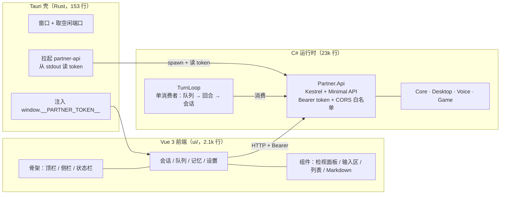

# Partner

本机 Agent 运行时。核心是一条**唯一逻辑会话**上的执行链：输入 → 队列 → Agent turn → 工具/记忆/治理 → 可编辑的会话日志，外加桌面控制、语音双向、游戏反射。

技术栈：**C# / .NET 8 运行时** + **Tauri 2 壳（Rust）** + **Vue 3 前端**。运行时用 C#（Win32 interop、音频、SQLite、MCP 都在这层），界面用 Web 技术（可 headless 测试），壳只负责起窗口和拉起 API。

设计文档在仓库外（随实现同步更新）：

| 文档 | 路径 |
|---|---|
| 目标架构方案（选型/缺口/分期/验收） | `D:/code/Clone/agent-harness-architecture-proposal.md` |
| 现状分析（被引用的源码核验） | `D:/code/Clone/agent-harness-desktop-game-implementation-analysis.md` |

---

## 快速开始

```bash
cd /d/code/Projects/partner
bash scripts/ci.sh
```

依次执行：.NET 编译 → 单元测试 → smoke → 能力门禁 → 前端类型检查/测试/构建 → 壳编译。任一步失败即中断，退出码非 0。

当前基线：**416 个 .NET 单测 + 42 个前端测试全绿 / 104 项 smoke 检查 / 51 项能力 `product-supported`**。

跳过最慢的壳编译：`SKIP_SHELL=1 bash scripts/ci.sh`。

### 环境要求

| 项 | 要求 |
|---|---|
| OS | **Windows**（`Partner.Smoke`/`Desktop`/`Voice` 是 `net8.0-windows10.0.19041.0`） |
| .NET | .NET 8 SDK（当前 8.0.423） |
| Node | Node 22 + npm（前端；**不用 pnpm**，见「坑」） |
| Rust | cargo 1.98+（仅壳需要；缺失时 CI 自动跳过该步） |
| WebView2 | Win10+ 自带（当前 153.x） |
| 硬件 | 真机语音需要麦克风/扬声器；桌面能力需要真实桌面会话 |

---

## 架构



**唯一接缝是 HTTP + Bearer token**：壳不知道任何业务逻辑，前端不引用任何 .NET 程序集，运行时不知道 UI 用什么技术。

### 目录结构

| 路径 | 平台 | 职责 |
|---|---|---|
| `src/Partner.Core` | net8.0 | 会话日志、输入队列、调度、Agent turn、MCP、记忆、治理、契约。**全部逻辑所在** |
| `src/Partner.Desktop` | net8.0-windows | 窗口枚举、GDI 抓帧、输入编组、动作后校验、租约门控 |
| `src/Partner.Voice` | net8.0-windows | 麦克风输入（VAD/分句/流式）、TTS 输出、播放期停听 |
| `src/Partner.Game` | net8.0 | 游戏通用层：反射引擎（槽位锁）、六域上下文、感知去抖分级、进程适配器 |
| `src/Partner.Api` | net8.0 | **UI 的唯一数据源**。Kestrel + Minimal API |
| `src/Partner.Smoke` | net8.0-windows | 端到端 smoke + 能力清单生成 + 门禁 |
| `ui/` | — | Vue 3 + Vite + TS 前端（四视图 + 契约类型 + 测试） |
| `src-tauri/` | Rust | 桌面壳：窗口、sidecar 生命周期、token 注入 |
| `tests/Partner.GameTestServer` | net8.0 | 合成网格游戏，作为**真实子进程**供游戏层闭环验证 |
| `tests/Partner.McpTestServer` | net8.0 | MCP stdio 夹具 |

### 运行期产物

工作区（默认 `%LocalAppData%/Partner/workspace`，壳与手工启动的 API 共用同一个）：

```
<workspace>/
  session/events.jsonl    追加式会话日志（唯一真相，编辑是追加 Edit 事件）
  queue/items.jsonl       队列日志（重启即重放）
  memory/memory.db        SQLite + FTS5 记忆库
  settings/voice.json     语音设置（首次保存时创建）
```

删除工作区即回到初始状态——会话与队列从日志重建，**记忆库是权威存储，删除即丢失**。

---

## 运行

### 完整应用（壳 + API）

```bash
# 开发模式（热更新：改 Vue 立刻生效）
npm --prefix ui install                 # 首次
npx --prefix ui tauri dev               # 起 vite + 壳，壳自动拉起 API

# 生产打包（发布 API → 构建前端 → 编译壳 → 打 NSIS 安装包）
bash scripts/build-shell.sh             # SKIP_INSTALLER=1 则只编译壳
```

**顺序不能颠倒**：壳打包的是 API 的 `publish` 快照，跳过发布就会把上一次的 API 装进去（新端点会在应用里 404）。这条已经封进 `scripts/build-shell.sh`，不要手敲那四步。

壳自己挑空闲端口、自己起 `partner-api`、自己把 token 注入 webview —— **没有需要手填的配置**。

### 只起 API

```bash
dotnet run --project src/Partner.Api -- "D:/tmp/ws" 5280
```

未提供 token 时会生成一个并打印到 stdout（仅此一次）：

```
partner-api listening on http://127.0.0.1:5280
token: <base64url>
```

所有端点都要求 `Authorization: Bearer <token>`，**包括 `/api/health`**：

```bash
TOKEN=<上一步打印的>
curl -H "Authorization: Bearer $TOKEN" http://127.0.0.1:5280/api/session
curl -H "Authorization: Bearer $TOKEN" http://127.0.0.1:5280/api/queue
curl -X POST -H "Authorization: Bearer $TOKEN" http://127.0.0.1:5280/api/projections/rebuild
```

### 只起前端（浏览器里调）

```bash
npm --prefix ui run dev     # http://localhost:5173
```

浏览器控制台里先放 token（前端不接受 URL 参数，避免 token 进历史记录）：

```js
localStorage.setItem('partner.token', '<token>')
localStorage.setItem('partner.port', '5280')
```

CORS 白名单已包含 `http://localhost:5173`。

---

## 消费者（队列 → 回合）

`Core/Hosting/TurnLoop.cs` 是输入队列的**唯一消费者**（设计文档 §2.2）：一次取一项、按到达顺序、跑一个回合、把项落定为 `Done`/`Failed`/`Canceled`。没有它，投递只会停在队列里。

| 不变量 | 实现 |
|---|---|
| 同一时刻只有一项在飞 | 循环体串行 await，从不重叠 |
| 每个被认领的项都会落定 | 异常也走 `CompleteAsync`，不会留下卡在 `Running` 的项 |
| UI 取消能打断执行中的项 | 回合观察队列的 `RunningToken` |
| 停机不切断执行中的回合 | 停止只停「认领」；被打断的项由队列在下次启动时重投 |
| 重投递不重复执行 | 回合已结束（日志里有该 `itemId` 的 `TurnEnd`）的项直接落定，不重跑 |

**配置模型**（不配就没有消费者——不会起一个假回退）：

```bash
export PARTNER_LLM_BASE_URL=http://127.0.0.1:11434/v1   # OpenAI 兼容端点
export PARTNER_LLM_MODEL=qwen3
export PARTNER_LLM_API_KEY=...                          # 可选
```

未配置时 `GET /api/consumer` 返回 `running: false` 与**缺哪个变量**；界面在输入区与状态栏显示「未执行 · 未配置模型：缺少 …」，因为一个不动的队列和一个忙碌的队列在界面上没有区别。

```bash
curl -H "Authorization: Bearer $TOKEN" http://127.0.0.1:5280/api/consumer
# {"running":true,"reason":"运行中","model":"qwen3","stats":{"completed":3,...}}
```

---

## 设置（运行时配置）

`GET /api/settings` 返回五段，字段名与真正消费它们的 option 记录一一对应（`AsrOptions`、`TtsOptions`、`HttpLlmOptions`、`VoiceInputSetting`、`VoiceOutputSetting`），所以对应关系可以并排读出来，不用记映射。

| 段 | 关键项 | 谁在读 |
|---|---|---|
| `input` | 开关、设备、静音阈值、整句/句间间隔、窗口、流式、无标点强切长度 | 语音输入半（**尚无宿主**） |
| `output` | 开关、设备、音色、语速、段间静音、drain、采样率、播放期停听 | 语音输出半（**尚无宿主**） |
| `asr` | 服务地址、模型、语言、连接/读取超时、采样率 | ASR 客户端（**尚无宿主**） |
| `tts` | 服务地址、语言、采样率、克隆参考音频、超时、播放块 | TTS 客户端（**尚无宿主**） |
| `model` | 服务地址、模型名、**API Key**、超时 | **消费者（已接线）** |

### API Key 是只写的

`GET` 只返回 `apiKeySet`，**永不回传密钥值**——这个端点只要持有 token 就能访问，回传即泄露。

写入语义（否则客户端改一个无关字段就会把密钥清掉）：

| 请求里的 `model.apiKey` | 效果 |
|---|---|
| 缺省 / `null` | **保持不变** |
| `""` | 清除 |
| 有值 | 替换 |

### 改设置会立刻生效

`PUT /api/settings` 在**模型段发生变化时重启消费者**（其余段不打断执行中的回合——重启会重置计数，所以是可观测的）。响应带上 `consumer` 状态，界面据此显示「消费中 · 模型名」或「未配置模型：队列不会被执行」。

**优先级**：设置里的 `model` 段 > 环境变量 `PARTNER_LLM_BASE_URL`/`PARTNER_LLM_MODEL` > 不启动。来源会出现在 `/api/consumer` 的 `reason` 里（`运行中（设置）` / `运行中（环境变量）`），免得用户猜为什么改了没反应。

```bash
curl -H "Authorization: Bearer $TOKEN" http://127.0.0.1:5280/api/settings
curl -X PUT -H "Authorization: Bearer $TOKEN" -H "Content-Type: application/json" \
  -d '{"model":{"baseUrl":"http://127.0.0.1:11434/v1","model":"qwen3"}}' \
  http://127.0.0.1:5280/api/settings
```

---

## 调试

### 分层命令

```bash
dotnet build                                                     # .NET 编译
dotnet test                                                      # 全部 .NET 单测
dotnet test --filter "FullyQualifiedName~ReflexEngine"            # 单个测试类
dotnet run --project src/Partner.Smoke                            # 只跑 smoke（须在仓库根）

npm --prefix ui run typecheck                                     # 前端类型检查
npm --prefix ui run test                                          # 前端测试（含对真实 exe 的契约测试）
npm --prefix ui run test -- tests/views.test.ts                   # 单个前端测试文件
npm --prefix ui run build                                         # 前端构建

cargo build --manifest-path src-tauri/Cargo.toml                  # 只编译壳
```

### 测试分层

| 层 | 位置 | 覆盖什么 |
|---|---|---|
| .NET 单测（416） | `tests/` | 各层逻辑：会话/队列/调度/记忆/治理/MCP/桌面/语音/游戏/API（含消费者循环、投递口、模型客户端、设置读写、进程生命周期） |
| smoke（97 检查） | `src/Partner.Smoke` | 端到端：真实进程、真实窗口、真实 HTTP、10 万条检索 P99 |
| 前端契约测试（11） | `ui/tests/api.contract.test.ts` | **拉起真实 `partner-api.exe`**，验证 TS 类型与服务端 JSON 不漂移、鉴权生效、消费者状态、设置全段落与密钥不回传 |
| 前端视图测试（12） | `ui/tests/views.test.ts` | 四个视图的渲染与交互（含设置五张卡片、密钥只写语义、未生效提示） |
| 前端组件测试（18） | `ui/tests/components.test.ts` | 顶栏徽标 / 侧栏 / 状态栏 / 输入区 / 检视面板 / Markdown 渲染与转义 |
| **壳的端到端（20）** | `scripts/e2e-shell.mjs` | 启动**发布版壳**，经 CDP 驱动真实 webview：选中→编辑→保存、切页签、投递一条输入、**在设置页改模型并看消费者起来**、折叠侧栏、切主题、验鉴权、验 sidecar 回收。**不在 CI**（需要桌面会话），按需手动跑 |
| 能力门禁（49） | `capabilities/manifest.baseline.json` | 能力消失或降级即失败 |

### 落盘点

| 现象 | 去哪看 |
|---|---|
| smoke 某检查失败 | 工作区**保留**在开头打印的 `workspace: <path>` |
| API 起不来 | 壳会把它 stderr 的第一行带进 panic 信息；手工跑则直接看终端 |
| 前端请求失败 | 浏览器 DevTools（开发模式）；401 表示 token 不对/过期 |
| 壳里的界面行为 | `node scripts/e2e-shell.mjs` —— WebView2 不把 DOM 暴露给 UIA，CDP 是唯一入口 |
| 壳 panic | 终端输出；`RUST_BACKTRACE=1` 拿完整栈 |

### 各子系统怎么调

| 目标 | 手段 | 前置 |
|---|---|---|
| Core（会话/队列/调度/记忆/治理/MCP） | `dotnet test --filter` 或往 smoke 加检查 | 无 |
| Desktop | smoke 的 desktop 段 | 真实桌面会话 |
| Voice | smoke 走合成路径；真机验证跑壳 | 麦克风/扬声器 |
| Game | smoke 自动拉起 `Partner.GameTestServer`；也可单独跑它喂 JSON 协议 | 无 |
| Api | curl（记得带 token） | 无 |
| 前端 | `npm --prefix ui run dev` + 浏览器 | token 放进 localStorage |

---

## 界面（M13）

规格见 `ui.md`（布局语言、令牌、尺寸策略、验收对照）。实现落在 `ui/src`：

| 区域 | 组件 | 关键约束 |
|---|---|---|
| ① 顶栏 | `components/TopBar.vue` | 品牌 / 视图名 / 面包屑 / **队列徽标** / 主题 / 侧栏折叠。内容撑高，无固定高度 |
| ② 侧栏 | `components/SideBar.vue` | 新建查询 / 视图导航 / 重建投影。轨道 `minmax(0,var(--sidebar))`，折叠后只剩图标 |
| ③ 内容区 | `views/*.vue` + `components/{EventList,QueueList,MemoryList,Inspector}.vue` | 主区用 `--measure`（68ch）限行宽；会话与记忆是 master–detail |
| ④ 输入区 | `components/Composer.vue` | 仅会话视图；状态条 + 输入 + 来源选择。状态条与顶栏徽标**同源** |
| ⑤ 状态栏 | `components/StatusBar.vue` | 连接态（401 单独措辞）+ 阻塞态 + 版本 |

**三条规范怎么在画面上成立**：

| 规范 | 视觉证据 |
|---|---|
| UI 不持状态 | 每个视图都有显式「刷新」；写操作后重新拉取，界面上没有乐观更新 |
| 编辑可撤销 | 列表行**常显** `已编辑 N 次 · 原文：…`；检视面板常驻修订历史，每条带「恢复此版本」 |
| 阻塞可见 | 顶栏徽标 `队列 N · 失败 M · 执行中 X`（失败转 error 色），不切页也看得到；5s 轮询 |

**尺寸纪律**：令牌里只有视觉标量（圆角/间距/字号/阴影，全 `rem`）。布局尺寸一律就地算——内容撑高、`minmax(0,1fr)` 弹性轨道、`clamp()` 比例。自适应用 `@container`（`.body` 为容器），**不写 px 断点**：窄容器检视面板转浮层、再窄侧栏只剩图标、最窄顶栏丢次要元素。暗色只重写令牌，组件不改。

### 与 `ui.md` 的偏差（实现按真实后端能力落地）

| 规格处 | 偏差 | 原因 |
|---|---|---|
| §6 输入区「角色：用户 ▾」 | **未实现** | `InputItem` 只有 `Source`（voice/text/schedule）与 `Payload`，没有「角色」字段。造一个纯前端下拉就是假控件 |
| §6「发送后事件流顶部出现新行」 | 改为「已入队 · 等待执行」 | **队列没有消费者宿主**（`TakeAsync` 只被 smoke 调用）。投递的真实效果是入队，会话要等消费者跑完才有新行 |
| §5.6 设置第四组「记忆」 | 未实现 | `VoiceSettings` 里没有记忆相关字段（`injectionTokenLimit` 只在设计文档里，未进 API） |
| §4 侧栏「用量 / 配额」 | 未实现 | 没有用量接口。宁可少一项，也不放一个永远显示「—」的标签 |

---

## 能力门禁

规则：**能力等级由实跑的 smoke 检查推导，配置永远不能决定**。门禁与基线比对：

- 能力**消失或降级** → `GATE FAIL`，退出码 1
- 能力**新增** → 提示 `update the baseline to lock it in`（不失败）

加一条 smoke 检查：

1. 在 `src/Partner.Smoke/Program.cs` 的 `RunAsync` 对应段加 `Check("模块: 行为", 条件, 细节)`
2. 把检查名加进同文件 `Capabilities` 表对应模块
3. `dotnet run --project src/Partner.Smoke -- --update-baseline capabilities/manifest.baseline.json`
4. 此后 CI 自动守住它

---

## 模块 → 源码

| 模块 | 主要位置 |
|---|---|
| M1 会话 | `Core/Sessions/`（`JsonlSessionStore`、`SessionEvent`、`SessionView`）、`Core/Storage/` |
| M2 队列 | `Core/Queue/`（`JsonlInputQueue`、`InputItem`） |
| M3 Agent | `Core/Agent/`（`AgentTurnRunner`、`Hooks/`、`Llm/`（含 `HttpLlmClient`）、`Tools/`、`Governance/`、`Mcp/`、`Skills/`）、`Core/Hosting/TurnLoop.cs` |
| M4 调度 | `Core/Scheduler/`（`JsonlScheduler`、`CronExpression`） |
| M5 记忆 | `Core/Memory/`（`MemoryStore`、`MemorySchema`、`MemoryScorer`、`Embeddings`、`TokenCounter`） |
| M6 治理 | `Core/Agent/Governance/`、`Core/Agent/Tools/`（`ToolGovernance`、`InMemoryToolRegistry`） |
| M7 MCP | `Core/Agent/Mcp/` |
| M8 Skills | `Core/Agent/Skills/` |
| M9 桌面 | `Desktop/`（`Windows/`、`Capture/`、`Input/`、`Interop/`、`Perception/`、`DesktopAutomation`） |
| M10/M11 语音 | `Voice/`（`Audio/`、`Asr/`、`Perception/`、`Tts/`、`Playback/`、`Settings/`） |
| M12 游戏 | `Game/`（`Reflex/`、`Perception/`、`Adapter/`） |
| M13 UI | `Api/ApiHost.cs`、`Api/Auth/TokenAuth.cs`、`Api/Endpoints/ViewEndpoints.cs`、`ui/src/`（骨架 + `components/` + `views/`）、`src-tauri/src/lib.rs` |

---

## 已实现能力（49）

括号内是支撑该能力的 smoke 检查数。

| 模块 | 能力 |
|---|---|
| M1 会话 | `session.append_only_log`(6)、`session.editable_projection`(5) |
| M2 队列 | `queue.single_fifo`(5)、`queue.idempotent_restart`(3)、`queue.crash_recovery`(2) |
| M3 Agent | `agent.turn_state_machine`(5)、`agent.tool_loop`(1)、`agent.hook_phases`(1)、`agent.queue_consumer`(4) |
| M4 调度 | `scheduler.durable_delivery`(3)、`scheduler.receipt_dedup`(1)、`scheduler.failure_retention`(2)、`scheduler.schedule_to_turn`(3) |
| M5 记忆 | `memory.recall_pipeline`(2)、`memory.offline_degradation`(1)、`memory.privacy_delete`(1)、`memory.promotion`(1)、`memory.injection_budget`(1)、`memory.scale_p99`(1) |
| M6 治理 | `governance.policy_decisions`(2)、`governance.fail_closed`(1)、`governance.target_param_rules`(1)、`governance.enforced_in_turn`(1) |
| M7 MCP | `mcp.stdio_lifecycle`(2)、`mcp.tool_bridge`(1)、`mcp.governed_turn`(1) |
| M8 Skills | `skills.workspace_scan`(1)、`skills.injection`(2) |
| M9 桌面 | `desktop.window_enumeration`(1)、`desktop.gdi_capture`(1)、`desktop.post_action_verification`(1)、`desktop.lease_gating`(3)、`desktop.input_marshalling`(1) |
| M10/M11 语音 | `voice.utterance_to_queue`(2)、`voice.asr_contract`(1)、`voice.threshold_guard`(1)、`voice.playback_gate`(4)、`voice.failure_visibility`(2)、`voice.output_ordering`(1)、`voice.output_switch`(1) |
| M12 游戏 | `game.process_adapter`(3)、`game.reflex_loop`(2)、`game.sensor_debounce`(1)、`game.latency_monitor`(1) |
| M13 UI | `ui.auth`(2)、`ui.composer`(1)、`ui.session_view`(1)、`ui.memory_view`(2)、`ui.queue_view`(1)、`ui.settings`(1)、`ui.projection_rebuild`(1)、`settings.*`(2) |

---

## 必须知道的坑

1. **API 的 token 是 fail-closed 的**：中间件保护**每一个**端点（含 `/api/health`），新增端点自动受保护。token 走环境变量 `PARTNER_API_TOKEN`，**不走命令行**（argv 全机可读）。
2. **CORS 顺序**：`UseCors()` 必须在 `UseTokenAuth()` **之前**——预检请求不带凭据，否则会被 401 挡掉。白名单是枚举的 Tauri 来源，不是 `*`。
3. **前端用 npm，不要用 pnpm**：pnpm 11 默认拦截依赖的构建脚本，esbuild 装不上（`ERR_PNPM_IGNORED_BUILDS`），vite 直接不可用。
4. **壳的资源必须是整目录**：`partner-api` 是 .NET apphost，需要同目录的 `.dll`；Tauri 的 `resources` 若配成单文件，dev 下会得到"找不到 partner-api.dll"。
5. **CI 只能在 Windows 跑**（见「环境要求」）。
6. **改能力要更新基线**，否则下次门禁提示 `update the baseline to lock it in`。
7. **改完 API 必须重新 `dotnet publish` 再打包**：壳打包的是 publish 快照，不是 Debug 输出。dev 下壳优先用 Debug 输出（改完 `dotnet build` 即生效），release 下只用打包目录。
8. **`cargo build --release` 需要 `custom-protocol` feature**（已在 `Cargo.toml` 里设为 default）。少了它，release 二进制仍指向 `devUrl`，窗口里是 `ERR_CONNECTION_REFUSED`。`tauri dev` 用 `--no-default-features` 走 dev server，这是设计如此。
9. **本仓库尚未纳入版本控制**（没有 `.git`）。改动没有回滚点，建议先 `git init` 并提交当前状态。

---

## 未做 / 未验证

诚实边界，避免误判完成度：

| 项 | 状态 |
|---|---|
| M9 L2（UIA 语义树 / OCR） | 未做。当前桌面感知只到窗口枚举 + GDI 抓帧 |
| 游戏商业目标 | 未接入。当前目标是自研合成网格游戏，用于证明闭环而非证明某个具体游戏 |
| 游戏浏览器/CDP 通道 | 未验证（环境受阻）。进程边界适配器已跑通并实测延迟 |
| 反射层真实节奏 | 未实测。单测与 smoke 都是受控节拍，真实游戏里的信号节奏仍需一次实测 |
| 壳的交互验证 | ✅ 已覆盖：`node scripts/e2e-shell.mjs`（9 项，CDP 驱动真实 webview）。**不在 CI**——需要桌面会话，且 CI 无法断言窗口 |
| WebView2 的 UI Automation | UIA 看不到 DOM（实测只暴露 16 个元素）；CDP 可以，e2e 就是走 CDP |
| 生产打包 | ✅ 已跑：`Partner_0.1.0_x64-setup.exe` **34.7 MB**（含 101 MB 自包含 API，NSIS 压缩）。**未在干净机器上安装验证** |
| 记忆页签空态 | API 按设计没有「新建记忆」端点（写入来自 Agent），因此该页签在空工作区是空列表 |
| 消费者里的工具 / MCP | **未接入**：宿主的消费者用空工具表跑回合，所以模型只能对话，不能调工具。MCP 客户端（`Core/Agent/Mcp/`）已在 smoke 里验证，但没接进宿主 |
| 真实模型供应商往返 | **未验证**：`HttpLlmClient` 用桩 handler 验了线格式，用真 TCP 假端点验了完整往返；没有对真实供应商（OpenAI/Ollama 等）跑过 |
| ASR / TTS 设置没有消费者 | **未接线**：设置能存、能校验、能回读，但**没有语音宿主**在读它们（`VoiceInputHalf`/`VoiceOutputHalf` 只在 smoke 里被驱动）。`model` 段是真接线的，其余三段目前只是配置面 |
| 回合流式输出 | 未做：一次补全一次返回，界面不做逐字刷新 |
| Phase 5c 帧级闭环 | 未做 |
