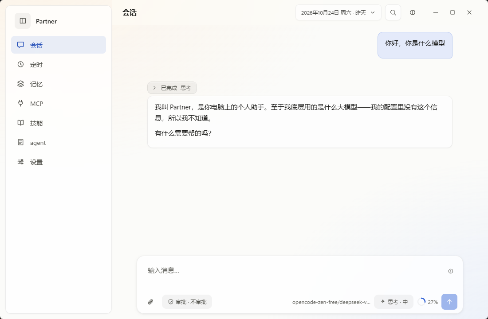
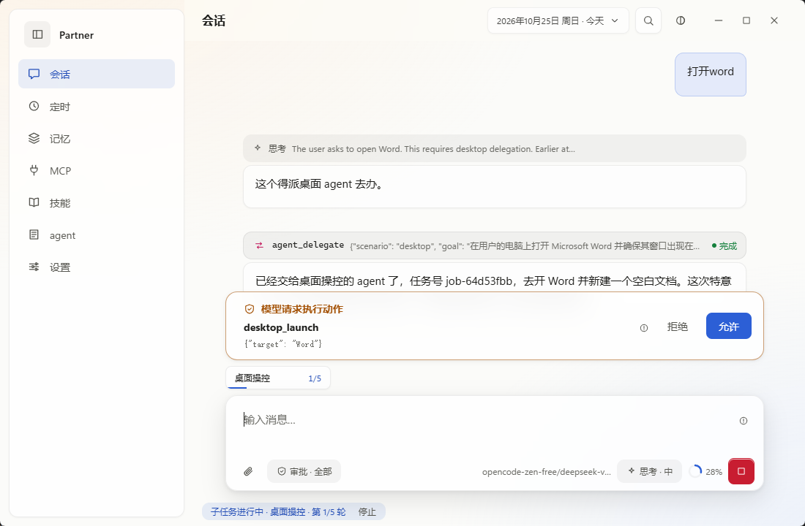
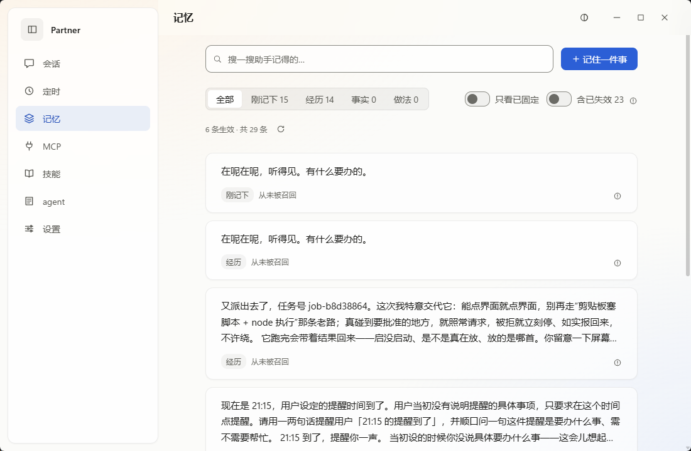
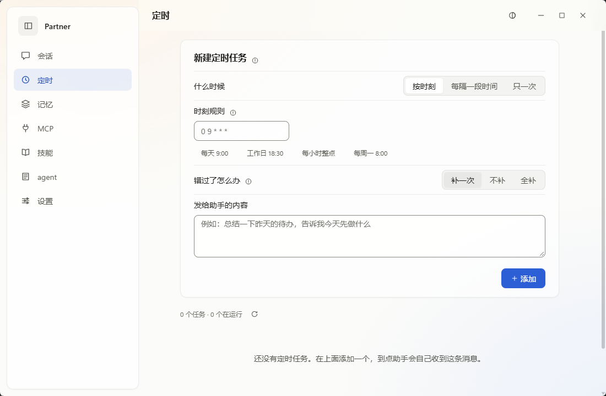
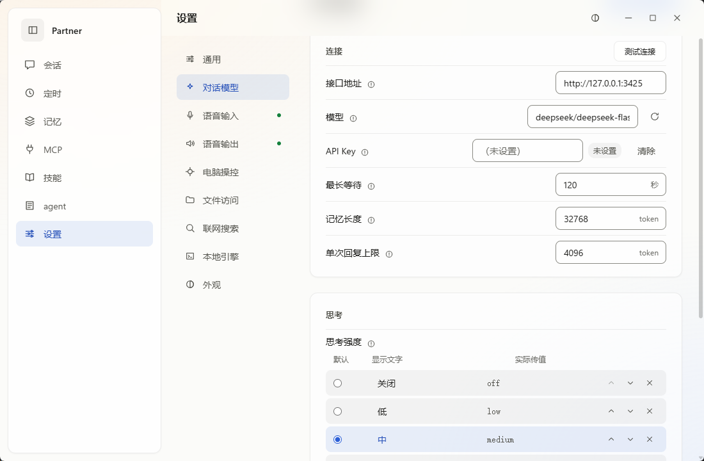
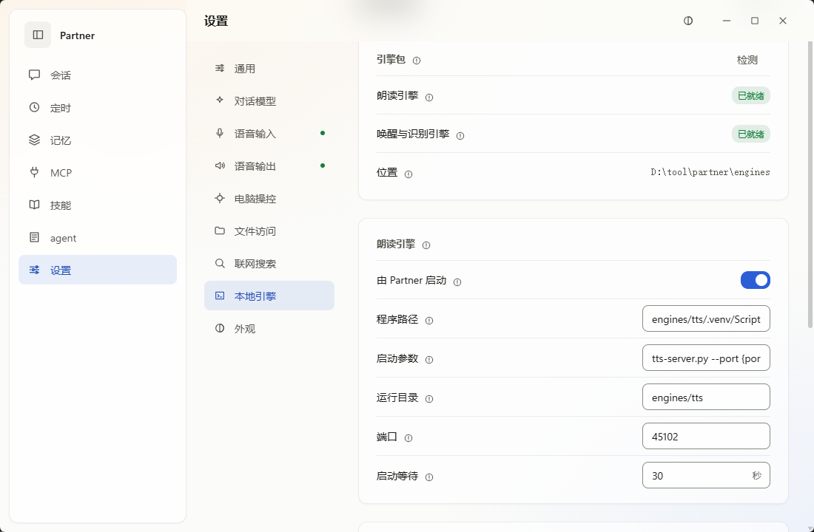

<div align="center">

# Partner

### 开箱即用的单会话 Windows 桌面 AI 助手

**一条连续的会话，打字或开口都行；带记忆、定时、MCP、Skills，还有能操作桌面的子 agent，动手前先问你。**

[](https://github.com/Jaspersol/partner/releases)
[](https://github.com/Jaspersol/partner/releases)
[](https://tauri.app/)
[](LICENSE)
[](https://github.com/Jaspersol/partner/releases/latest)

**简体中文** | [繁體中文](README.zh-TW.md) | [English](README.md)

**[下载安装](#下载安装) · [快速开始](#快速开始) · [功能](#功能) · [常见问题](#常见问题) · [文档](doc/README.md)**

</div>

## 为什么选择 Partner？

多数 agent 工具要你管理会话、给每个对话挑模型、一字一句地打字。Partner 去掉这些琐事：只有一条会话，你像跟人说话一样跟它交流，用键盘或语音都可以。它连接你配置的 OpenAI 兼容或 Anthropic 端点。

- **一条会话，无需管理** — 打字、语音、定时任务和子 agent 回报都写进同一条日志，按到达顺序执行。不用新建、命名、切换或清理会话
- **语音：本地或自备** — 唤醒词、断句、识别、逐句朗读、语音审批。可以下载本地引擎，也可以接已有的 ASR/TTS 服务
- **操作桌面，先批准** — 需要操作窗口或读文件的请求交给后台子 agent。默认每个动作都先征求你同意，无人应答按拒绝处理
- **看得见的记忆** — 你提过的偏好存在本地数据库里，每条记录都可以查看、调整层级、置顶和删除
- **定时、MCP 与 Skills** — 按 cron、固定间隔或指定时间执行一句话；接入 stdio MCP 服务器；用 `SKILL.md` 教模型一套做法
- **默认只在本机** — 本地 API 只监听 `127.0.0.1`，请求必须带启动时生成的令牌。对话内容只发给你配置的模型端点
- **原生 Windows 应用** — 基于 Tauri 2 和 .NET 10 后端，安装包自带 .NET 运行时

## 截图

<table>
<tr>
<td align="center" width="50%"><br>主界面</td>
<td align="center" width="50%"><br>操作前批准</td>
</tr>
<tr>
<td align="center"><br>记忆</td>
<td align="center"><br>定时任务</td>
</tr>
<tr>
<td align="center"><br>模型设置</td>
<td align="center"><br>本地引擎</td>
</tr>
</table>

## 下载安装

### 系统要求

| 项 | 要求 |
|---|---|
| 系统 | Windows 10 2004 及以上，x64 |
| WebView2 | Windows 10/11 自带 |
| 模型 | 一个 OpenAI 兼容或 Anthropic 端点 |
| 语音（可选） | 麦克风和扬声器。本地朗读需要约 1.9 GB 显存，唤醒和识别只用 CPU |

不支持 macOS 和 Linux。桌面操控和音频直接调用 Win32 API。

### Windows 用户

1. 从 [Releases](https://github.com/Jaspersol/partner/releases/latest) 下载 `Partner_<版本>_x64-setup.exe`。
2. 运行安装程序，装到当前用户目录，不需要管理员权限。
3. 安装包没有代码签名，SmartScreen 拦截时点“更多信息 → 仍要运行”。可以用同一 release 里的 `SHA256SUMS.txt` 或 `<安装包名>.exe.sha256` 校验文件。

### 更新

“设置 → 通用 → 检查更新”。检查以 GitHub REST API 为主，遇到配额用尽、网络不通或 release 缺少 API 校验文件时自动切到直链下载兜底；应用从可用的路径下载新安装包，核对 SHA-256 后启动安装程序并退出。

## 快速开始

### 基本用法

1. **配置模型**：打开“设置 → 对话模型”，选接口格式（OpenAI 兼容或 Anthropic），填服务地址，从下拉列表选模型，需要时填 API Key。保存即生效
2. **发消息**：在主界面输入框输入。模型没配好时，消息留在队列里，输入框会提示缺什么
3. **开启语音（可选）**：在“设置 → 本地引擎”下载引擎，或在“设置 → 语音输入 / 语音输出”填已有服务的地址。见[语音功能](doc/voice.md)
4. **开启桌面操控（可选）**：打开“设置 → 电脑操控 → 允许助手操作电脑”，按提示启用“桌面操控”子 agent。每个动作都要你在输入框上方的提示里点“允许”

模型也可以用环境变量配置，设置页的值优先：

```bash
export PARTNER_LLM_BASE_URL=http://127.0.0.1:11434/v1
export PARTNER_LLM_MODEL=qwen3
export PARTNER_LLM_API_KEY=...       # 可选
export PARTNER_LLM_PROTOCOL=openai   # 可选：openai / anthropic
```

### 记忆、定时、MCP 与 Skills

- **记忆**：点击侧边栏“记忆” → 查看记录、按层级筛选、置顶、删除，或手写一条
- **定时**：点击侧边栏“定时” → 选 cron、固定间隔或指定时间 → 填要发送的那句话
- **MCP**：点击侧边栏“MCP” → 打开总开关 → 添加服务器（名称、命令、参数）
- **Skills**：点击侧边栏“技能” → 上传 `SKILL.md`（或压缩后的技能文件夹），或在应用里新建
- **Agent**：点击侧边栏“agent”，编辑主 agent 和各子 agent 的提示词，也可以给子 agent 单独指定模型

> **注意**：没配置模型时不会丢消息。各来源的消息都留在队列里，等模型可用后再执行。

每项功能的详细说明见**[文档目录](doc/README.md)**。

## 功能

### 功能一览

| 功能 | 说明 | 文档 |
|---|---|---|
| 单会话 | 打字、语音、定时和子 agent 回报共用一条日志，界面按日期分页 | [单会话](#单会话) |
| 记忆 | 记下你提过的偏好，之后的回合可以调用 | [memory](doc/memory.md) |
| 子 agent | 在后台执行桌面和读文件任务并回报 | [sub-agents](doc/sub-agents.md) |
| 桌面操控 | 列出窗口、点击控件、输入文字、启动程序 | [desktop-control](doc/desktop-control.md) |
| 语音 | 唤醒词、识别、朗读和语音审批 | [voice](doc/voice.md) |
| 定时 | cron、固定间隔或指定时间 | [schedules](doc/schedules.md) |
| MCP | 接入 stdio MCP 服务器 | [mcp](doc/mcp.md) |
| Skills | 用 `SKILL.md` 描述一套做法 | [skills](doc/skills.md) |

### 单会话

- **一条日志** — 打字、语音、定时任务和子 agent 回报排在同一个队列里，按到达顺序执行
- **无需维护** — 不用新建、命名、切换或清理会话，也不用记某件事在哪个会话里聊过
- **适合语音** — 开口前不需要先选会话
- **按日期分页** — 日期选择器只决定看哪一天。停在旧日期时发的消息照样追加到日志末尾，没有消息的日期不显示。日期按本机时区划分，零点时如果回合还没结束，界面等它结束再切到新的一天

### 记忆

- **自动记录** — 每个回合结束时提炼。每个回合开始前检索相关记忆并加入系统提示，上限约 5000 token
- **四个层级** — 刚记下、经历、事实、做法。同层级里新记录与旧记录冲突时，旧记录被标为失效并记下被谁替换，但不删除；三个月没被调用的记录降一级
- **由你调整** — 记忆页列出所有记录，包括已失效的。可以在层级间移动，置顶后不会被降级或清理，也可以手写或删除任意一条
- **中文检索** — 单独的二元分词全文索引，中文搜索不会退化成全表扫描
- **本地并有备份** — 存在 SQLite 中，至少每天复制一次到 `memory/backups/`，保留最近 7 份

### 子 agent 与桌面操控

- **派活** — 主 agent 只对话和派活。子 agent 在后台执行，结果作为一条新输入回报，主 agent 再转述给你
- **两个场景** — `desktop`（内置）和 `file-read`（只读，默认关闭，限定在目录白名单内）
- **重试** — 一个任务默认最多 5 轮（1–10），总时限 15 分钟。成功必须有子 agent 给出的证据；所有轮次都失败时，主 agent 如实回报失败，不会声称成功
- **先找控件再动手** — 动作针对控件 ID，不靠猜坐标。按钮、列表项、复选框通过 UI Automation 直接调用，不必把窗口提到前台
- **审批级别** — 在输入区切换“不审批”“危险指令审批”“全部审批”（默认）。默认级别下，执行命令、启动程序和写剪贴板每次都问
- **安全护栏** — 按键和输入要求目标窗口在前台，坐标越界直接拒绝而不是夹到边界，结果把“已注入输入”和“屏幕是否变化”分开报告
- **窗口白名单** — 可以限定只操作哪些窗口。截图需要打开“能看图片”的模型

### 语音

- **流程** — 麦克风 → 按停顿断句 → ASR → 队列 → 回合 → 会话；新的助手回复 → 断句 → TTS → 按序播放
- **本地引擎或自备服务** — KWS + ASR（sherpa-onnx + SenseVoice，约 380 MB，纯 CPU）和 TTS（Qwen3-TTS 1.7B GGUF，约 3.0 GB，约 1.9 GB 显存）分别下载，断线后续传。也可以填已有的 ASR/TTS 服务地址
- **唤醒词** — 逗号分隔的多个词，可设置唤醒后的等待时长，可选唤醒提示音
- **说话控制** — 助手说话时可关闭麦克风，也可以用说话打断它（持续约半秒；没有回声消除，建议戴耳机）
- **语音审批** — 审批请求会被朗读，可以说“批准执行”或“拒绝执行”应答。原始参数不会被读出，120 秒无人应答按拒绝处理

### 定时、MCP 与 Skills

- **定时** — 五段 cron（本机时区）、1 分钟到 1 年的固定间隔，或一次性的未来时间；最多 100 个任务。到点后内容作为普通消息进队列。助手也可以创建定时任务，创建和删除遵循你的审批级别
- **MCP** — 默认关闭。工具名带 `mcp_{server}_` 前缀，每次调用默认都要批准，可以按服务器打开“跳过审批”。某个服务器启动失败不影响其他服务器
- **Skills** — 一个带 `SKILL.md`（`name`、`description` 和步骤）的文件夹。启用的技能会列在模型提示里，最多 50 个，下一回合生效，无需重启

### 系统与平台

- **模型协议** — 支持 OpenAI 兼容和 Anthropic Messages 端点，API Key 只写不读
- **联网搜索** — 默认开启，搜索时查询语句会发给第三方搜索引擎，可以在“设置 → 联网搜索”关闭
- **自动更新** — 下载新安装包，核对 SHA-256，重启进入新版本
- **崩溃恢复** — 会话和队列是只追加的 `.jsonl` 文件，可以重建；崩溃后未完成的子 agent 任务会在下次启动时收到“被中断”的回报
- **多语言** — 界面支持简体中文、繁体中文和英文

## 常见问题

<details>
<summary><strong>必须下载语音引擎吗？</strong></summary>

不用，只打字用不到。唤醒和识别引擎约 380 MB，纯 CPU；朗读引擎约 3 GB，需要显卡。也可以都不下，直接接已有的 ASR/TTS 服务。

</details>

<details>
<summary><strong>为什么朗读引擎分成几个文件？</strong></summary>

GitHub 单个 release 附件上限 2 GiB，朗读引擎约 3 GB。应用按顺序下载到同一目录并校验 SHA-256，断线后续传。

</details>

<details>
<summary><strong>数据存在哪里？</strong></summary>

默认在 `%LocalAppData%/Partner/workspace`：

- **会话日志**：`session/events.jsonl`
- **队列**：`queue/items.jsonl`
- **记忆库**：`memory/memory.db`（SQLite），备份在 `memory/backups/`
- **定时任务**：`scheduler/`
- **技能**：`skills/`
- **附件**：`media/`

会话和队列可以从对应的 `.jsonl` 重建。`memory.db` 至少每天复制一次到 `memory/backups/`（启动时最新备份过期就补一份，每日维护前也会检查），保留最近 7 份；删除原库只丢失上次备份之后的记忆。

</details>

<details>
<summary><strong>日志在哪里？</strong></summary>

外壳把 API 的 stdout/stderr 和自身诊断写入 `%LocalAppData%/Partner/partner-api.log`，超过 10 MB 轮转并保留一份旧日志。

</details>

<details>
<summary><strong>会把我的数据传到别处吗？</strong></summary>

对话内容发给你配置的模型端点。“联网搜索”默认开启，搜索时查询语句会发给第三方搜索引擎，可以在“设置 → 联网搜索”关闭。应用还会访问 GitHub 检查更新和下载语音引擎。本地 API 只监听 `127.0.0.1`，请求必须带启动时生成的令牌。

</details>

<details>
<summary><strong>助手为什么总是请求批准？</strong></summary>

桌面操控的默认级别是“全部审批”，每个界面动作都要问，无人应答按拒绝处理。可以在聊天输入区的下拉菜单里切换级别。“危险指令审批”只在执行命令、启动程序和写剪贴板时询问。默认级别下，一次批准可让同一窗口在 10 分钟内再连续执行 10 步。MCP 工具不受这个级别约束，而是用各服务器自己的“跳过审批”列表。

</details>

<details>
<summary><strong>应用关闭期间，定时任务为什么没有执行？</strong></summary>

应用关闭期间错过的时间点会被跳过，暂停期间错过的也一样，不会补发。定时任务没有编辑功能：要改规则或内容，删除后重新创建。

</details>

<details>
<summary><strong>支持 macOS / Linux 吗？</strong></summary>

不支持。桌面操控和音频直接调用 Win32 API，换系统需要重写这两部分。

</details>

更多问题见[文档目录](doc/README.md)。

## 从源码构建

需要 .NET 10 SDK、Node 22 + npm（不要用 pnpm，esbuild 会装不上）、Rust（cargo 1.98+）。

```bash
npm --prefix ui install          # 首次
npx --prefix ui tauri dev        # 开发模式：启动前端和桌面壳，壳会拉起 API
bash scripts/build-shell.sh      # 打 NSIS 安装包
bash scripts/ci.sh               # 全量检查；SKIP_SHELL=1 跳过壳编译
```

调试方式和单独启动 API / 前端见[开发与调试](doc/development.md)，发版见[发布流程](doc/release.md)。

### 项目结构

| 路径 | 内容 |
|---|---|
| `src/Partner.Core` | 会话、队列、agent 回合、记忆、调度、MCP、Skills、治理 |
| `src/Partner.Desktop` | 窗口枚举、截图、输入注入、动作校验 |
| `src/Partner.Voice` | 麦克风输入、断句、ASR/TTS 客户端、播放 |
| `src/Partner.Api` | 本地 HTTP API、队列消费者、语音宿主、本地引擎管理 |
| `ui/` | Vue 3 前端，界面支持简中、繁中、英文 |
| `src-tauri/` | Tauri 2 桌面壳 |
| `engines/` | 本地语音引擎的服务脚本，运行时和模型不进 git |
| `scripts/` | CI、打包、引擎安装脚本 |

## 参与贡献

欢迎提 issue 和建议。较大的改动请先开 issue 讨论方案。提 PR 前请在 Windows 上跑通 `bash scripts/ci.sh`；`master` 只接受 PR 合入。

**技术栈**：C# / .NET 10 · Vue 3 · TypeScript · Tauri 2 · SQLite

## Star History

[](https://www.star-history.com/#Jaspersol/partner&Date)

## 许可

代码使用 [MIT](LICENSE) 许可。语音引擎的运行时、模型权重和音色锚点不在本仓库，各自遵循 [THIRD-PARTY-NOTICES.md](THIRD-PARTY-NOTICES.md) 列出的许可（Apache-2.0、FunASR MODEL_LICENSE 等），不受 MIT 覆盖。
