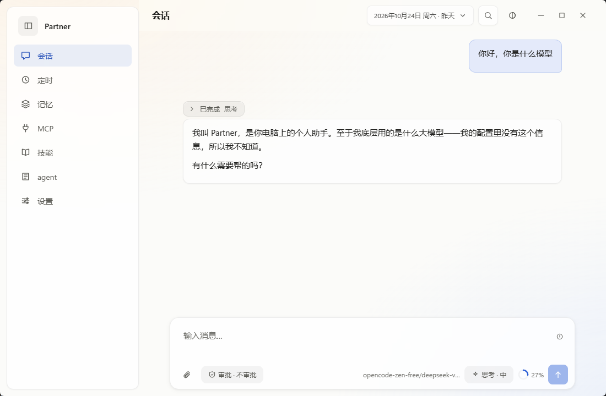
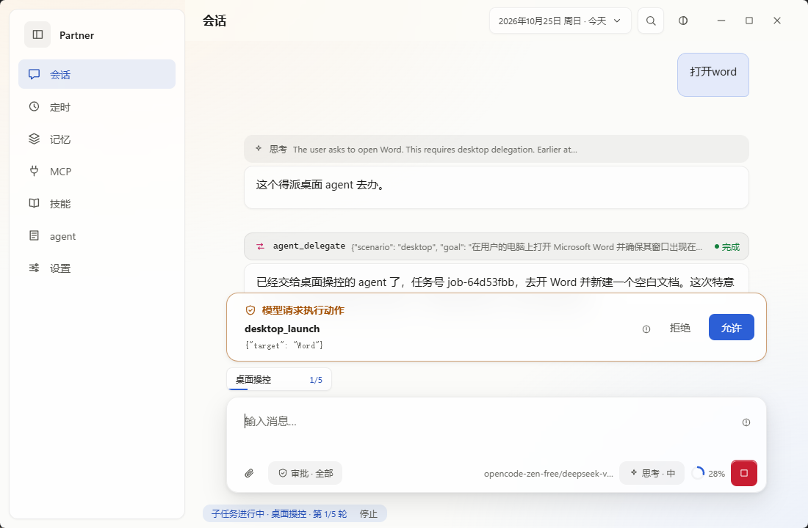
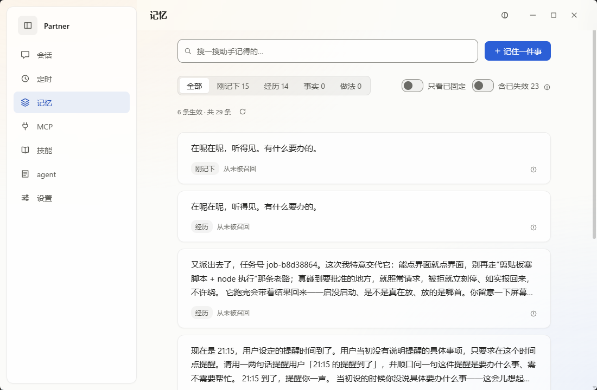
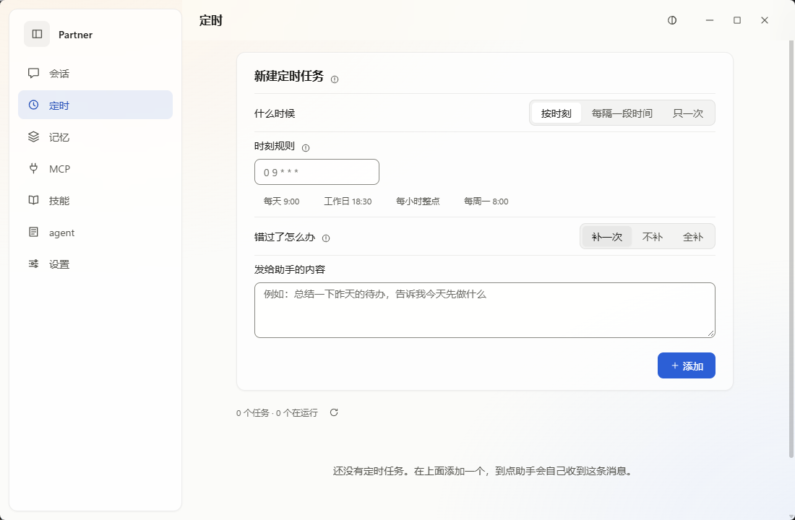
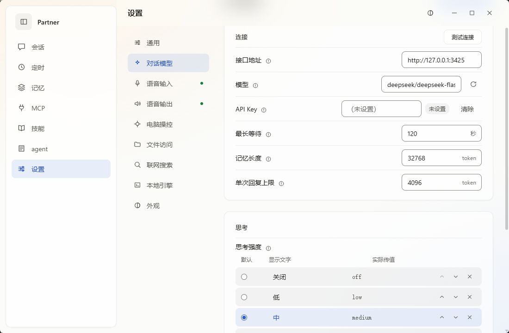
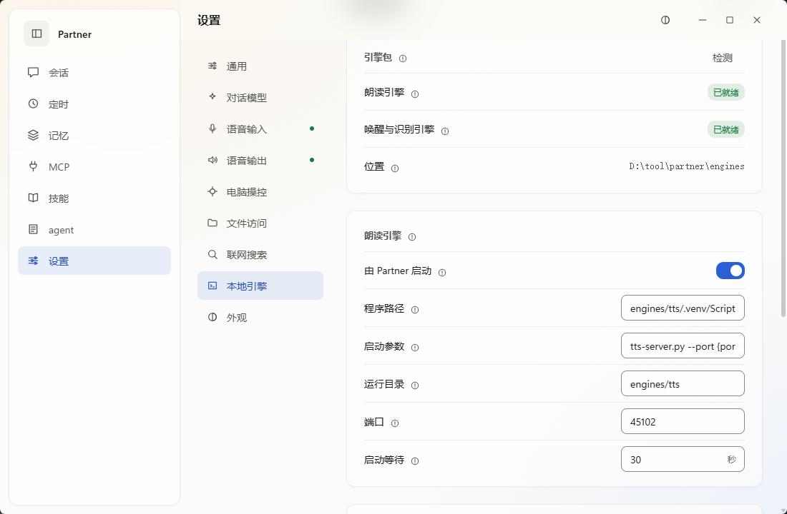

<div align="center">

# Partner

### 开箱即用的 Windows 单会话桌面 AI 助手

**Partner 把对话、语音、记忆、定时任务、MCP 和 Skills 放进一条持续的会话里。它还可以通过带权限审批的子 agent 操作桌面，并提供兼容 OpenAI/Anthropic 的本地服务，让游戏 AI mod、插件和其他 agent 接入你的 Partner，按需使用相关记忆并将交互总结写回主记忆。**

[](https://github.com/Jaspersol/partner/releases)
[](https://github.com/Jaspersol/partner/releases)
[](https://tauri.app/)
[](LICENSE)
[](https://github.com/Jaspersol/partner/releases/latest)

**简体中文** | [繁體中文](README.zh-TW.md) | [English](README.md)

**[下载安装](#下载安装) · [快速开始](#快速开始) · [功能特性](#功能特性) · [常见问题](#常见问题) · [文档](doc/README.md)**

</div>

## 为什么选择 Partner？

很多 agent 工具需要用户反复创建和整理会话、为不同对话挑选模型，还主要依赖键盘输入。Partner 把这些步骤简化为一条持续的会话：你可以打字，也可以直接说话；模型则连接到你配置的 OpenAI 兼容或 Anthropic 服务。

- **对话始终在同一处** — 文字、语音、定时任务和子 agent 的结果都会进入同一条日志，并按到达顺序处理，不必创建、命名、切换或清理会话。
- **语音引擎任选** — 支持唤醒词、停顿断句、语音识别、逐句朗读和语音审批。可使用本地引擎，也能连接已有的 ASR/TTS 服务。
- **桌面操作由你把关** — 窗口操作和文件读取交给后台子 agent。每种动作是否需要审批由审批级别决定；无人回应审批请求时，操作会被拒绝。
- **记忆可以检查和管理** — 提取出的偏好保存在本地数据库。你可以查看每条记录、修改所属层级、置顶或删除。
- **让外部工具接入 Partner** — 游戏 AI mod、编辑器或浏览器插件、其他 agent 框架可以通过 OpenAI/Anthropic 兼容的本地端点接入。请求会带上相关记忆，交互内容的总结也可以写回主记忆。
- **任务与能力可扩展** — 支持 cron、固定间隔和指定时间触发的定时任务，支持连接 stdio MCP 服务器，也可以通过 `SKILL.md` 为模型提供一套具体的操作方法。
- **默认仅本机访问** — 本地 API 绑定 `127.0.0.1`，每个请求都需要携带应用启动时生成的令牌。对话内容会发送到你配置的模型端点。
- **原生 Windows 桌面应用** — 前端使用 Tauri 2，后端基于 .NET 10；安装包已包含 .NET 运行时。

## 截图

<table>
<tr>
<td align="center" width="50%"><br>主界面</td>
<td align="center" width="50%"><br>操作前批准</td>
</tr>
<tr>
<td align="center"><br>记忆</td>
<td align="center"><br>定时任务</td>
</tr>
<tr>
<td align="center"><br>模型设置</td>
<td align="center"><br>本地引擎</td>
</tr>
</table>

## 下载安装

### 系统要求

| 项目 | 要求 |
|---|---|
| 操作系统 | Windows 10 2004 或更新版本，x64 |
| WebView2 | Windows 10/11 已内置 |
| 模型服务 | 一个 OpenAI 兼容或 Anthropic 端点 |
| 语音（可选） | 麦克风和扬声器。本地 TTS 约需 1.9 GB 显存；唤醒词和语音识别使用 CPU |

目前不支持 macOS 和 Linux，因为桌面控制与音频功能直接使用 Win32 API。

### 在 Windows 上安装

1. 从 [Releases 页面](https://github.com/Jaspersol/partner/releases/latest)下载 `Partner_<版本>_x64-setup.exe`。
2. 运行安装程序并安装到当前用户目录；安装不需要管理员权限。
3. 安装包尚未进行代码签名。若 SmartScreen 阻止运行，选择“更多信息 → 仍要运行”。可用同一 release 中的 `SHA256SUMS.txt` 或 `<安装包名>.exe.sha256` 检验下载文件。

### 更新应用

在“设置 → 通用 → 检查更新”中启动更新检查。应用首先使用 GitHub REST API；如果 API 配额耗尽、网络不可用，或 release 没有 API 校验文件，就会改用直链下载。安装包下载后会先核对 SHA-256，再启动安装程序并退出当前应用。

## 快速开始

### 初次使用

1. **设置模型**：进入“设置 → 对话模型”，选择 OpenAI 兼容或 Anthropic 接口格式，填写服务地址并从列表选择模型；如服务需要，再输入 API Key。保存后配置立即生效。
2. **发送消息**：在主界面的输入框中输入内容。模型尚未配置时，消息不会丢弃，而是留在队列中，输入框也会说明缺少哪些配置。
3. **配置语音（可选）**：可以在“设置 → 本地引擎”下载引擎，也可以在“设置 → 语音输入 / 语音输出”填写已有服务的地址。具体说明见[语音功能](doc/voice.md)。
4. **启用桌面控制（可选）**：打开“设置 → 电脑操控 → 允许助手操作电脑”，按提示配置“桌面操控”子 agent。需要审批时，在输入框上方的审批提示中选择“允许”。

也可以通过环境变量设置模型连接信息。设置页面中的配置优先级更高：

```bash
export PARTNER_LLM_BASE_URL=http://127.0.0.1:11434/v1
export PARTNER_LLM_MODEL=qwen3
export PARTNER_LLM_API_KEY=...       # 可选
export PARTNER_LLM_PROTOCOL=openai   # 可选：openai / anthropic
```

### 配置记忆、定时任务和扩展

- **记忆**：从侧边栏打开“记忆”，浏览记录、按层级筛选、置顶或删除，也可以手动添加记录。
- **定时任务**：进入侧边栏的“定时”，选择 cron、固定间隔或指定时间，再填写要发送的内容。
- **MCP**：在“设置 → MCP”启用总开关，然后添加服务器名称、命令和参数。
- **Skills**：从“设置 → 技能”上传 `SKILL.md` 或打包后的技能目录，也可以直接在应用内创建。
- **对外服务**：在侧边栏打开“对外服务”，添加名称、端口、协议和对外模型名。创建后复制只展示一次的令牌，并在 mod 或插件中配置 `http://127.0.0.1:<端口>/v1`、令牌及模型名。
- **Agent**：在“设置 → agent”中修改主 agent 和子 agent 的提示词，也可以为子 agent 单独选择模型。

> **提示**：模型未配置时，各来源的消息都会保留在队列中，等模型可用后再处理。

各功能的详细用法请查阅**[文档目录](doc/README.md)**。

## 功能特性

### 功能一览

| 功能 | 说明 | 文档 |
|---|---|---|
| 单会话 | 文字、语音、定时任务和子 agent 回报共用一条日志，界面可按日期查看 | [单会话](#单会话) |
| 记忆 | 保存用户提到的偏好，供后续对话检索 | [记忆](doc/memory.md) |
| 子 agent | 在后台执行桌面控制或文件读取任务，并将结果交还主 agent | [子 agent](doc/sub-agents.md) |
| 桌面控制 | 查看窗口、操作控件、输入文字和启动程序 | [桌面控制](doc/desktop-control.md) |
| 语音 | 唤醒、识别、语音播放和语音审批 | [语音](doc/voice.md) |
| 定时任务 | 按 cron、固定间隔或指定时间触发 | [定时任务](doc/schedules.md) |
| MCP | 连接 stdio MCP 服务器 | [MCP](doc/mcp.md) |
| Skills | 使用 `SKILL.md` 描述模型可以采用的步骤 | [Skills](doc/skills.md) |
| 对外服务 | 通过本地 OpenAI/Anthropic 端点为游戏 mod、插件和外部 agent 提供记忆，并把交互总结写回主记忆 | [对外服务](doc/services.md) |

### 单会话

- **输入来源共用日志** — 键盘消息、语音输入、定时任务和子 agent 回报进入同一个队列，并按到达顺序处理。
- **无需维护会话列表** — 不必新建、命名、切换或清理会话，也不必回忆某件事曾在哪场对话中提到。
- **适合语音交互** — 开始说话前无需先选定会话。
- **按日期浏览** — 日期选择器用于切换查看日期。即使当前停留在旧日期，新消息仍会追加到日志末尾；没有消息的日期不会列出。日期以本机时区计算，若跨过午夜时当前回合尚未结束，界面会等回合完成后再切换日期。
- **只展示已提交事件** — 默认模式下，新事件成功写入磁盘后才会出现在会话视图中；写入失败的事件不会作为历史记录显示。

### 记忆

- **每回合自动整理** — 回合结束后提炼记忆；下一回合开始前检索相关内容并加入系统提示，检索内容上限约为 5000 token。
- **四级分类** — 记录分为“刚记下”“经历”“事实”和“做法”。同一层级出现新旧冲突时，旧记录会被标记为失效，并注明替代它的新记录，但不会被删除。记录连续三个月未被调用时会下调一级。
- **由用户管理** — 记忆页面包含有效和已失效的全部记录。你可以调整记录层级、手动新增或删除；置顶记录不会自动降级或清理。
- **中文全文检索** — 使用独立的二元分词全文索引，中文搜索不需要退化为全表扫描。
- **本地保存并备份** — 记忆存储在 SQLite 数据库中，每天至少备份一次到 `memory/backups/`，仅保留最近 7 份。

### 子 agent 与桌面控制

- **后台派发任务** — 主 agent 负责对话和分派工作，子 agent 在后台执行。任务结果会作为新输入返回，再由主 agent 转告你。
- **两种任务类型** — `desktop` 内置；`file-read` 只读且默认关闭，并限制在配置的目录白名单内。
- **重试和结果核实** — 每项任务默认最多尝试 5 轮，可设置为 1–10 轮，总时限为 15 分钟。报告成功必须附有子 agent 提供的证据；若所有尝试均失败，主 agent 会如实说明，不会声称任务已完成。
- **依据控件操作** — 操作以控件 ID 为目标，不依赖猜测坐标。按钮、列表项和复选框可通过 UI Automation 直接调用，不要求先把窗口置于前台。Chromium/Electron 页面控件也不需要调试端口。
- **三种审批级别** — 可在输入区选择“不审批”“危险指令审批”或默认的“全部审批”。执行命令只有在“全部审批”时需要批准；文件写入和编辑在“不审批”之外都要逐次批准。启动程序、写入剪贴板以及系统快捷键（Win 组合键、Alt+F4、Alt+Tab、Ctrl+Alt+*、Ctrl+Shift+Esc）在两个需要审批的级别下都要确认。
- **操作约束** — 发送按键或输入文字时，目标窗口必须位于前台且目标控件必须有焦点。越界坐标会直接被拒绝，不会被修正到边缘；密码字段不会返回内容。结果会分别说明动作是否已发出，以及屏幕是否发生变化。
- **窗口白名单** — 可以限制 agent 可操作的窗口。若要使用截图，模型还需要支持图像输入。

### 语音

- **处理流程** — 麦克风收音后按停顿切分语句，再经过 ASR、队列和 agent 回合进入会话；助手的新回复则会被切分，交给 TTS 生成语音并按顺序播放。
- **本地引擎或现有服务** — KWS 与 ASR 使用 sherpa-onnx 和 SenseVoice（约 380 MB，仅使用 CPU）；TTS 使用 Qwen3-TTS 1.7B GGUF（约 3.0 GB，约需 1.9 GB 显存）。各引擎分别下载，网络中断后可以续传；也可直接填写已有 ASR/TTS 服务的地址。
- **唤醒词** — 可用逗号分隔配置多个唤醒词，设置唤醒后等待时长，并选择是否播放提示音。
- **控制语音播放** — 助手朗读期间可以关闭麦克风，也可以通过说话打断朗读（持续约半秒）。目前没有回声消除，建议使用耳机。
- **语音审批** — 审批内容会被朗读，你可以说“批准执行”或“拒绝执行”。原始参数不会读出；等待 120 秒仍未收到回应时，请求按拒绝处理。

### 定时任务、MCP 与 Skills

- **定时任务** — 支持五段式 cron（使用本机时区）、从 1 分钟到 1 年的固定间隔，以及一次性未来时间；最多可创建 100 个任务。触发时，任务内容作为普通消息进入队列。助手也能创建定时任务，创建和删除操作遵循当前审批级别。
- **MCP** — 默认关闭。工具名称使用 `mcp_{server}_` 前缀，调用时默认需要审批；可以针对单个服务器启用“跳过审批”。某个服务器无法启动不会阻止其他服务器运行。
- **Skills** — 技能目录需要包含带有 `name`、`description` 和步骤的 `SKILL.md`。启用的技能会列入模型提示，最多支持 50 个；改动从下一回合开始生效，无需重启应用。

### 对外服务

- **适用场景** — 游戏 AI mod、NPC 对话插件、写作或编程插件以及其他 agent 框架，只要支持填写 OpenAI 或 Anthropic 兼容的地址、密钥和模型名，就可以接入。
- **请求转发** — 每项服务使用独立的 `127.0.0.1` 端口，可以把请求交给主模型，也可以指定单独的上游模型。服务只会改动三项内容：对外模型名、插入最后一条用户消息之前的召回记忆，以及可选的自定义提示词。工具调用、流式输出、`tool_calls` 和错误信息都会原样传递。
- **总结写入记忆** — 按配置的间隔，把调用方的要求与回复概括成一句话，以 `[对外服务:<名称>]` 为前缀写入主记忆。记忆页支持按来源筛选；删除服务时也可以同时移除该服务写入的记忆。
- **使用边界** — 调用方必须与 Partner 位于同一台电脑；服务协议需与上游协议一致，接口不会进行格式转换。每项服务使用独立令牌。由于外部内容会进入主记忆，请只向可信程序提供令牌。

### 桌宠

- **Live2D 角色** — 桌宠显示在透明、置顶的小窗口中。应用根据关键词字典匹配已经定稿的助手回复，再播放对应的固定场景。Cubism Core 和角色模型均由用户确认后自行下载。

### 系统与平台

- **模型接口** — 支持 OpenAI 兼容端点和 Anthropic Messages 端点。API Key 只能写入，应用不会读回该值。
- **联网搜索** — 默认启用。使用搜索时，查询内容会发送给第三方搜索引擎；可以在“设置 → 联网搜索”中关闭。
- **自动更新** — 下载新版安装包并校验 SHA-256，然后重启进入新版本。
- **崩溃恢复** — 会话与队列使用只追加的 `.jsonl` 文件，可以据此重建。若应用崩溃时仍有未完成的子 agent 任务，下次启动会收到说明任务已中断的回报。
- **界面语言** — 支持简体中文、繁体中文和英文。

## 常见问题

<details>
<summary><strong>使用语音一定要安装本地引擎吗？</strong></summary>

不需要。纯文字对话无需语音引擎。唤醒和识别引擎约 380 MB，只用 CPU；语音朗读引擎约 3 GB，需要显卡。你也可以不下载本地引擎，改为连接现有的 ASR/TTS 服务。

</details>

<details>
<summary><strong>为什么 TTS 引擎要拆成多个文件下载？</strong></summary>

GitHub 的单个 release 附件不能超过 2 GiB，而 TTS 引擎约有 3 GB。应用会依次把文件下载到同一目录、检查 SHA-256，并支持中断后续传。

</details>

<details>
<summary><strong>应用数据保存在哪个目录？</strong></summary>

默认位置是 `%LocalAppData%/Partner/workspace`，主要内容如下：

- **会话日志**：`session/events.jsonl`
- **消息队列**：`queue/items.jsonl`
- **记忆数据库**：`memory/memory.db`（SQLite），备份位于 `memory/backups/`
- **定时任务**：`scheduler/`
- **技能**：`skills/`
- **附件**：`media/`

会话和队列可以从各自的 `.jsonl` 文件重建。`memory.db` 至少每天会复制到 `memory/backups/`：启动时若最新备份已过期会创建新备份，每日维护前也会检查；最多保留 7 份。若数据库原件丢失，恢复备份后会缺少最近一次备份之后新增的记忆。

</details>

<details>
<summary><strong>在哪里查看应用日志？</strong></summary>

桌面外壳会把 API 的 stdout/stderr 和自身诊断信息写入 `%LocalAppData%/Partner/partner-api.log`。日志超过 10 MB 时会轮转，并保留一个旧文件。

</details>

<details>
<summary><strong>应用会向外发送哪些数据？</strong></summary>

对话内容会发送到你配置的模型服务。“联网搜索”默认开启，搜索词会发送给第三方搜索引擎；你可以在“设置 → 联网搜索”关闭此功能。应用也会访问 GitHub 检查更新和下载语音引擎。本地 API 与对外服务只绑定 `127.0.0.1`，所有请求都需要令牌。

</details>

<details>
<summary><strong>为什么桌面操作会频繁要求审批？</strong></summary>

桌面控制默认采用“全部审批”，审批请求超时未响应会被拒绝。可通过聊天输入区的下拉菜单更改级别。“危险指令审批”会在启动程序、写入剪贴板或使用系统快捷键（Win 组合键、Alt+F4、Alt+Tab、Ctrl+Alt+*、Ctrl+Shift+Esc）时请求确认，但执行命令不在该级别下询问，只有“全部审批”会为命令请求批准。文件写入和编辑在“不审批”以外的级别都需要逐次授权。默认级别下，同一窗口获得一次批准后，可在 10 分钟内继续执行最多 10 步。MCP 工具不遵循这个审批级别，而是根据各服务器自己的“跳过审批”配置处理。

</details>

<details>
<summary><strong>应用退出时，定时任务会补执行吗？</strong></summary>

不会。应用关闭或暂停期间错过的触发时间会跳过，不会在恢复后补发。定时任务目前不能直接编辑；要更改规则或内容，需要删除后重新创建。

</details>

<details>
<summary><strong>Partner 可以运行在 macOS 或 Linux 上吗？</strong></summary>

目前不支持。桌面控制和音频功能依赖 Win32 API，移植到其他系统需要重写这两部分。

</details>

更多问题请查看[文档目录](doc/README.md)。

## 从源码构建

构建环境需要 .NET 10 SDK、Node 22 与 npm（不要使用 pnpm，否则 esbuild 无法安装），以及 Rust（cargo 1.98 或更新版本）。

```bash
npm --prefix ui install          # 首次构建前安装依赖
npx --prefix ui tauri dev        # 开发模式：启动前端和桌面外壳，外壳会启动 API
bash scripts/build-shell.sh      # 构建 NSIS 安装包
bash scripts/ci.sh               # 执行完整检查；设置 SKIP_SHELL=1 可跳过桌面外壳编译
```

调试流程以及如何分别运行 API 和前端，请参阅[开发与调试](doc/development.md)。

### 项目目录

| 路径 | 内容 |
|---|---|
| `src/Partner.Core` | 会话、队列、agent 回合、记忆、定时调度、MCP、Skills 和治理逻辑 |
| `src/Partner.Desktop` | 窗口枚举、截图、输入注入和操作校验 |
| `src/Partner.Voice` | 麦克风输入、断句、ASR/TTS 客户端与音频播放 |
| `src/Partner.Api` | 本地 HTTP API、队列消费者、语音宿主和本地引擎管理 |
| `ui/` | Vue 3 前端，支持简体中文、繁体中文和英文 |
| `src-tauri/` | Tauri 2 桌面外壳 |
| `engines/` | 本地语音引擎的服务脚本；运行时和模型文件不纳入 git |
| `scripts/` | CI、打包和引擎安装脚本 |

## 参与贡献

欢迎提交 issue 和建议。较大范围的改动请先通过 issue 讨论方案。提交 PR 前，请在 Windows 上成功运行 `bash scripts/ci.sh`。`master` 分支只通过 PR 接收改动。

**技术栈**：C# / .NET 10 · Vue 3 · TypeScript · Tauri 2 · SQLite

## Star History

[](https://www.star-history.com/#Jaspersol/partner&Date)

## 许可

项目代码采用 [MIT](LICENSE) 许可。语音引擎运行时、模型权重和音色锚点不包含在本仓库中，分别遵守 [THIRD-PARTY-NOTICES.md](THIRD-PARTY-NOTICES.md) 中列出的许可（包括 Apache-2.0、FunASR MODEL_LICENSE 等），不属于 MIT 许可覆盖范围。
