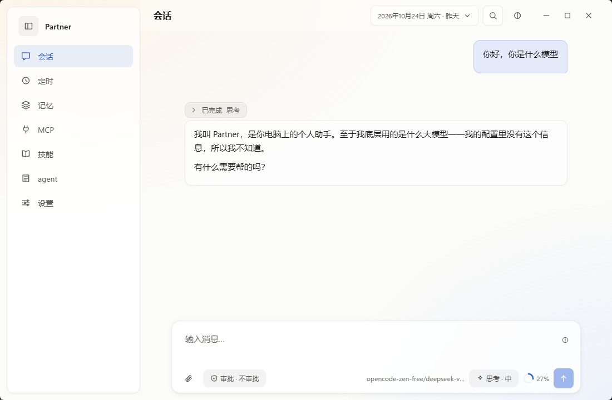
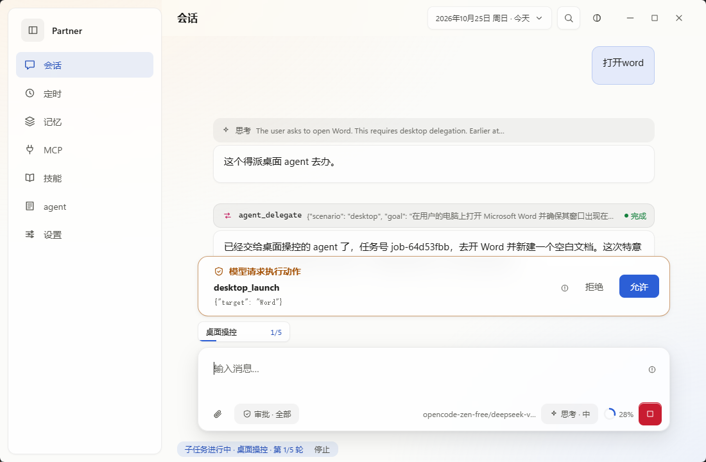
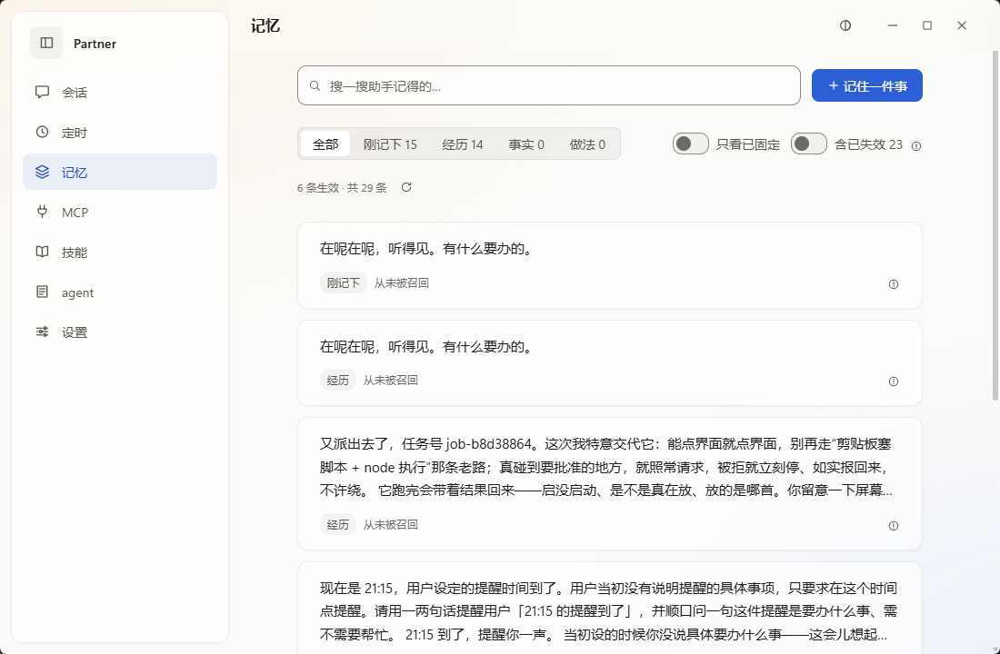
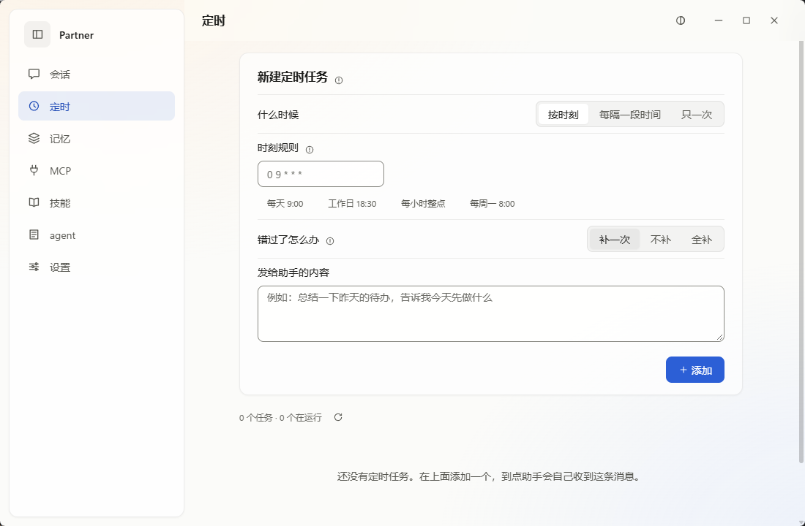
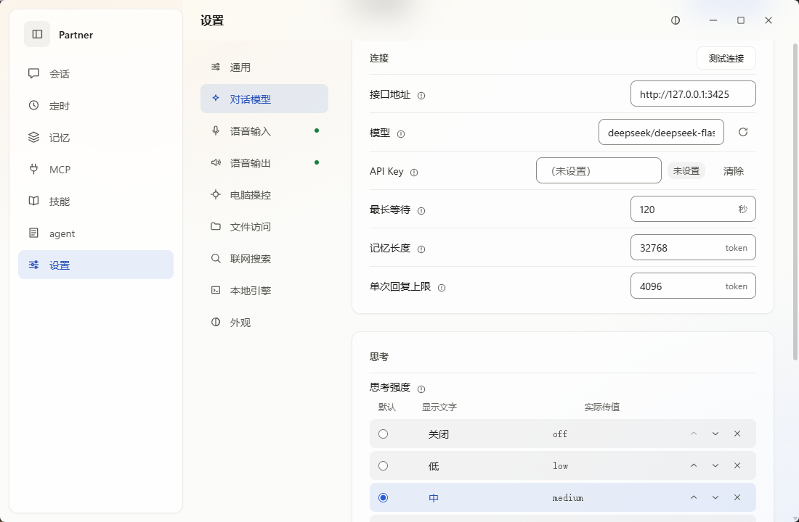
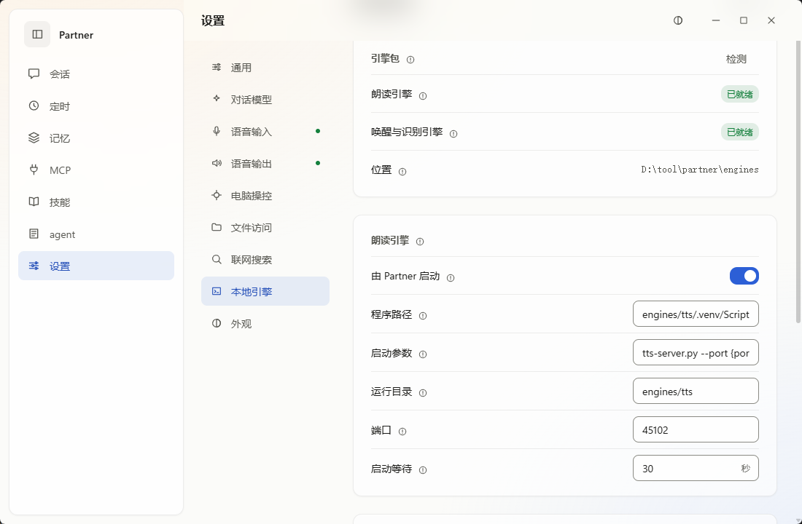

<div align="center">

# Partner

### 開箱即用的單一工作階段 Windows 桌面 AI 助手

**一條連續的工作階段，打字或開口都行；帶記憶、定時、MCP、Skills，還有能操作桌面的子 agent，動手前先問你。**

[](https://github.com/Jaspersol/partner/releases)
[](https://github.com/Jaspersol/partner/releases)
[](https://tauri.app/)
[](LICENSE)
[](https://github.com/Jaspersol/partner/releases/latest)

[简体中文](README.zh-CN.md) | **繁體中文** | [English](README.md)

**[下載安裝](#下載安裝) · [快速開始](#快速開始) · [功能](#功能) · [常見問題](#常見問題) · [文件](doc/README.zh-TW.md)**

</div>

## 為什麼選擇 Partner？

多數 agent 工具要你管理工作階段、替每個對話挑模型、一字一句地打字。Partner 去掉這些瑣事：只有一條工作階段，你像跟人說話一樣跟它交流，用鍵盤或語音都可以。它連接你設定的 OpenAI 相容或 Anthropic 端點。

- **一條工作階段，無需管理** — 打字、語音、定時任務和子 agent 回報都寫進同一條記錄，依到達順序執行。不用新建、命名、切換或清理工作階段
- **語音：本機或自備** — 喚醒詞、斷句、辨識、逐句朗讀、語音審批。可以下載本機引擎，也可以接已有的 ASR/TTS 服務
- **操作桌面，先批准** — 需要操作視窗或讀檔案的請求交給背景子 agent。預設每個動作都先徵求你同意，無人回應視為拒絕
- **看得見的記憶** — 你提過的偏好存在本機資料庫裡，每條記錄都可以檢視、調整層級、置頂和刪除
- **定時、MCP 與 Skills** — 依 cron、固定間隔或指定時間執行一句話；接入 stdio MCP 伺服器；用 `SKILL.md` 教模型一套做法
- **預設只在本機** — 本機 API 只監聽 `127.0.0.1`，請求必須帶啟動時產生的權杖。對話內容只傳給你設定的模型端點
- **原生 Windows 應用程式** — 以 Tauri 2 和 .NET 10 後端打造，安裝檔內附 .NET 執行環境

## 截圖

<table>
<tr>
<td align="center" width="50%"><br>主介面</td>
<td align="center" width="50%"><br>操作前批准</td>
</tr>
<tr>
<td align="center"><br>記憶</td>
<td align="center"><br>定時任務</td>
</tr>
<tr>
<td align="center"><br>模型設定</td>
<td align="center"><br>本機引擎</td>
</tr>
</table>

## 下載安裝

### 系統需求

| 項目 | 要求 |
|---|---|
| 系統 | Windows 10 2004 以上，x64 |
| WebView2 | Windows 10/11 內建 |
| 模型 | 一個 OpenAI 相容或 Anthropic 端點 |
| 語音（選用） | 麥克風和喇叭。本機朗讀需要約 1.9 GB 顯示記憶體，喚醒和辨識只用 CPU |

不支援 macOS 和 Linux。桌面操控和音訊直接呼叫 Win32 API。

### Windows 使用者

1. 從 [Releases](https://github.com/Jaspersol/partner/releases/latest) 下載 `Partner_<版本>_x64-setup.exe`。
2. 執行安裝程式，裝到目前使用者目錄，不需要系統管理員權限。
3. 安裝檔沒有程式碼簽章，SmartScreen 攔下時點「其他資訊 → 仍要執行」。可以用同一 release 裡的 `SHA256SUMS.txt` 或 `<安裝包名>.exe.sha256` 校驗檔案。

### 更新

「設定 → 一般 → 檢查更新」。檢查以 GitHub REST API 為主，遇到配額用盡、網路不通或 release 缺少 API 校驗檔時自動切到直鏈下載備援；應用程式從可用的路徑下載新安裝檔，核對 SHA-256 後啟動安裝程式並結束。

## 快速開始

### 基本用法

1. **設定模型**：開啟「設定 → 對話模型」，選介面格式（OpenAI 相容或 Anthropic），填服務位址，從下拉選單選模型，需要時填 API Key。儲存即生效
2. **發訊息**：在主介面輸入框輸入。模型沒設定好時，訊息留在佇列裡，輸入框會提示缺什麼
3. **開啟語音（選用）**：在「設定 → 本機引擎」下載引擎，或在「設定 → 語音輸入 / 語音輸出」填已有服務的位址。見[語音功能](doc/voice.zh-TW.md)
4. **開啟桌面操控（選用）**：開啟「設定 → 電腦操控 → 允許助手操作電腦」，依提示啟用「桌面操控」子 agent。每個動作都要你在輸入框上方的提示裡點「允許」

模型也可以用環境變數設定，設定頁的值優先：

```bash
export PARTNER_LLM_BASE_URL=http://127.0.0.1:11434/v1
export PARTNER_LLM_MODEL=qwen3
export PARTNER_LLM_API_KEY=...       # 選填
export PARTNER_LLM_PROTOCOL=openai   # 選填：openai / anthropic
```

### 記憶、定時、MCP 與 Skills

- **記憶**：點選側邊欄「記憶」 → 檢視記錄、依層級篩選、置頂、刪除，或手寫一條
- **定時**：點選側邊欄「排程」 → 選 cron、固定間隔或指定時間 → 填要發送的那句話
- **MCP**：點選側邊欄「MCP」 → 開啟總開關 → 新增伺服器（名稱、指令、參數）
- **Skills**：點選側邊欄「技能」 → 上傳 `SKILL.md`（或壓縮後的技能資料夾），或在應用程式裡新建
- **Agent**：點選側邊欄「agent」，編輯主 agent 和各子 agent 的提示詞，也可以替子 agent 單獨指定模型

> **注意**：沒設定模型時不會遺失訊息。各來源的訊息都留在佇列裡，等模型可用後再執行。

每項功能的詳細說明見**[文件目錄](doc/README.zh-TW.md)**。

## 功能

### 功能一覽

| 功能 | 說明 | 文件 |
|---|---|---|
| 單一工作階段 | 打字、語音、定時和子 agent 回報共用一條記錄，介面依日期分頁 | [單一工作階段](#單一工作階段) |
| 記憶 | 記下你提過的偏好，之後的回合可以取用 | [memory](doc/memory.zh-TW.md) |
| 子 agent | 在背景執行桌面和讀檔案任務並回報 | [sub-agents](doc/sub-agents.zh-TW.md) |
| 桌面操控 | 列出視窗、點選控制項、輸入文字、啟動程式 | [desktop-control](doc/desktop-control.zh-TW.md) |
| 語音 | 喚醒詞、辨識、朗讀和語音審批 | [voice](doc/voice.zh-TW.md) |
| 定時 | cron、固定間隔或指定時間 | [schedules](doc/schedules.zh-TW.md) |
| MCP | 接入 stdio MCP 伺服器 | [mcp](doc/mcp.zh-TW.md) |
| Skills | 用 `SKILL.md` 描述一套做法 | [skills](doc/skills.zh-TW.md) |
| 對外記憶服務 | 託管多個帶記憶召回的 OpenAI/Anthropic 反向代理埠，定時把互動總結寫回主記憶 | [services](doc/services.zh-TW.md) |

### 單一工作階段

- **一條記錄** — 打字、語音、定時任務和子 agent 回報排在同一個佇列裡，依到達順序執行
- **不需維護** — 不用新建、命名、切換或清理工作階段，也不用記某件事在哪個工作階段裡聊過
- **適合語音** — 開口前不需要先選工作階段
- **依日期分頁** — 日期選擇器只決定看哪一天。停在舊日期時發的訊息照樣附加到記錄末尾，沒有訊息的日期不顯示。日期依本機時區劃分，午夜時如果回合還沒結束，介面等它結束再切到新的一天

### 記憶

- **自動記錄** — 每個回合結束時提煉。每個回合開始前檢索相關記憶並加入系統提示，上限約 5000 token
- **四個層級** — 剛記下、經歷、事實、做法。同層級裡新記錄與舊記錄衝突時，舊記錄被標為失效並記下被誰取代，但不刪除；三個月沒被召回的記錄降一級
- **由你調整** — 記憶頁列出所有記錄，包括已失效的。可以在層級間移動，置頂後不會被降級或清理，也可以手寫或刪除任意一條
- **中文檢索** — 獨立的二元分詞全文索引，中文搜尋不會退化成全表掃描
- **本機並有備份** — 存在 SQLite 中，至少每天複製一次到 `memory/backups/`，保留最近 7 份

### 子 agent 與桌面操控

- **派活** — 主 agent 只對話和派活。子 agent 在背景執行，結果作為一則新輸入回報，主 agent 再轉述給你
- **兩個場景** — `desktop`（內建）和 `file-read`（唯讀，預設關閉，限定在目錄白名單內）
- **重試** — 一個任務預設最多 5 輪（1–10），總時限 15 分鐘。成功必須有子 agent 提出的證據；所有輪次都失敗時，主 agent 如實回報失敗，不會宣稱成功
- **先找控制項再動手** — 動作針對控制項 ID，不靠猜座標。按鈕、清單項目、核取方塊透過 UI Automation 直接呼叫，不必把視窗提到前景
- **審批檔位** — 在輸入區切換「不審批」「危險指令審批」「全部審批」（預設）。預設檔位下，執行指令、啟動程式和寫剪貼簿每次都問
- **安全護欄** — 按鍵和輸入要求目標視窗在前景，座標越界直接拒絕而不是夾到邊界，結果把「已注入輸入」和「畫面是否變化」分開報告
- **視窗白名單** — 可以限定只操作哪些視窗。截圖需要開啟「能看圖片」的模型

### 語音

- **流程** — 麥克風 → 依停頓斷句 → ASR → 佇列 → 回合 → 工作階段；新的助手回覆 → 斷句 → TTS → 依序播放
- **本機引擎或自備服務** — KWS + ASR（sherpa-onnx + SenseVoice，約 380 MB，只用 CPU）和 TTS（Qwen3-TTS 1.7B GGUF，約 3.0 GB，約 1.9 GB 顯示記憶體）分別下載，斷線後續傳。也可以填已有的 ASR/TTS 服務位址
- **喚醒詞** — 以逗號分隔的多個詞，可設定喚醒後的等待時長，可選喚醒提示音
- **說話控制** — 助手說話時可關閉麥克風，也可以用說話打斷它（持續約半秒；沒有回音消除，建議戴耳機）
- **語音審批** — 審批請求會被朗讀，可以說「批准執行」或「拒絕執行」來回應。原始參數不會被唸出，120 秒無人回應視為拒絕

### 定時、MCP 與 Skills

- **定時** — 五欄 cron（本機時區）、1 分鐘到 1 年的固定間隔，或一次性的未來時間；最多 100 個任務。到點後內容當作一般訊息進佇列。助手也可以建立定時任務，建立和刪除遵循你的審批檔位
- **MCP** — 預設關閉。工具名帶 `mcp_{server}_` 前綴，每次呼叫預設都要批准，可以按伺服器開啟「跳過審批」。某個伺服器啟動失敗不影響其他伺服器
- **Skills** — 一個帶 `SKILL.md`（`name`、`description` 和步驟）的資料夾。啟用的技能會列在模型提示裡，最多 50 個，下一回合生效，無需重新啟動

### 系統與平台

- **模型協定** — 支援 OpenAI 相容和 Anthropic Messages 端點，API Key 只寫不讀
- **聯網搜尋** — 預設開啟，搜尋時查詢語句會傳給第三方搜尋引擎，可以在「設定 → 聯網搜尋」關閉
- **自動更新** — 下載新安裝檔，核對 SHA-256，重新啟動進入新版本
- **當機復原** — 工作階段和佇列是只附加的 `.jsonl` 檔案，可以重建；當機後未完成的子 agent 任務會在下次啟動時收到「被中斷」的回報
- **多語言** — 介面支援簡體中文、繁體中文和英文

## 常見問題

<details>
<summary><strong>一定要下載語音引擎嗎？</strong></summary>

不用，只打字用不到。喚醒和辨識引擎約 380 MB，只用 CPU；朗讀引擎約 3 GB，需要顯示卡。也可以都不下載，直接接已有的 ASR/TTS 服務。

</details>

<details>
<summary><strong>為什麼朗讀引擎分成幾個檔案？</strong></summary>

GitHub 單一 release 附件上限 2 GiB，朗讀引擎約 3 GB。應用程式依序下載到同一目錄並校驗 SHA-256，斷線後續傳。

</details>

<details>
<summary><strong>資料存在哪裡？</strong></summary>

預設在 `%LocalAppData%/Partner/workspace`：

- **工作階段記錄**：`session/events.jsonl`
- **佇列**：`queue/items.jsonl`
- **記憶庫**：`memory/memory.db`（SQLite），備份在 `memory/backups/`
- **定時任務**：`scheduler/`
- **技能**：`skills/`
- **附件**：`media/`

工作階段和佇列可以從對應的 `.jsonl` 重建。`memory.db` 至少每天複製一次到 `memory/backups/`（啟動時最新備份過期就補一份，每日維護前也會檢查），保留最近 7 份；刪除原庫只遺失上次備份之後的記憶。

</details>

<details>
<summary><strong>日誌在哪裡？</strong></summary>

外殼把 API 的 stdout/stderr 和自身診斷寫入 `%LocalAppData%/Partner/partner-api.log`，超過 10 MB 輪轉並保留一份舊日誌。

</details>

<details>
<summary><strong>會把我的資料傳到別處嗎？</strong></summary>

對話內容傳給你設定的模型端點。「聯網搜尋」預設開啟，搜尋時查詢語句會傳給第三方搜尋引擎，可以在「設定 → 聯網搜尋」關閉。應用程式還會連 GitHub 檢查更新和下載語音引擎。本機 API 只監聽 `127.0.0.1`，請求必須帶啟動時產生的權杖。

</details>

<details>
<summary><strong>助手為什麼總是請求批准？</strong></summary>

桌面操控的預設檔位是「全部審批」，每個介面動作都要問，無人回應視為拒絕。可以在聊天輸入區的下拉選單切換檔位。「危險指令審批」只在執行指令、啟動程式和寫剪貼簿時詢問。預設檔位下，一次批准可讓同一視窗在 10 分鐘內再連續執行 10 步。MCP 工具不受這個檔位約束，而是用各伺服器自己的「跳過審批」清單。

</details>

<details>
<summary><strong>應用程式關閉期間，定時任務為什麼沒有執行？</strong></summary>

應用程式關閉期間錯過的時間點會被跳過，暫停期間錯過的也一樣，不會補發。定時任務沒有編輯功能：要改規則或內容，刪除後重新建立。

</details>

<details>
<summary><strong>支援 macOS / Linux 嗎？</strong></summary>

不支援。桌面操控和音訊直接呼叫 Win32 API，換系統需要重寫這兩部分。

</details>

更多問題見[文件目錄](doc/README.zh-TW.md)。

## 從原始碼建置

需要 .NET 10 SDK、Node 22 + npm（不要用 pnpm，esbuild 會裝不上）、Rust（cargo 1.98+）。

```bash
npm --prefix ui install          # 第一次
npx --prefix ui tauri dev        # 開發模式：啟動前端和桌面殼，殼會帶起 API
bash scripts/build-shell.sh      # 打包 NSIS 安裝檔
bash scripts/ci.sh               # 完整檢查；SKIP_SHELL=1 跳過殼編譯
```

除錯方式和單獨啟動 API / 前端見[開發與除錯](doc/development.zh-TW.md)，發版見[發佈流程](doc/release.zh-TW.md)。

### 專案結構

| 路徑 | 內容 |
|---|---|
| `src/Partner.Core` | 工作階段、佇列、agent 回合、記憶、排程、MCP、Skills、治理 |
| `src/Partner.Desktop` | 視窗列舉、截圖、輸入注入、動作校驗 |
| `src/Partner.Voice` | 麥克風輸入、斷句、ASR/TTS 用戶端、播放 |
| `src/Partner.Api` | 本機 HTTP API、佇列消費者、語音宿主、本機引擎管理 |
| `ui/` | Vue 3 前端，介面支援簡中、繁中、英文 |
| `src-tauri/` | Tauri 2 桌面殼 |
| `engines/` | 本機語音引擎的服務腳本，執行環境和模型不進 git |
| `scripts/` | CI、打包、引擎安裝腳本 |

## 參與貢獻

歡迎提 issue 和建議。較大的改動請先開 issue 討論方案。送 PR 前請在 Windows 上跑過 `bash scripts/ci.sh`；`master` 只接受 PR 合併。

**技術堆疊**：C# / .NET 10 · Vue 3 · TypeScript · Tauri 2 · SQLite

## Star History

[](https://www.star-history.com/#Jaspersol/partner&Date)

## 授權

程式碼以 [MIT](LICENSE) 授權。語音引擎的執行環境、模型權重和音色錨點不在本儲存庫，各自依 [THIRD-PARTY-NOTICES.md](THIRD-PARTY-NOTICES.md) 所列的授權發布（Apache-2.0、FunASR MODEL_LICENSE 等），不在 MIT 涵蓋範圍內。
