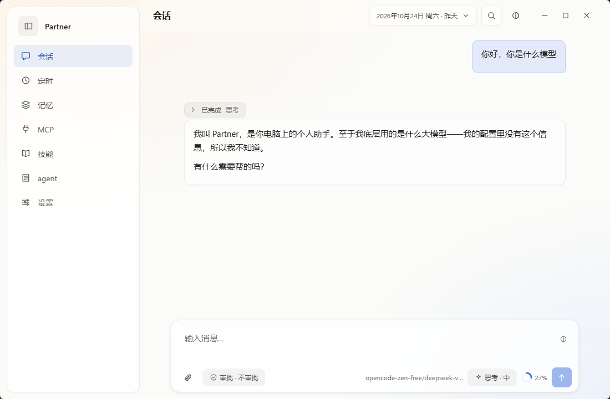
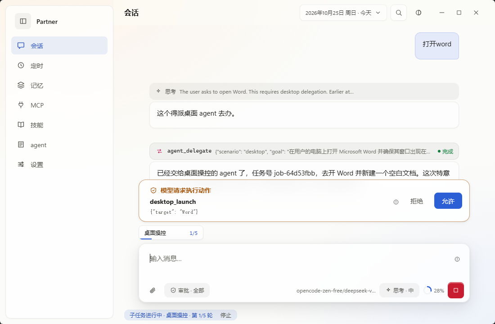
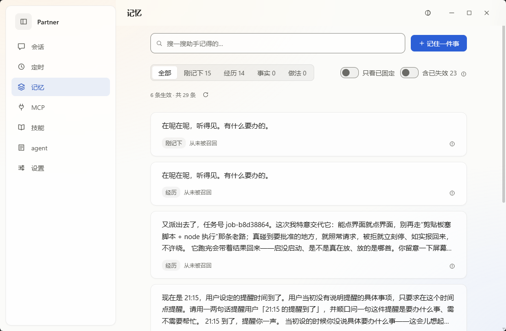
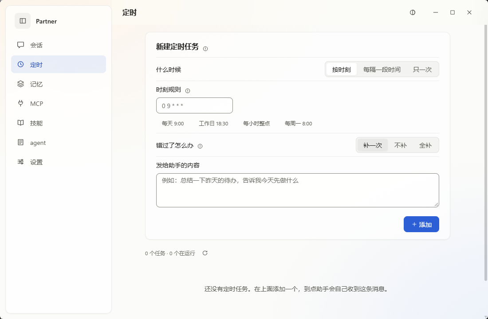
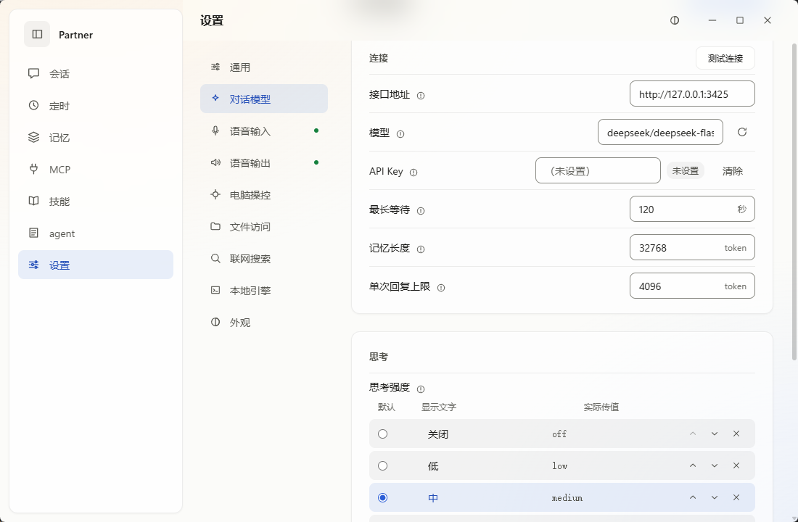
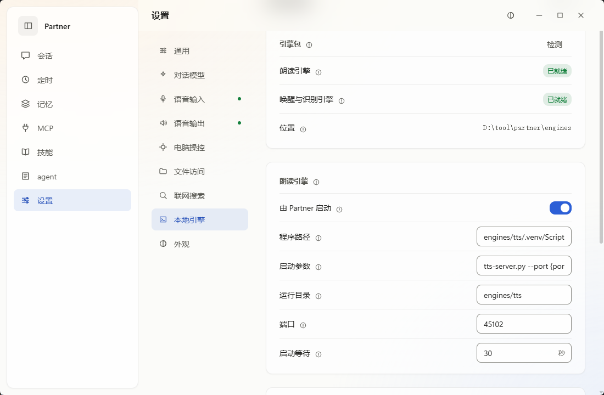

<div align="center">

# Partner

一個開箱即用的單會話 Windows 桌面 AI 助手

[](https://github.com/Jaspersol/partner/releases)
[](https://github.com/Jaspersol/partner/releases)
[](https://tauri.app/)
[](LICENSE)

[简体中文](README.zh-CN.md) | **繁體中文** | [English](README.md)

**[下載安裝](#下載安裝) · [上手](#上手) · [功能](#功能) · [常見問題](#常見問題) · [文件](doc/README.zh-TW.md)**

</div>

## 簡介

Partner 是一個支援語音輸入輸出的單一工作階段智慧助手，連接你設定的 OpenAI 相容或 Anthropic 端點。它具備常規 harness 的大多數功能：

- **單一工作階段**：只有一條工作階段，不用新建和切換，見[單一工作階段](#單一工作階段)。
- **語音**：喚醒詞、斷句、辨識、逐句朗讀、語音審批。可以下載本機引擎，也可以接已有的 ASR/TTS 服務。
- **桌面操控和子 agent**：需要操作視窗或讀檔案的請求交給子 agent 在背景執行，預設動手前先徵求你同意。
- **記憶、定時、MCP、Skills**：見[功能](#功能)。

## 單一工作階段

Partner 只有一條工作階段。打字、語音、定時任務和子 agent 回報都寫進同一條記錄，依到達順序執行。

- **不需維護**：不用新建、命名、切換或清理工作階段。
- **心智負擔小**：不用記某件事在哪個工作階段裡聊過，想到什麼直接說。
- **適合語音**：開口前不需要先選工作階段。

介面依日期分頁檢視，日期選擇器只決定看哪一天。停在舊日期時發的訊息照樣附加到記錄末尾；沒有訊息的日期不顯示。日期依本機時區劃分，午夜時如果回合還沒結束，介面等它結束再切到新的一天。

## 截圖

<table>
<tr>
<td align="center" width="50%"><br>主介面</td>
<td align="center" width="50%"><br>操作前批准</td>
</tr>
<tr>
<td align="center"><br>記憶</td>
<td align="center"><br>定時任務</td>
</tr>
<tr>
<td align="center"><br>模型設定</td>
<td align="center"><br>本機引擎</td>
</tr>
</table>

## 下載安裝

### 系統需求

| 項目 | 要求 |
|---|---|
| 系統 | Windows 10 2004 以上，x64 |
| WebView2 | Windows 10/11 內建 |
| 模型 | 一個 OpenAI 相容或 Anthropic 端點 |
| 語音（選用） | 麥克風和喇叭；本機朗讀需要約 1.9 GB 顯示記憶體，喚醒和辨識只用 CPU |

安裝檔內附 .NET 執行環境。

### 安裝

1. 從 [Releases](https://github.com/Jaspersol/partner/releases/latest) 下載 `Partner_<版本>_x64-setup.exe`。
2. 執行安裝程式，裝到目前使用者目錄，不需要系統管理員權限。
3. 安裝檔沒有程式碼簽章，SmartScreen 攔下時點「其他資訊 → 仍要執行」。可以用同一 release 裡的 `SHA256SUMS.txt` 校驗檔案。

### 更新

「設定 → 一般 → 檢查更新」。應用程式下載新安裝檔，核對 SHA-256 後啟動安裝程式並結束。

## 上手

1. 開啟「設定 → 對話模型」，選介面格式（OpenAI 相容或 Anthropic），填服務位址，從下拉選單選模型，需要時填 API Key。儲存即生效。
2. 在主介面輸入框發一則訊息。模型沒設定好時，訊息留在佇列裡，輸入框會提示缺什麼。
3. 用語音：在「設定 → 本機引擎」下載引擎，或在「設定 → 語音輸入 / 語音輸出」填已有服務的位址。見[語音功能](doc/voice.zh-TW.md)。
4. 操作桌面：開啟「設定 → 電腦操控 → 允許助手操作電腦」，依提示啟用「桌面操控」子 agent。每個動作都要你點「允許」，提示在輸入框上方，無人回應視為拒絕。

模型也可以用環境變數設定，設定頁的值優先：

```bash
export PARTNER_LLM_BASE_URL=http://127.0.0.1:11434/v1
export PARTNER_LLM_MODEL=qwen3
export PARTNER_LLM_API_KEY=...       # 選填
export PARTNER_LLM_PROTOCOL=openai   # 選填：openai / anthropic
```

## 功能

| 功能 | 說明 | 文件 |
|---|---|---|
| 記憶 | 記下你提過的偏好，之後的回合可以取用。記憶頁可以檢視、在四個層級間移動、置頂和刪除。 | [memory](doc/memory.zh-TW.md) |
| 子 agent | 需要操作桌面或讀檔案的請求由子 agent 在背景執行，完成後回報，失敗會重試。 | [sub-agents](doc/sub-agents.zh-TW.md) |
| 桌面操控 | 列出視窗、點選控制項、輸入文字、啟動程式。預設操作前需要批准，可以限定只操作哪些視窗。 | [desktop-control](doc/desktop-control.zh-TW.md) |
| 語音 | 喚醒詞觸發，依停頓斷句，辨識結果進佇列，回覆逐句朗讀；可以設定朗讀時不聽麥克風。 | [voice](doc/voice.zh-TW.md) |
| 定時 | 支援 cron、固定間隔和指定時間。到點後內容當作一般訊息進佇列。 | [schedules](doc/schedules.zh-TW.md) |
| MCP | 接入 stdio MCP 伺服器。工具呼叫預設需要批准，可以按伺服器關閉。 | [mcp](doc/mcp.zh-TW.md) |
| Skills | 用 `SKILL.md` 描述一套做法，上傳或在應用程式裡新建；啟用後加入模型提示。 | [skills](doc/skills.zh-TW.md) |

## 常見問題

**一定要下載語音引擎嗎？**
不用，只打字用不到。喚醒和辨識引擎約 380 MB，只用 CPU；朗讀引擎約 3 GB，需要顯示卡。也可以都不下載，直接接已有的 ASR/TTS 服務。

**為什麼朗讀引擎分成幾個檔案？**
GitHub 單一 release 附件上限 2 GiB，朗讀引擎約 3 GB。應用程式依序下載到同一目錄並校驗 SHA-256，斷線後續傳。

**資料存在哪裡？**
預設在 `%LocalAppData%/Partner/workspace`，包括工作階段記錄、佇列、記憶庫和設定。工作階段和佇列可以從對應的 `.jsonl` 重建；`memory.db` 沒有備份，刪除後記憶無法復原。

**會把我的資料傳到別處嗎？**
對話內容傳給你設定的模型端點。「聯網搜尋」預設開啟，搜尋時查詢語句會傳給第三方搜尋引擎，可以在「設定 → 聯網搜尋」關閉。應用程式還會連 GitHub 檢查更新和下載語音引擎。本機 API 只監聽 `127.0.0.1`，請求必須帶啟動時產生的權杖。

**支援 macOS / Linux 嗎？**
不支援。桌面操控和音訊直接呼叫 Win32 API，換系統需要重寫這兩部分。

更多問題見[文件目錄](doc/README.zh-TW.md)。

## 從原始碼建置

需要 .NET 8 SDK、Node 22 + npm（不要用 pnpm，esbuild 會裝不上）、Rust（cargo 1.98+）。

```bash
npm --prefix ui install          # 第一次
npx --prefix ui tauri dev        # 開發模式：啟動前端和桌面殼，殼會帶起 API
bash scripts/build-shell.sh      # 打包 NSIS 安裝檔
bash scripts/ci.sh               # 完整檢查；SKIP_SHELL=1 跳過殼編譯
```

除錯方式和單獨啟動 API / 前端見[開發與除錯](doc/development.zh-TW.md)，發版見[發佈流程](doc/release.zh-TW.md)。

### 專案結構

| 路徑 | 內容 |
|---|---|
| `src/Partner.Core` | 工作階段、佇列、agent 回合、記憶、排程、MCP、Skills、治理 |
| `src/Partner.Desktop` | 視窗列舉、截圖、輸入注入、動作校驗 |
| `src/Partner.Voice` | 麥克風輸入、斷句、ASR/TTS 用戶端、播放 |
| `src/Partner.Api` | 本機 HTTP API、佇列消費者、語音宿主、本機引擎管理 |
| `ui/` | Vue 3 前端，介面支援簡中、繁中、英文 |
| `src-tauri/` | Tauri 2 桌面殼 |
| `engines/` | 本機語音引擎的服務腳本，執行環境和模型不進 git |
| `scripts/` | CI、打包、引擎安裝腳本 |

**技術堆疊**：C# / .NET 8 · Vue 3 · TypeScript · Tauri 2 · SQLite

## 參與貢獻

歡迎提 issue，較大的改動請先開 issue 討論。送 PR 前請在 Windows 上跑過 `bash scripts/ci.sh`；`master` 只接受 PR 合併。

## 授權

程式碼以 [MIT](LICENSE) 授權。語音引擎的執行環境、模型權重和音色錨點不在本儲存庫，各自依 [THIRD-PARTY-NOTICES.md](THIRD-PARTY-NOTICES.md) 所列的授權發布（Apache-2.0、FunASR MODEL_LICENSE 等），不在 MIT 涵蓋範圍內。
