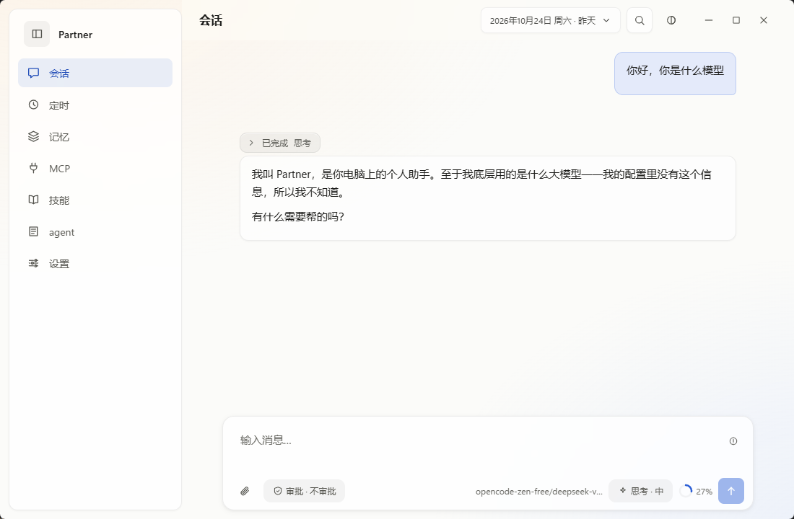
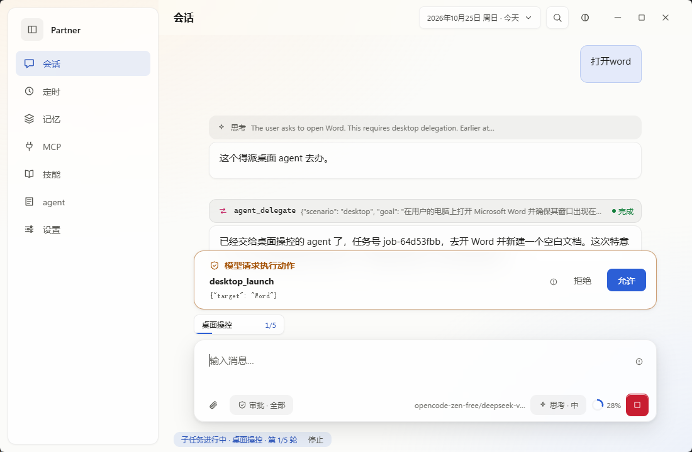
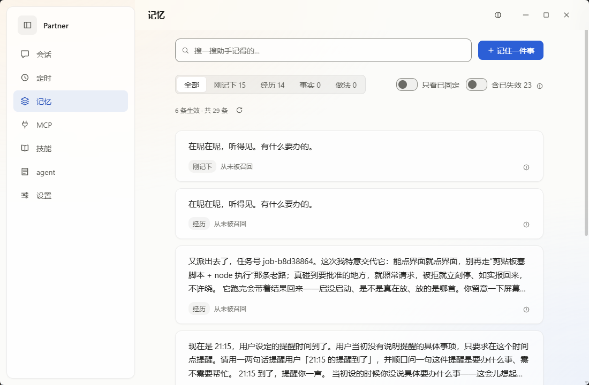
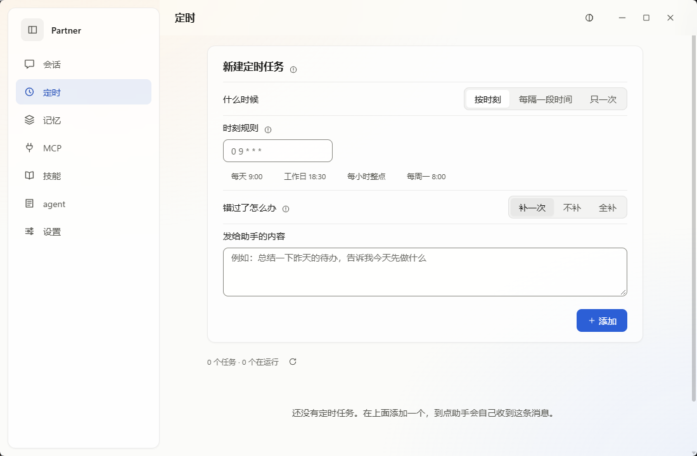
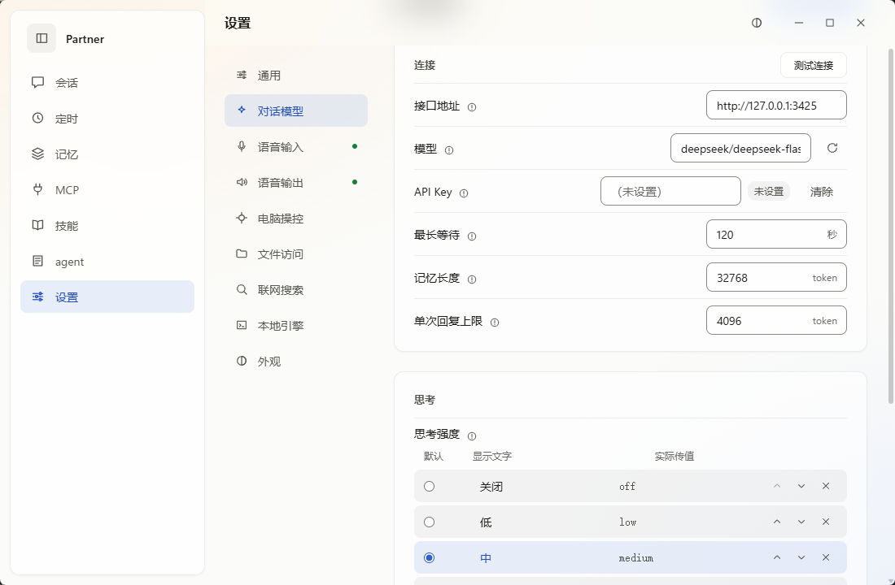
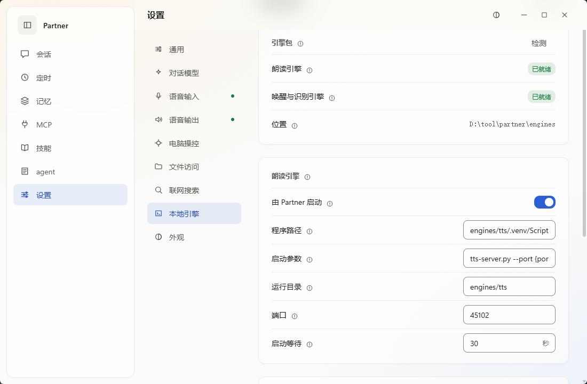

<div align="center">

# Partner

### 開箱即用的 Windows 單一工作階段桌面 AI 助手

**Partner 把對話、語音、記憶、定時任務、MCP 和 Skills 放在同一條持續的工作階段中。它也能透過具備權限審批機制的子 agent 操作桌面，並提供相容 OpenAI/Anthropic 的本機服務，讓遊戲 AI mod、外掛和其他 agent 接入你的 Partner，使用相關記憶，再把互動總結寫回主記憶。**

[](https://github.com/Jaspersol/partner/releases)
[](https://github.com/Jaspersol/partner/releases)
[](https://tauri.app/)
[](LICENSE)
[](https://github.com/Jaspersol/partner/releases/latest)

[简体中文](README.zh-CN.md) | **繁體中文** | [English](README.md)

**[下載安裝](#下載安裝) · [快速開始](#快速開始) · [功能特色](#功能特色) · [常見問題](#常見問題) · [文件](doc/README.zh-TW.md)**

</div>

## 為什麼選擇 Partner？

許多 agent 工具要求你管理工作階段、為每段對話選擇模型，還得逐字輸入。Partner 把這些管理工作簡化成一條持續的工作階段：你可以用鍵盤輸入，也可以直接說話，就像和真人交流一樣。它會連接你設定的 OpenAI 相容或 Anthropic 端點。

- **一條工作階段，不必整理會話** — 文字、語音、定時任務和子 agent 回報都會進入同一份記錄，依到達順序處理，不需要建立、命名、切換或清理工作階段。
- **語音可用本機引擎或自備服務** — 支援喚醒詞、依停頓斷句、語音辨識、逐句朗讀和語音審批。你可以下載本機引擎，也可以連接現有的 ASR/TTS 服務。
- **桌面操作由你決定是否批准** — 涉及視窗操作或檔案讀取的請求會交給背景子 agent。是否需要審批取決於動作和目前檔位；審批提示無人回應時會視為拒絕。
- **記憶內容清楚可見** — 你提到的偏好會儲存在本機資料庫。每筆記錄都能檢視、調整層級、置頂或刪除。
- **連接外部 agent 與外掛** — 遊戲 AI mod、編輯器或瀏覽器外掛，以及其他 agent 框架，都能透過本機 OpenAI/Anthropic 相容端點接入。每個請求會取得相關記憶，互動總結也能寫回主記憶。
- **定時任務、MCP 與 Skills** — 可在 cron、固定間隔或指定時間執行訊息，連接 stdio MCP 伺服器，並透過 `SKILL.md` 教模型一套做法。
- **預設只在本機運作** — 本機 API 僅監聽 `127.0.0.1`，每個請求都必須帶有應用程式啟動時產生的權杖。對話內容只會傳送到你設定的模型端點。
- **原生 Windows 應用程式** — 以 Tauri 2 和 .NET 10 後端打造，安裝程式內含 .NET 執行環境。

## 截圖

<table>
<tr>
<td align="center" width="50%"><br>主介面</td>
<td align="center" width="50%"><br>操作前批准</td>
</tr>
<tr>
<td align="center"><br>記憶</td>
<td align="center"><br>定時任務</td>
</tr>
<tr>
<td align="center"><br>模型設定</td>
<td align="center"><br>本機引擎</td>
</tr>
</table>

## 下載安裝

### 系統需求

| 項目 | 要求 |
|---|---|
| 作業系統 | Windows 10 2004 或更新版本，x64 |
| WebView2 | Windows 10/11 內建 |
| 模型服務 | 一個 OpenAI 相容或 Anthropic 端點 |
| 語音（選用） | 麥克風和喇叭。本機文字轉語音約需 1.9 GB 顯示記憶體；喚醒詞偵測和辨識使用 CPU |

Partner 目前不支援 macOS 和 Linux，因為桌面控制與音訊功能直接呼叫 Win32 API。

### 在 Windows 上安裝

1. 從[最新 release](https://github.com/Jaspersol/partner/releases/latest)下載 `Partner_<版本>_x64-setup.exe`。
2. 執行安裝程式。它會安裝到目前使用者的目錄，不需要系統管理員權限。
3. 安裝程式沒有程式碼簽章。如果 SmartScreen 阻止執行，請選擇「其他資訊 → 仍要執行」。你可以使用同一個 release 裡的 `SHA256SUMS.txt` 或 `<安裝程式>.exe.sha256` 驗證檔案。

### 更新

前往「設定 → 一般 → 檢查更新」。Partner 會先透過 GitHub REST API 檢查；如果 API 受到速率限制、無法連線，或 release 缺少 API 校驗檔，就會改用直接下載連結。應用程式會從可用的路徑下載安裝程式、核對 SHA-256、啟動安裝程式，然後結束目前版本。

## 快速開始

### 開始使用

1. **設定模型** — 開啟「設定 → 對話模型」，選擇 OpenAI 相容或 Anthropic 介面格式，填入服務位址並從清單選擇模型；服務需要時再輸入 API Key。儲存後立即生效。
2. **傳送訊息** — 在主介面的輸入框中輸入內容。尚未設定模型時，訊息會留在佇列中，輸入框也會提示缺少哪些設定。
3. **設定語音（選用）** — 在「設定 → 本機引擎」下載引擎，或在「設定 → 語音輸入 / 語音輸出」填入現有服務的位址。詳見[語音功能](doc/voice.zh-TW.md)。
4. **啟用桌面操控（選用）** — 開啟「設定 → 電腦操控 → 允許助手操作電腦」，再依提示啟用「桌面操控」子 agent。需要審批時，在輸入框上方的提示中選擇「允許」。

也可以用環境變數設定模型。設定頁的值優先：

```bash
export PARTNER_LLM_BASE_URL=http://127.0.0.1:11434/v1
export PARTNER_LLM_MODEL=qwen3
export PARTNER_LLM_API_KEY=...       # 選填
export PARTNER_LLM_PROTOCOL=openai   # 選填：openai / anthropic
```

### 記憶、定時任務、MCP 與 Skills

- **記憶** — 從側邊欄開啟「記憶」，瀏覽記錄、按層級篩選、置頂或刪除，也可以手動新增記錄。
- **定時任務** — 進入側邊欄的「排程」，選擇 cron、固定間隔或指定時間，再填寫要傳送的內容。
- **MCP** — 在「設定 → MCP」開啟總開關，然後新增伺服器名稱、指令和參數。
- **Skills** — 從「設定 → 技能」上傳 `SKILL.md` 或壓縮後的技能資料夾，也可以直接在應用程式內建立。
- **對外服務** — 從側邊欄開啟「對外服務」，新增名稱、連接埠、協定和對外模型名稱。建立後複製只顯示一次的權杖，並在 mod 或外掛中設定 `http://127.0.0.1:<連接埠>/v1`、權杖及模型名稱。
- **Agent** — 在「設定 → agent」中修改主 agent 和子 agent 的提示詞，也可以為子 agent 指定獨立模型。

> **注意**：模型尚未設定時，所有來源的訊息都會保留在佇列中，等模型可用後再處理，不會遺失。

各功能的詳細說明請參閱**[文件目錄](doc/README.zh-TW.md)**。

## 功能特色

### 功能一覽

| 功能 | 說明 | 文件 |
|---|---|---|
| 單一工作階段 | 文字、語音、定時任務和子 agent 回報共用一份記錄，可按日期瀏覽 | [單一工作階段](#單一工作階段) |
| 記憶 | 保存你提到的偏好，供後續回合檢索 | [記憶](doc/memory.zh-TW.md) |
| 子 agent | 在背景執行桌面和檔案讀取任務，完成後回報 | [子 agent](doc/sub-agents.zh-TW.md) |
| 桌面操控 | 列出視窗、操作控制項、輸入文字和啟動程式 | [桌面操控](doc/desktop-control.zh-TW.md) |
| 語音 | 喚醒詞、辨識、朗讀和語音審批 | [語音](doc/voice.zh-TW.md) |
| 定時任務 | cron、固定間隔或指定日期與時間 | [定時任務](doc/schedules.zh-TW.md) |
| MCP | 連接 stdio MCP 伺服器 | [MCP](doc/mcp.zh-TW.md) |
| Skills | 使用 `SKILL.md` 描述一套流程 | [Skills](doc/skills.zh-TW.md) |
| 對外服務 | 讓遊戲 mod、外掛和外部 agent 透過本機 OpenAI/Anthropic 端點使用記憶，並將總結寫回主記憶 | [對外服務](doc/services.zh-TW.md) |

### 單一工作階段

- **共用一份記錄** — 文字、語音、定時任務和子 agent 回報會進入同一個佇列，依到達順序處理。
- **不需要維護會話** — 不必建立、命名、切換或清理工作階段，也不必記得某件事在哪一段對話中提過。
- **適合語音使用** — 開口前不需要先選擇工作階段。
- **依日期瀏覽** — 日期選擇器只會改變目前顯示的日期。即使正在查看較早的日期，新訊息仍會追加到記錄末尾；沒有訊息的日期不會列出。日期依本機時區計算；若午夜時仍有回合執行中，會等該回合完成後才切換到新的一天。
- **只顯示已提交的歷史** — 在預設模式下，事件成功刷入磁碟後才會發布到工作階段畫面；提交失敗的事件不會顯示為歷史記錄。

### 記憶

- **自動整理** — 每個回合結束時提煉記憶；下一回合開始前檢索相關記錄並加入系統提示，最多約 5,000 token。
- **四個層級** — 「剛記下」「經歷」「事實」和「做法」。同一層級出現新舊衝突時，舊記錄會被標記為失效，並記下由哪筆記錄取代，但不會刪除。連續三個月未被召回的記錄會下調一級。
- **記錄由你管理** — 記憶頁會列出所有記錄，包括已失效的記錄。你可以調整層級、置頂以免降級或清理、手動新增，或刪除任意記錄。
- **中文全文搜尋** — 使用獨立的二元分詞索引，中文搜尋不會退化成完整資料表掃描。
- **本機儲存並備份** — 記憶存放在 SQLite，每天至少複製一次到 `memory/backups/`，保留最新 7 份。

### 子 agent 與桌面操控

- **委派工作** — 主 agent 負責對話與分派工作；子 agent 在背景執行，結果會以新輸入返回，再由主 agent 轉告你。
- **兩種任務模式** — `desktop` 內建；`file-read` 為唯讀模式，預設關閉，並限制在允許的目錄清單內。
- **重試與證據** — 每項任務預設最多執行 5 輪，可設定為 1–10 輪，總時限 15 分鐘。成功回報必須包含子 agent 提供的證據；如果所有輪次都失敗，主 agent 會回報失敗，不會宣稱已完成。
- **先定位控制項再操作** — 動作以控制項 ID 為目標，而不是猜測座標。UI Automation 能直接呼叫按鈕、清單項目和核取方塊，不必先把視窗切到前景；Chromium/Electron 頁面控制項也不需要偵錯連接埠。
- **審批檔位** — 可以在輸入區選擇「不審批」「危險指令審批」或預設的「全部審批」。執行指令只有在「全部審批」下需要批准；檔案寫入和編輯除了「不審批」外都要逐次批准。啟動程式、寫入剪貼簿和系統快速鍵（Win 組合鍵、Alt+F4、Alt+Tab、Ctrl+Alt+*、Ctrl+Shift+Esc）在兩個需要審批的檔位下都要確認。
- **安全限制** — 發送按鍵和輸入文字時，目標視窗必須在前景，目標控制項也必須取得焦點。超出範圍的座標會直接拒絕，不會被夾到邊界；密碼欄位不會回傳值。結果會分別回報動作是否已送出，以及畫面是否發生變化。
- **視窗允許清單** — 可以限制 agent 只能操作指定視窗。要使用截圖，模型必須啟用圖像輸入能力。

### 語音

- **處理流程** — 麥克風收音後依停頓切分，經過 ASR 和佇列後作為工作階段回合處理；助手的新回覆會被切成句子，交給 TTS 產生語音，再依序播放。
- **本機引擎或現有服務** — KWS 和 ASR 使用 sherpa-onnx 及 SenseVoice（約 380 MB，僅使用 CPU）；TTS 使用 Qwen3-TTS 1.7B GGUF（約 3.0 GB，約需 1.9 GB 顯示記憶體）。引擎分開下載，網路中斷後可以續傳；也能直接填入現有 ASR/TTS 服務的位址。
- **喚醒詞** — 可設定多個以逗號分隔的喚醒詞、喚醒後的等待時間，以及選擇是否播放提示音。
- **說話控制** — 助手說話時可以關閉麥克風，也可以說話約半秒來打斷它。目前沒有回音消除，建議使用耳機。
- **語音審批** — 審批請求會被朗讀，可以說「批准執行」或「拒絕執行」回答。原始參數不會被讀出；120 秒內沒有回應時，請求會被拒絕。

### 定時任務、MCP 與 Skills

- **定時任務** — 支援五欄 cron（使用本機時區）、1 分鐘到 1 年的固定間隔，以及一次性的未來時間；最多可建立 100 個任務。觸發時，任務內容會像普通訊息一樣進入佇列。助手也能建立定時任務，建立和刪除遵循目前的審批檔位。
- **MCP** — 預設關閉。工具名稱使用 `mcp_{server}_` 前綴，呼叫時預設需要審批；可以為個別伺服器開啟「跳過審批」。某個伺服器啟動失敗不會影響其他伺服器。
- **Skills** — 技能資料夾需要包含帶有 `name`、`description` 和步驟的 `SKILL.md`。啟用的技能會列在模型提示中，最多 50 個；修改會在下一回合生效，不需重新啟動。

### 對外服務

- **使用場景** — 遊戲 AI mod、NPC 對話外掛、寫作或程式設計外掛，以及其他 agent 框架，只要能填寫 OpenAI 或 Anthropic 相容的位址、金鑰和模型名稱，就可以接入。
- **請求轉送** — 每項服務使用獨立的 `127.0.0.1` 連接埠，把請求轉送給主模型或另行指定的上游。服務只會改動對外模型名稱、插入最後一則使用者訊息之前的召回記憶，以及可選的自訂提示詞。工具呼叫、串流輸出、`tool_calls` 和錯誤都會原樣傳遞。
- **寫回記憶** — 依設定的間隔，把呼叫端的要求與回覆總結成一句話，以 `[对外服务:<名稱>]` 為前綴寫入主記憶。記憶頁可以依來源篩選；刪除服務時，也可以一併刪除該服務寫入的記憶。
- **使用邊界** — 呼叫端必須與 Partner 位於同一台電腦。服務協定必須與上游協定一致，不進行格式轉換；每個服務都有獨立權杖。外部文字可能進入主記憶，因此只應將權杖交給可信任的程式。

### 桌寵

- **Live2D 角色** — 角色顯示在透明且置頂的小視窗中，應用程式會用關鍵詞字典比對已定稿的助手回覆，再播放固定場景。Cubism Core 和模型由你自行決定是否下載。

### 系統與平台

- **模型協定** — 支援 OpenAI 相容端點和 Anthropic Messages 端點。API Key 僅可寫入，不能被讀回。
- **網路搜尋** — 預設啟用。搜尋查詢會傳送給第三方搜尋引擎，可以在「設定 → 網路搜尋」中關閉。
- **自動更新** — 下載新版安裝程式、核對 SHA-256，然後重新啟動進入新版。
- **當機復原** — 工作階段和佇列使用只追加的 `.jsonl` 檔案，可以重建。如果當機時有未完成的子 agent 任務，下次啟動會回報它們已中斷。
- **介面語言** — 支援簡體中文、繁體中文和英文。

## 常見問題

<details>
<summary><strong>一定要下載語音引擎嗎？</strong></summary>

不需要。純文字使用不會用到語音引擎。喚醒詞和辨識引擎約 380 MB，使用 CPU；朗讀引擎約 3 GB，需要顯示卡。你也可以跳過本機引擎，改用現有的 ASR/TTS 服務。

</details>

<details>
<summary><strong>為什麼朗讀引擎要拆成幾個檔案？</strong></summary>

GitHub 將每個 release 附件限制在 2 GiB，而朗讀引擎約有 3 GB。應用程式會依順序把檔案下載到同一個資料夾、驗證 SHA-256，並支援網路中斷後續傳。

</details>

<details>
<summary><strong>我的資料儲存在哪裡？</strong></summary>

資料預設位於 `%LocalAppData%/Partner/workspace`：

- **工作階段記錄**：`session/events.jsonl`
- **佇列**：`queue/items.jsonl`
- **記憶資料庫**：`memory/memory.db`（SQLite），備份位於 `memory/backups/`
- **定時任務**：`scheduler/`
- **技能**：`skills/`
- **附件**：`media/`

工作階段和佇列可以從各自的 `.jsonl` 檔案重建。`memory.db` 至少每天複製到 `memory/backups/`；啟動時若最新備份已過期會建立新備份，每日維護流程也會檢查。最多保留最新 7 份。若原始資料庫遺失，還原後只會缺少上次備份之後新增的記憶。

</details>

<details>
<summary><strong>在哪裡可以找到日誌？</strong></summary>

桌面外殼會將 API 的 stdout/stderr 和自身診斷訊息寫入 `%LocalAppData%/Partner/partner-api.log`。日誌超過 10 MB 時會輪替，並保留一個舊檔案。

</details>

<details>
<summary><strong>我的資料會被傳到其他地方嗎？</strong></summary>

對話內容會傳送到你設定的模型端點。網路搜尋預設啟用，搜尋查詢會傳給第三方搜尋引擎；可以在「設定 → 網路搜尋」中關閉。應用程式也會連接 GitHub 檢查更新和下載語音引擎。本機 API 與對外服務只監聽 `127.0.0.1`，請求都需要權杖。

</details>

<details>
<summary><strong>為什麼助手一直要求審批？</strong></summary>

桌面操控預設使用「全部審批」，無人回應的提示會被拒絕。可以從聊天輸入區的下拉選單變更檔位。「危險指令審批」會在啟動程式、寫入剪貼簿或使用系統快速鍵（Win 組合鍵、Alt+F4、Alt+Tab、Ctrl+Alt+*、Ctrl+Shift+Esc）前詢問，但執行指令不會在此檔位詢問；只有「全部審批」會要求批准指令。檔案寫入和編輯除了「不審批」外都要逐次批准。在預設檔位下，一次批准可讓同一視窗在 10 分鐘內再執行最多 10 步。MCP 工具使用各伺服器自己的「跳過審批」設定，不受這個審批檔位控制。

</details>

<details>
<summary><strong>為什麼應用程式關閉時定時任務沒有執行？</strong></summary>

應用程式關閉或任務暫停期間錯過的觸發時間會被跳過，不會補執行。定時任務目前不能直接編輯；要修改規則或內容，請刪除後重新建立。

</details>

<details>
<summary><strong>支援 macOS 或 Linux 嗎？</strong></summary>

不支援。桌面操控和音訊直接呼叫 Win32 API，若要支援其他作業系統，這兩部分都需要重寫。

</details>

更多答案請參閱[文件目錄](doc/README.zh-TW.md)。

## 從原始碼建置

需要 .NET 10 SDK、Node 22 與 npm（不要使用 pnpm，否則 esbuild 會安裝失敗），以及 Rust（cargo 1.98 或更新版本）。

```bash
npm --prefix ui install          # 第一次設定
npx --prefix ui tauri dev        # 開發模式：啟動前端和桌面外殼；外殼會啟動 API
bash scripts/build-shell.sh      # 建立 NSIS 安裝程式
bash scripts/ci.sh               # 執行完整檢查；設定 SKIP_SHELL=1 可跳過外殼建置
```

除錯方式以及如何單獨執行 API 或前端，請參閱[開發與除錯](doc/development.zh-TW.md)。

### 專案結構

| 路徑 | 內容 |
|---|---|
| `src/Partner.Core` | 工作階段、佇列、agent 回合、記憶、排程、MCP、Skills 和治理邏輯 |
| `src/Partner.Desktop` | 視窗列舉、截圖、輸入注入和動作驗證 |
| `src/Partner.Voice` | 麥克風輸入、斷句、ASR/TTS 用戶端和播放 |
| `src/Partner.Api` | 本機 HTTP API、佇列消費者、語音主機和本機引擎管理 |
| `ui/` | Vue 3 前端，介面支援簡體中文、繁體中文和英文 |
| `src-tauri/` | Tauri 2 桌面外殼 |
| `engines/` | 本機語音引擎服務腳本；執行環境和模型不納入 git |
| `scripts/` | CI、打包和引擎安裝腳本 |

## 參與貢獻

歡迎提交 issue 和建議。較大的改動請先開 issue 討論方案。提交 PR 前，請在 Windows 上成功執行 `bash scripts/ci.sh`。`master` 分支只透過 PR 接收改動。

**技術堆疊**：C# / .NET 10 · Vue 3 · TypeScript · Tauri 2 · SQLite

## Star History

[](https://www.star-history.com/#Jaspersol/partner&Date)

## 授權

程式碼採用 [MIT](LICENSE) 授權。語音引擎執行環境、模型權重和音色錨點不包含在本儲存庫中，分別遵守 [THIRD-PARTY-NOTICES.md](THIRD-PARTY-NOTICES.md) 列出的授權，包括 Apache-2.0 和 FunASR MODEL_LICENSE，不在 MIT 授權範圍內。
